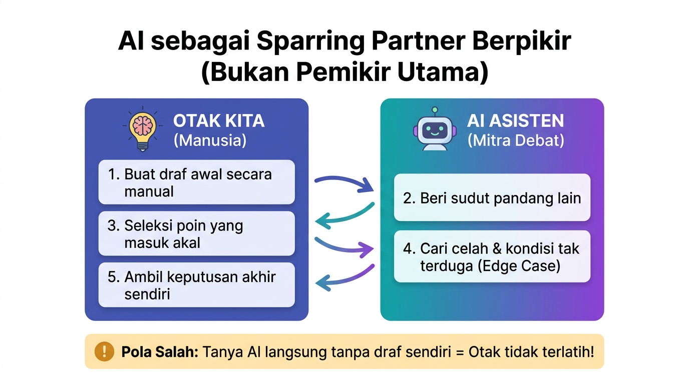

# 01b. Problem Solving & Berpikir Terstruktur dengan AI

**Minggu 1: AI Literacy | Sesi 2 (Selasa)**  
**Target Waktu:** 90 - 120 Menit  
**Output Sesi:** Lembar Dekomposisi Masalah (Komparasi Berpikir Mandiri vs Bantuan AI)

---

## 1. Mengapa Ini Penting?

Komputer dan AI hanyalah alat bantu eksekusi. Mereka tidak bisa menyelesaikan masalah apa pun jika kita sendiri tidak bisa merumuskan masalah tersebut secara terstruktur.

Keterampilan memecah masalah rumit menjadi langkah-langkah logis dan teratur disebut **Computational Thinking (CT)**. 

Di sesi ini, kita berkenalan secara ringan dengan konsep dasar berpikir terstruktur tersebut, dan fokus mempraktikkan bagaimana menjadikan **AI sebagai sparring partner berpikir (mitra dialog)**—bukan alat yang berpikir menggantikan kita.

> [!NOTE]
> *Catatan Perjalanan Belajar:* Di Minggu 1 ini kita fokus melatih cara bernalar dan berdialog logis. Detail mendalam mengenai 4 pilar Computational Thinking, diagram alur, dan struktur data akan kita bedah di Minggu 2—lengkap dengan latihan kode kecil untuk menyegarkan memori JavaScript-mu!

---

## 2. Pengenalan Ringan: Apa Itu Berpikir Terstruktur?

Bayangkan seorang pemilik warung bakso mengeluh: *"Warung saya sering rugi dan pembeli sering kecewa!"*

Bagi orang awam, keluhan itu terdengar membingungkan. Tetapi bagi seorang calon software engineer, masalah tersebut dipecah secara terstruktur:

1. **Memilah Masalah:** Apakah masalahnya di stok bahan (kuah basi / daging habis), di pencatatan kasir yang salah, atau di antrean yang terlalu lama?
2. **Melihat Pola:** Apakah pembeli selalu menumpuk di jam 12:00–13:00 siang?
3. **Mengambil Intinya Saja:** Abaikan obrolan santai pelanggan, fokus pada angka: Berapa mangkok terjual? Berapa mangkok sisa?
4. **Menyusun Langkah Aturan Logika:**
   ```text
   JIKA stok bakso tersisa <= 10 porsi MAKA
       TAMPILKAN pesan "Stok Menipis" di kasir
   LAINNYA
       Lanjutkan pesanan pelanggan
   AKHIR-JIKA
   ```

Perhatikan format di atas: `JIKA ... MAKA ... LAINNYA ... AKHIR-JIKA`. Format ini adalah aturan logika baku yang akan kita gunakan sepanjang program agar alur berpikir kita mudah dibaca oleh siapa pun.

---

## 3. AI sebagai "Sparring Partner" Berpikir

Bagaimana cara terbaik memadukan daya nalar kita dengan kemampuan AI?



1. **Otak Kita:** Buat draf awal secara manual, lalu kirim ke AI untuk mendapat sudut pandang lain.
2. **Seleksi & Uji:** Pilih masukan yang masuk akal, lalu minta AI menguji celah & kondisi tak terduga (*edge case*).
3. **Keputusan Akhir:** Tetap di tangan kita sendiri setelah mengevaluasi hasil uji AI.

- **Pola Keliru:** Membuka AI dan langsung bertanya: *"Pecahkan masalah stok warung makan!"* (Hasilnya akan klise, umum, dan kamu tidak belajar apa-apa).
- **Pola Tepat:** Tulis ide langkahmu di kertas terlebih dahulu, lalu jadikan AI teman debat:
  > *"Kami merancang alur pemesanan bakso menjadi 3 tahap berikut: [sebutkan tahap 1, 2, 3]. Menurutmu, di mana celah kesalahan yang mungkin terjadi saat pembeli memesan bersamaan?"*

---

## 4. Workshop Praktik Squad: Uji Sparring Partner (60 Menit)

Pilihlah salah satu dari dua skenario masalah UMKM berikut:

### Skenario 1: "Toko Kelontong Bu Rahma — Barang Sering Hilang / Kadaluwarsa"
Toko kelontong Bu Rahma memiliki ratusan barang. Barang kalengan di rak pojok sering kadaluwarsa tanpa terpantau, sementara minyak goreng sering habis tiba-tiba saat pembeli datang.

### Skenario 2: "Laundry Kiloan Mas Dwi — Pakaian Tertukar & Antrean Menumpuk"
Di musim hujan, cucian menumpuk. Mas Dwi sering menerima komplain karena pakaian putih kelunturan dan celana jeans milik dua pelanggan tertukar.

### Langkah Kerja Squad:
1. **Langkah 1 (Berpikir Mandiri Tanpa AI - 20 Menit):**
   - Tanpa membuka laptop/HP, squad menuliskan pemecahan masalah di kertas:
     - Apa 3 penyebab utama masalah tersebut?
     - Tuliskan 3-5 urutan langkah sederhana untuk mencegah masalah terulang!
2. **Langkah 2 (Ajak AI Berdebat / Sparring - 20 Menit):**
   - Buka AI. Masukkan ide langkah yang telah kalian tulis di Langkah 1:
     > *"Kami sedang merancang alur pencegahan masalah untuk [Skenario Toko]. Ini rancangan awal kami: [...tulis langkah kalian...]. Menurutmu, apa titik lemah dari rancangan kami? Skenario tak terduga apa yang belum kami antisipasi?"*
3. **Langkah 3 (Saring & Ambil Keputusan - 20 Menit):**
   - Diskusikan: mana masukan AI yang realistis untuk warung kecil, dan mana saran AI yang terlalu rumit sehingga harus ditolak?

---

## 5. Output Sesi: Lembar Analisis Masalah Squad

Kumpulkan satu file Markdown ringkas berisi:
1. Skenario yang dipilih.
2. Rancangan langkah awal versi squad (hasil pemikiran sendiri).
3. Kritik / masukan dari AI saat diajak sparring.
4. Keputusan akhir tim: apa saran AI yang diterima dan apa yang ditolak beserta alasannya.

---

## 6. Tugas Mandiri (Individual)

- **Sifat:** Individu (dikerjakan sendiri di luar jam kelas)
- **Target Waktu:** 20 menit
- **Nama File:** Simpan di folder pribadimu dalam repo squad dengan nama `tugas_01b.md`

### Instruksi:
1. Pilih satu rutinitas harianmu (misal: menyiapkan diri sebelum berangkat belajar, mencuci piring, atau berbelanja di warung).
2. Tuliskan 4–5 langkah urutan kegiatannya secara runtut.
3. Tanyakan ke AI: *"Menurutmu apa 1 hal tak terduga yang bisa membuat urutan langkah ini berantakan?"*
4. Tuliskan 1 aturan logika pencegahan dengan format:
   ```text
   JIKA [kondisi darurat] MAKA
       [tindakan kamu]
   LAINNYA
       [tindakan normal]
   AKHIR-JIKA
   ```

### Contoh Hasil yang Diharapkan:
```markdown
# Tugas Mandiri 01b — Logika Terstruktur Harian
Nama: [Nama Kamu]

## 1. Urutan Rutinitas: Membeli Sarapan Pagi di Warung
1. Cek saldo uang tunai di dompet.
2. Berjalan ke warung nasi uduk.
3. Memesan nasi uduk bungkus dengan lauk telur balado.
4. Menyerahkan uang pas dan menerima kembalian.
5. Membawa bungkusan pulang.

## 2. Celah Tak Terduga dari Sparing AI
AI mengingatkan: "Bagaimana jika lauk telur balado sudah habis saat kamu sampai di warung?"

## 3. Logika Pencegahan Saya
JIKA lauk telur balado HABIS MAKA
    Pilih alternatif lauk tempe orek
LAINNYA
    Beli lauk telur balado sesuai rencana
AKHIR-JIKA
```

---

## 7. Cek Pemahaman Diri

1. Mengapa kita disarankan menuliskan ide sendiri terlebih dahulu sebelum bertanya kepada AI?
2. Mengapa instruksi komputer membutuhkan aturan tegas seperti `JIKA ... MAKA ... LAINNYA ... AKHIR-JIKA`?

---

Lanjut ke: **[01c-prompt-engineering-dasar.md](01c-prompt-engineering-dasar.md)**
