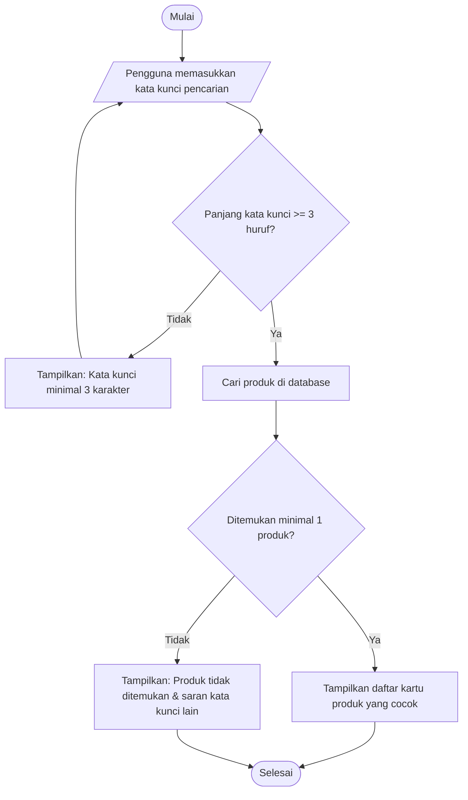

# 02c. Flowchart: Visualisasi Alur Sistem & Keputusan

**Minggu 2: Computational Thinking & Algoritma | Sesi 3 (Rabu)**  
**Target Waktu:** 90 - 120 Menit  
**Output Sesi:** Minimal 2 Flowchart Fitur Platform UMKM per Squad (Format Mermaid / Gambar)

---

## 1. Mengapa Ini Penting?

Membaca teks algoritma yang panjang terkadang melelahkan dan rawan salah tafsir. Di tim produk profesional—yang terdiri dari engineer, desainer produk (UI/UX), dan manajer bisnis—**Flowchart** adalah bahasa visual bersama.

Dengan flowchart:
- Titik percabangan keputusan (*"Bagaimana kalau password salah?"*) langsung terlihat jelas.
- Celah logika (*"Loh, kalau stok habis panahnya lari ke mana?"*) langsung tertangkap mata sebelum ada kode yang diketik.

Hari ini kita akan menguasai simbol baku flowchart dan menggambar alur sistem Platform UMKM.

---

## 2. Simbol-Simbol Standar Flowchart (ISO / ANSI)

Hanya ada **5 simbol utama** yang paling sering kamu pakai 90% waktu:

```text
┌─────────────────┐
│     ( Mulai )   │  1. TERMINATOR (Oval / Kapsul)
└─────────────────┘     Menandai titik AWAL (Mulai) dan AKHIR (Selesai). Wajib ada!

┌─────────────────┐
│ [ Proses/Aksi ] │  2. PROCESS (Persegi Panjang)
└─────────────────┘     Operasi internal, manipulasi data, atau kalkulasi logika.
                        Contoh: "Hitung total tagihan", "Kurangi stok 1".

      /\
     /  \            3. DECISION (Belah Ketupat / Diamond)
    < ?  >              Pertanyaan pengujian kondisi logika. 
     \  /               Wajib memiliki minimal dua panah keluar bertuliskan "Ya" / "Tidak".
      \/                Contoh: "Apakah password benar?", "Stok > 0?".

   /─────────/
  /  Input  /        4. DATA / INPUT-OUTPUT (Jajar Genjang)
 /─────────/            Menerima input dari pengguna atau menampilkan output ke layar.
                        Contoh: "Pengguna mengetik nama produk", "Tampilkan struk".

     ───────►        5. FLOWLINE / PANAH
                        Menunjukkan arah jalannya instruksi. Tidak boleh panah tanpa ujung!
```

---

## 3. Contoh Flowchart Menggunakan Sintaks Mermaid

Di era modern, flowchart sering ditulis langsung di dalam file Markdown menggunakan teks sintaks **Mermaid**, sehingga bisa langsung dirender oleh GitHub atau tools dokumentasi lainnya.

### Contoh Alur: "Pencarian Produk di Katalog UMKM"



Perhatikan:
1. Dimulai dari `Mulai` dan berakhir di `Selesai`.
2. Pada belah ketupat keputusan, ada cabang jelas: **Ya** dan **Tidak**.
3. Jika kondisi tidak terpenuhi, panah berputar kembali (*looping*) meminta pengguna mengulang input.

---

## 4. Workshop Praktik Squad (60 Menit)

Tiap squad wajib menggambar **2 Flowchart Resmi**:

### Flowchart 1: "Merchant Menambah Produk Baru ke Katalog"
Alur langkah:
1. Pemilik toko membuka form tambah produk.
2. Memasukkan: Nama Produk, Harga, Kategori, Stok, Foto.
3. Sistem memvalidasi:
   - Nama produk tidak boleh kosong.
   - Harga harus angka dan lebih besar dari 0.
   - Stok minimal 1.
4. Jika ada data tidak valid, tunjukkan pesan error spesifik dan biarkan pemilik toko memperbaiki form tanpa menghapus inputan yang sudah benar.
5. Jika valid, simpan ke katalog dan tampilkan notifikasi sukses lalu arahkan kembali ke daftar katalog produk.

### Flowchart 2: "Pembeli Melakukan Checkout Pesanan"
Alur langkah:
1. Pembeli menekan tombol "Beli Sekarang".
2. Sistem mengecek stok barang secara *real-time*.
3. Jika stok habis, beri tahu pembeli dan batalkan pesanan.
4. Jika stok ada, minta pembeli memilih metode pembayaran (Transfer Bank / Tunai COD).
5. Jika memilih COD: konfirmasi alamat pengiriman → langsung buat nomor resi pesanan.
6. Jika Transfer Bank: tampilkan nomor rekening + batas waktu transfer (15 menit). Cek apakah transfer diterima sebelum waktu habis. Jika habis, kembalikan stok (*release stock*).

---

## 5. Output Sesi

Kumpulkan dalam repositori squad:
1. File Markdown berisi kode **Mermaid diagram** untuk kedua flowchart (atau gambar ekspor dari draw.io/Whimsical/kertas jika belum terbiasa Mermaid).
2. Tabel *Uji Skenario Alur* (*Trace Table*): Simulasikan 1 kasus sukses dan 1 kasus gagal pada Flowchart 2, tunjukkan langkah demi langkah yang dilalui panah.

---

## 6. Cek Pemahaman Diri

1. Apa kesalahan fatal yang terjadi jika sebuah diamond *Decision* hanya memiliki satu panah keluar?
2. Mengapa flowchart sangat penting dikerjakan bersama sebelum mendesain tampilan layar (*wireframe*)?

Lanjut ke: **[02d-erd-dasar.md](file:///home/iqbaal/gelombang-3/modul 12 bulan/modul-pra-coding-bulan1/2-Computational-Thinking/02d-erd-dasar.md)**
