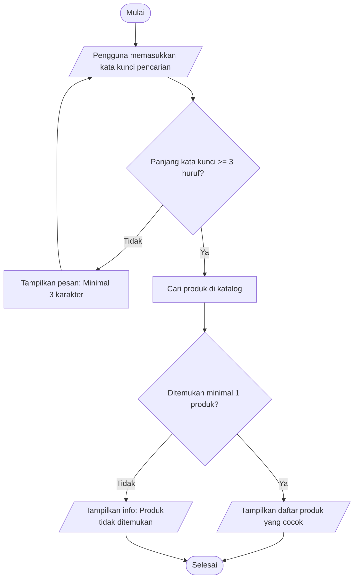
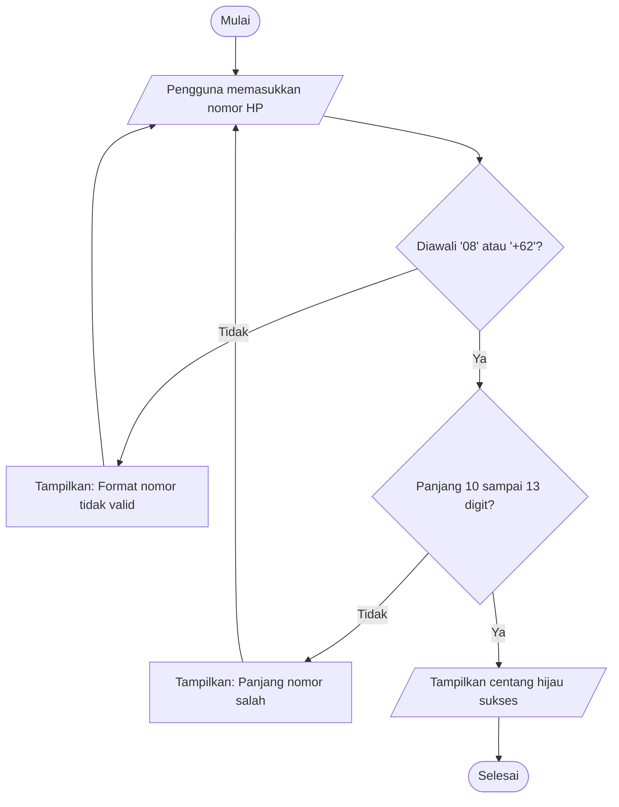

# 02c. Flowchart: Visualisasi Alur Sistem & Keputusan

**Minggu 2: Computational Thinking & Algoritma | Sesi 2 (Rabu)**  
**Target Waktu:** 90 - 120 Menit  
**Output Sesi:** Minimal 2 Flowchart Fitur Platform UMKM per Squad (Format Mermaid / Gambar)

---

## 1. Mengapa Ini Penting?

Membaca teks algoritma yang panjang terkadang melelahkan dan rawan salah tafsir. Di tim produk software—yang terdiri dari programmer, desainer antarmuka (UI/UX), dan pengelola bisnis—**Flowchart adalah bahasa visual bersama**.

Dengan flowchart:
- Titik percabangan keputusan (*"Bagaimana jika stok habis?"*) langsung terlihat jelas.
- Celah logika (*"Loh, kalau data tidak valid panahnya lari ke mana?"*) langsung tertangkap mata sebelum ada kode yang diketik.

Hari ini kita akan menguasai 5 simbol standar flowchart dan menggambarkan alur sistem Platform Katalog UMKM.

---

## 2. Lima Simbol Baku Flowchart

Bayangkan simbol flowchart seperti rambu lalu lintas: bentuknya memberi tahu tindakan apa yang sedang berlangsung di jalan logika sistem.

```text
┌─────────────────┐
│     ( Mulai )   │  1. TERMINATOR (Kapsul / Oval)
└─────────────────┘     Menandai titik AWAL (Mulai) dan AKHIR (Selesai). Wajib ada!

┌─────────────────┐
│ [ Proses/Aksi ] │  2. PROSES (Persegi Panjang)
└─────────────────┘     Operasi internal mesin atau kalkulasi data.
                        Contoh: "Hitung total harga", "Kurangi stok 1".

      /\
     /  \            3. DECISION / KEPUTUSAN (Belah Ketupat / Diamond)
    < ?  >              Pertanyaan pengujian kondisi logika. 
     \  /               Wajib memiliki minimal dua panah keluar bertuliskan "Ya" dan "Tidak".
      \/                Contoh: "Apakah stok > 0?", "Nama produk diisi?".

   /─────────/
  /  Input  /        4. DATA / INPUT-OUTPUT (Jajar Genjang)
 /─────────/            Menerima masukan dari pengguna atau menampilkan informasi ke layar.
                        Contoh: "Pengguna memilih produk", "Tampilkan pesan error".

     ───────►        5. PANAH ALUR (Flowline)
                        Menunjukkan arah jalannya instruksi. Tidak boleh panah tanpa ujung!
```

> [!NOTE]
> **Istilah Tambahan (Opsional):**  
> Simbol-simbol bentuk geometris di atas mengacu pada standar internasional dokumentasi proses industri (ISO/ANSI), yang memastikan seluruh tim rekayasa di dunia memahami arti gambar yang sama.

---

## 3. Contoh Flowchart Menggunakan Sintaks Mermaid

Flowchart modern bisa ditulis langsung menggunakan teks sintaks **Mermaid** di dalam file Markdown, dan otomatis tampil sebagai gambar diagram di GitHub.

### Contoh Alur: "Pencarian Produk di Katalog"



Perhatikan:
1. Dimulai dari `Mulai` dan berakhir di `Selesai`.
2. Pada belah ketupat keputusan, ada dua panah berlabel jelas: **Ya** dan **Tidak**.
3. Jika kondisi tidak memenuhi syarat, panah berputar kembali (*looping*) meminta input ulang.

---

## 4. Workshop Praktik Squad (60 Menit)

Tiap squad wajib menggambar **2 Flowchart Resmi Platform UMKM**:

### Flowchart 1: "Merchant Menambah Produk Baru ke Katalog"
1. Pemilik toko membuka form tambah produk di dashboard.
2. Memasukkan: Nama Produk, Harga, Kategori, Stok, Tautan Foto.
3. Sistem memvalidasi:
   - Nama produk tidak boleh kosong.
   - Harga harus berupa angka dan > 0.
   - Stok minimal 1.
4. Jika ada data tidak valid, tampilkan pesan error spesifik dan arahkan kembali ke form.
5. Jika semua data valid, simpan ke katalog dan tampilkan notifikasi sukses.

### Flowchart 2: "Pembeli Memesan via WhatsApp"
*(Scope Resmi: Katalog diteruskan ke WhatsApp penjual, tanpa alur pembayaran/checkout kartu/COD yang rumit).*
1. Pembeli membuka halaman detail produk di katalog.
2. Pembeli menekan tombol *"Pesan via WhatsApp"*.
3. Sistem memeriksa ketersediaan stok produk:
   - **JIKA stok habis (0):** Tampilkan label *"Maaf, Produk Ini Sedang Habis"*, nonaktifkan tombol pemesanan, dan arahkan pembeli melihat produk serupa lainnya.
   - **JIKA stok tersedia:** Minta pembeli mengisi Nama dan Jumlah Pesanan.
4. Sistem merakit teks template pesan otomatis (format: *"Halo [Nama Toko], saya [Nama Pembeli] ingin memesan [Nama Produk] x [Jumlah]..."*).
5. Sistem membuka tautan `https://wa.me/[Nomor_WA_Penjual]?text=[Template_Pesan]` di browser/aplikasi WhatsApp pembeli.
6. Alur selesai.

---

## 5. Output Sesi

Kumpulkan di repositori squad:
1. File Markdown berisi kode **Mermaid diagram** untuk kedua flowchart (atau gambar ekspor dari draw.io/Whimsical).
2. Tabel *Uji Skenario Alur* (*Trace Table*): Simulasikan 1 kasus sukses dan 1 kasus stok habis pada Flowchart 2, tunjukkan langkah demi langkah yang dilalui panah.

---

## 6. Tugas Mandiri (Individual)

- **Sifat:** Individu (dikerjakan sendiri di luar jam kelas)
- **Target Waktu:** 25 menit
- **Nama File:** Simpan di folder pribadimu dalam repo squad dengan nama `tugas_02c.md`

### Instruksi:
1. Rancanglah satu flowchart logika sederhana: **Validasi Nomor WhatsApp Indonesia**.
   - Input: Nomor HP yang dimasukkan pengguna.
   - Syarat Valid: Harus diawali dengan `"08"` atau `"+62"`, dan panjang nomor antara 10 sampai 13 digit.
   - Jika tidak valid: Tampilkan pesan error dan minta input ulang.
   - Jika valid: Tampilkan tanda centang sukses.
2. Tuliskan dalam bentuk kode sintaks Mermaid diagram (atau foto sketsa tangan jika ada kendala sintaks).

### Contoh Hasil yang Diharapkan:
```markdown
# Tugas Mandiri 02c — Flowchart Validasi Nomor WhatsApp
Nama: [Nama Kamu]


```

---

## 7. Cek Pemahaman Diri

1. Apa kesalahan fatal yang terjadi jika sebuah diamond keputusan (*decision*) hanya memiliki satu panah keluar?
2. Mengapa dalam scope Bulan 1 pemesanan langsung diteruskan ke WhatsApp alih-alih membangun keranjang belanja checkout yang rumit?

---

Lanjut ke: **[02d-erd-dasar.md](02d-erd-dasar.md)**
