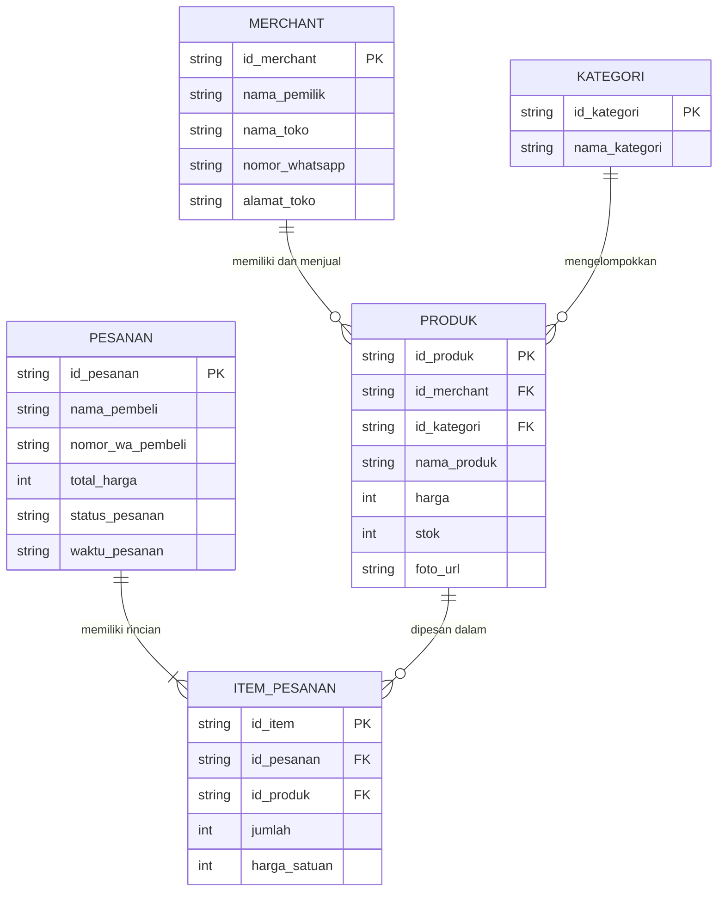

# 02d. ERD Dasar: Merancang Hubungan Data Sebelum Database

**Minggu 2: Computational Thinking & Algoritma | Sesi 4 (Kamis)**  
**Target Waktu:** 90 - 120 Menit  
**Output Sesi:** Draft ERD Platform Katalog UMKM per Squad

---

## 1. Mengapa Ini Penting?

Sebuah aplikasi pada dasarnya adalah: **Alur Logika + Tempat Menyimpan Data**.

Kemarin kita sudah merancang alur logika menggunakan flowchart. Namun, ke mana data produk, harga, data pedagang, dan daftar pesanan disimpan? Dan bagaimana data-data tersebut saling terhubung satu sama lain?

Jika kamu salah merancang struktur data sejak awal:
- Data duplikat di mana-mana (*redundancy*).
- Jika nama toko berganti, ratusan baris data produk ikut rusak (*inconsistency*).
- Jika produk dihapus, riwayat transaksi masa lalu ikut hilang tanpa jejak.

Keterampilan memodelkan struktur data ini disebut **Entity Relationship Diagram (ERD)**. Kita tidak akan langsung menyentuh kode SQL rumit; hari ini kita fokus pada logika relasi di dunia nyata.

---

## 2. Tiga Konsep Fundamental ERD

```text
┌─────────────────┐             ┌─────────────────┐
│     ENTITAS     │             │     ATRIBUT     │
│   (Benda Nyata) │─────────────│ (Informasi/Ciri)│
└─────────────────┘             └─────────────────┘
         │
         │ (Memiliki Hubungan / Relasi)
         ▼
┌─────────────────┐
│     RELASI      │ (1:1, 1:N, N:N)
└─────────────────┘
```

### 1. Entitas (*Entity*)
Objek, orang, tempat, atau hal nyata yang datanya ingin dicatat ke sistem. Biasanya berupa kata benda tunggal.
- *Contoh:* `Merchant` (Toko), `Produk`, `Kategori`, `Pesanan`.

### 2. Atribut (*Attribute*)
Ciri-ciri, informasi, atau kolom isian yang melekat pada suatu entitas.
- *Contoh pada entitas `Produk`:* `id_produk`, `nama_produk`, `harga`, `stok`.
- **Primary Key (PK / Kunci Utama):** Satu atribut unik yang membedakan satu baris data dengan data lainnya (misal: nomor identitas unik `id_produk`; tidak boleh ada 2 produk berbeda yang memiliki ID sama).
- **Foreign Key (FK / Kunci Tamu):** Atribut penghubung yang menunjuk ke Primary Key milik entitas lain.

### 3. Hubungan Relasi Data (Berapa Banyak Pasangannya?)
Bagaimana hubungan jumlah antara dua entitas di dunia nyata:

| Tipe Relasi | Bahasa Sehari-hari | Contoh Nyata di Katalog UMKM |
|---|---|---|
| **Satu ke Satu (1 : 1)** | Satu hal hanya punya satu pasangan | 1 Toko Merchant hanya memiliki 1 Pengaturan Jam Buka Toko. |
| **Satu ke Banyak (1 : N)** | Satu induk punya banyak anak, tapi anak hanya punya satu induk | 1 `Kategori` ("Makanan Ringan") memiliki banyak `Produk` (Keripik, Roti, Biskuit). Tiap produk hanya masuk ke satu kategori utama. |
| **Banyak ke Banyak (N : N)** | Banyak hal di sisi kiri bisa berpasangan dengan banyak hal di sisi kanan | 1 `Pesanan` bisa berisi banyak `Produk`, dan 1 jenis `Produk` bisa dibeli di dalam banyak `Pesanan`. |

> [!NOTE]
> **Istilah Tambahan (Opsional):**  
> Dalam teori basis data, jumlah hubungan pasangan data ini disebut **Kardinalitas (*Cardinality*)**.

---

## 3. Menyelesaikan Relasi Banyak-ke-Banyak (N:N) dengan "ItemPesanan"

Komputer tidak bisa menyimpan relasi Banyak-ke-Banyak secara langsung tanpa memicu kekacauan data.  
*Pertanyaan:* Jika 1 pesanan membeli 3 produk sekaligus (Keripik Tempe 2 bungkus dan Sambal Botol 1 botol), di mana jumlah per barang disimpan?

Solusinya: Kita membuat satu **Entitas Penghubung (*Junction Entity*)** bernama `ItemPesanan`.
- `Pesanan` berhubungan (1 : N) dengan `ItemPesanan`.
- `Produk` berhubungan (1 : N) dengan `ItemPesanan`.
- Di dalam `ItemPesanan`, kita mencatat: `id_pesanan`, `id_produk`, `jumlah`, dan `harga_saat_beli`.

### Bagaimana dengan Data Pembeli?
Di Bulan 1, pembeli berbelanja sebagai **tamu (*guest checkout*)** tanpa perlu membuat akun atau login dengan password yang merepotkan. Oleh karena itu, data pembeli (nama dan nomor WhatsApp) **cukup dicatat langsung di dalam entitas `Pesanan`**. Jika nanti di bulan-bulan berikutnya aplikasi berkembang memiliki program loyalitas member, barulah kita memisahkan entitas `Pembeli` tersendiri.

---

## 4. Contoh ERD Platform Katalog UMKM (Sintaks Mermaid)



### Status Pesanan Sesuai Alur WhatsApp:
Karena alur belanja diteruskan ke WhatsApp penjual, status pesanan disesuaikan dengan alur komunikasi nyata:
- `Draft WA` (Pesanan baru dirakit di web).
- `Diteruskan ke WA` (Pembeli sudah mengklik tombol kirim chat WhatsApp).
- `Dikonfirmasi Penjual` (Penjual membalas chat dan menyetujui pesanan).
- `Selesai` (Barang sudah diserahkan/diterima).
- `Batal` (Stok mendadak habis atau pembeli membatalkan pesanan via chat).

---

## 5. Workshop Praktik Squad (60 Menit)

Rancanglah **Draft ERD Platform Katalog UMKM** untuk squad-mu:

1. **Langkah 1 (Bedah Entitas - 20 Menit):**  
   Periksa 5 entitas di atas (`Merchant`, `Kategori`, `Produk`, `Pesanan`, `ItemPesanan`). Apakah ada atribut penting yang masih kurang untuk mendukung alur pemesanan WhatsApp?
2. **Langkah 2 (Tentukan Tipe Data Sederhana - 20 Menit):**  
   Tentukan tipe data untuk setiap atribut: teks (`string`) atau angka bulat (`int`).
3. **Langkah 3 (Rakit Diagram Mermaid - 20 Menit):**  
   Salin draf kalian ke format Mermaid diagram yang rapi dan pastikan semua Foreign Key (`FK`) terhubung ke Primary Key (`PK`) yang tepat.

---

## 6. Output Sesi

1. Diagram ERD format Mermaid (atau gambar dari diagram tool) menampilkan 5 entitas inti: `Merchant`, `Kategori`, `Produk`, `Pesanan`, dan `ItemPesanan`.
2. Penjelasan 1 paragraf mengapa entitas penghubung `ItemPesanan` wajib ada dan mengapa data pembeli cukup dicatat di entitas `Pesanan` pada scope pra-coding saat ini.

---

## 7. Tugas Mandiri (Individual)

- **Sifat:** Individu (dikerjakan sendiri di luar jam kelas)
- **Target Waktu:** 25 menit
- **Nama File:** Simpan di folder pribadimu dalam repo squad dengan nama `tugas_02d.md`

### Instruksi:
1. Bayangkan kamu ingin menambahkan fitur **Ulasan Singkat Produk** (bintang 1–5 dan komentar pembeli) di katalog.
2. Rancang satu entitas baru bernama `Ulasan`.
3. Tuliskan atributnya (tandai Primary Key dan Foreign Key).
4. Jelaskan apa relasi antara entitas `Produk` dengan entitas `Ulasan` (apakah 1:1, 1:N, atau N:N?).

### Contoh Hasil yang Diharapkan:
```markdown
# Tugas Mandiri 02d — Model Data Fitur Ulasan
Nama: [Nama Kamu]

## 1. Entitas Baru: ULASAN
- id_ulasan (string, PK)
- id_produk (string, FK — menghubungkan ke entitas Produk)
- nama_pembeli (string)
- rating_bintang (int, 1-5)
- komentar (string)
- waktu_kirim (string)

## 2. Hubungan Relasi dengan Produk:
Relasi: Satu ke Banyak (1 : N).
Satu jenis Produk bisa memiliki banyak Ulasan dari pembeli yang berbeda-beda, tetapi satu baris ulasan hanya tertuju pada satu produk tertentu.
```

---

## 8. Cek Pemahaman Diri

1. Apa perbedaan mendasar antara *Entitas* dan *Atribut*? Berikan contohnya!
2. Mengapa kita membutuhkan entitas penghubung `ItemPesanan` untuk menghubungkan `Pesanan` dan `Produk`?

---

Lanjut ke: **[02e-latihan-terpadu-ct.md](02e-latihan-terpadu-ct.md)**
