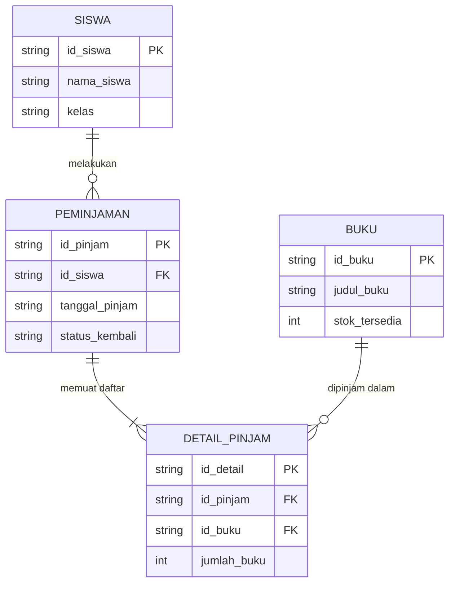
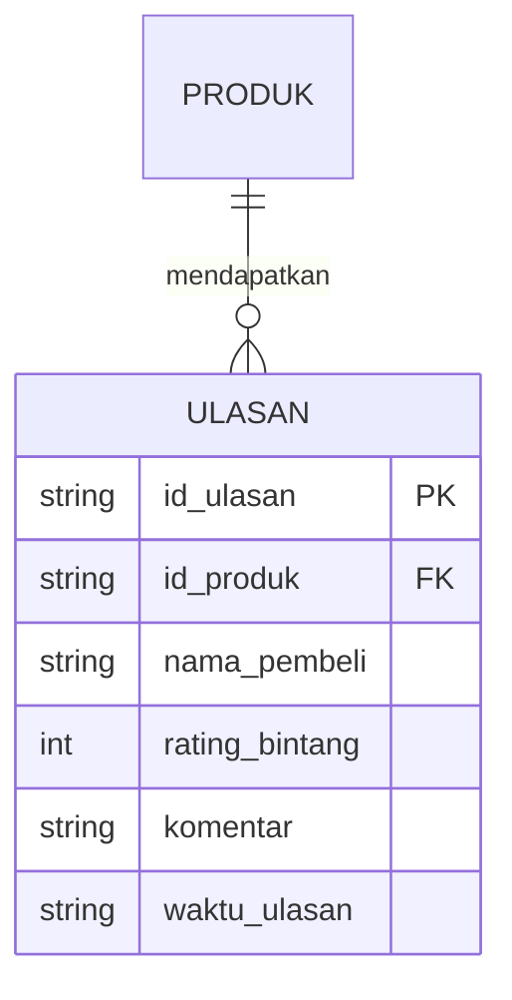

# 02d. ERD Dasar: Merancang Hubungan Data Sebelum Database

**Minggu 2: Computational Thinking & Algoritma | Sesi 3 (Kamis)**  
**Target Waktu:** 90 - 120 Menit  
**Output Sesi:** Draft ERD Platform Katalog UMKM per Squad + Tabel Simulasi Relasi Data

---

## 1. Mengapa Ini Penting? (Bahaya "Satu Tabel Campur Aduk")

Sebuah aplikasi pada dasarnya terdiri dari dua hal: **Alur Logika (Flowchart)** + **Tempat Menyimpan Data (Database)**.

Kemarin kita sudah merancang alur logika menggunakan Flowchart. Sekarang pertanyaannya: **bagaimana cara kita menata tabel penyimpanan data produk, toko, kategori, dan pesanan agar tidak berantakan?**

Bayangkan seorang pemula menyimpan seluruh data katalog UMKM ke dalam **satu tabel Excel campur aduk** seperti ini:

| id_produk | nama_produk | harga | nama_kategori | nama_toko | nomor_wa_toko | alamat_toko |
|---|---|---|---|---|---|---|
| PRD-01 | Keripik Pisang | 15000 | Makanan Ringan | Warung Bu Siti | 08123456789 | Jl. Merdeka No. 10 |
| PRD-02 | Basreng Pedas | 12000 | Makanan Ringann | Warung Bu Siti | 08123456789 | Jl. Merdeka No. 10 |
| PRD-03 | Sambal Bawang | 20000 | Bumbu Dapur | Warung Bu Siti | 08123456789 | Jl. Merdeka No. 10 |

Sekilas terlihat biasa saja. Namun di dunia rekayasa perangkat lunak, tabel tunggal seperti di atas menyimpan **3 bom waktu**:
1. **Pemborosan & Duplikasi Data (*Redundancy*):**  
   Jika Warung Bu Siti menjual 200 jenis barang, maka tulisan `"Warung Bu Siti"`, `"08123456789"`, dan `"Jl. Merdeka No. 10"` akan diulang 200 kali!
2. **Data Rusak Saat Diperbarui (*Update Anomaly / Inconsistency*):**  
   Jika bulan depan Bu Siti mengganti nomor WhatsApp-nya, sistem harus mengedit 200 baris produk satu per satu. Jika ada 1 baris saja yang gagal ter-update, pembeli akan mengirim pesanan ke nomor yang salah.
3. **Salah Ketik Merusak Fitur Pencarian:**  
   Perhatikan baris `PRD-02`: tertulis `"Makanan Ringann"` (huruf `n` ganda karena salah ketik). Saat pembeli memfilter kategori `"Makanan Ringan"`, produk Basreng Pedas tidak akan pernah muncul!

Keterampilan memecah tabel agar rapi, bebas duplikat, dan saling terhubung dengan aman disebut **Entity Relationship Diagram (ERD)**.

---

## 2. Tiga Konsep Fundamental ERD

```text
┌─────────────────┐             ┌─────────────────┐
│     ENTITAS     │             │     ATRIBUT     │
│  (Tabel / Objek)│─────────────│ (Kolom / Ciri)  │
└─────────────────┘             └─────────────────┘
         │
         │ (Dihubungkan lewat Kunci PK & FK)
         ▼
┌─────────────────┐
│     RELASI      │ (1:1, 1:N, N:N)
└─────────────────┘
```

### 1. Entitas (*Entity*) dan Atribut (*Attribute*)
Bayangkan sebuah **Formulir Pendaftaran Fisik**:
- **Entitas** adalah **Judul Map/Tabelnya**: objek nyata yang datanya ingin dicatat secara terpisah (misal: `MERCHANT`, `KATEGORI`, `PRODUK`, `PESANAN`).
- **Atribut** adalah **Kolom Isian di dalamnya**: ciri atau informasi yang melekat pada entitas tersebut (misal pada entitas `PRODUK`: `id_produk`, `nama_produk`, `harga`, `stok`).

### 2. Primary Key (PK) & Foreign Key (FK) — Cara Menghubungkan Tabel
Agar tidak terjadi bencana "Tabel Campur Aduk" seperti di Bagian 1, kita memisahkan data ke tabel masing-masing lalu menyambungkannya dengan **Kunci Identitas**:

- **Primary Key (PK / Kunci Utama):**  
  Satu kolom identitas unik yang membedakan satu baris data dengan baris lainnya di tabel tersebut (seperti NIK KTP; tidak boleh ada dua baris yang punya PK sama).
- **Foreign Key (FK / Kunci Tamu):**  
  Kolom referensi yang isinya menunjuk ke Primary Key milik tabel lain.

Mari lihat betapa rapinya tabel Bagian 1 setelah dipisah menggunakan **PK** dan **FK**:

**Tabel 1: `MERCHANT` (Induk Toko)**
| id_merchant (PK) | nama_toko | nomor_whatsapp | alamat_toko |
|---|---|---|---|
| **M-01** | Warung Bu Siti | 08123456789 | Jl. Merdeka No. 10 |

**Tabel 2: `KATEGORI` (Induk Kategori)**
| id_kategori (PK) | nama_kategori |
|---|---|
| **KAT-01** | Makanan Ringan |
| **KAT-02** | Bumbu Dapur |

**Tabel 3: `PRODUK` (Cukup Menyimpan Kode FK-nya Saja!)**
| id_produk (PK) | id_merchant (FK) | id_kategori (FK) | nama_produk | harga |
|---|---|---|---|---|
| PRD-01 | **M-01** | **KAT-01** | Keripik Pisang | 15000 |
| PRD-02 | **M-01** | **KAT-01** | Basreng Pedas | 12000 |
| PRD-03 | **M-01** | **KAT-02** | Sambal Bawang | 20000 |

> **Perhatikan keajaibannya:** Jika Warung Bu Siti ganti nomor WhatsApp, kita cukup mengubah **1 baris saja** di tabel `MERCHANT` (`M-01`), dan seluruh 200 produk miliknya otomatis terhubung ke nomor baru!

### 3. Tiga Jenis Hubungan Relasi (*Cardinality*)
Berapa banyak pasangan yang boleh dimiliki antara dua entitas di dunia nyata?

| Tipe Relasi | Cara Membaca Sederhana | Contoh Nyata |
|---|---|---|
| **Satu ke Satu (1 : 1)** | Satu induk hanya punya satu pasangan tunggal | 1 Warga Negara hanya memiliki 1 Nomor NIK KTP. |
| **Satu ke Banyak (1 : N)** | Satu induk punya banyak anak, tapi tiap anak hanya punya satu induk | 1 `KATEGORI` menaungi banyak `PRODUK`, tetapi 1 `PRODUK` hanya masuk ke 1 kategori utama. |
| **Banyak ke Banyak (N : N)** | Banyak data di kiri bisa berpasangan dengan banyak data di kanan | 1 `PESANAN` bisa membeli banyak jenis `PRODUK`, dan 1 `PRODUK` bisa dibeli di banyak `PESANAN` berbeda. |

---

## 3. Memecah Relasi Banyak-ke-Banyak (N:N) Lewat Simulasi Struk Belanja

Di dalam database, dua tabel yang berhubungan **Banyak-ke-Banyak (N:N)** tidak bisa disambungkan langsung. Mengapa? Mari kita buktikan lewat sebuah struk belanja nyata!

### Studi Kasus Struk Nota `#PSN-101`:
Pembeli bernama **Budi** memesan 2 macam barang sekaligus dalam satu kali pesanan:
- `2 bungkus` **Keripik Pisang (`PRD-01`)** @ Rp 15.000 = Rp 30.000
- `1 botol` **Sambal Bawang (`PRD-03`)** @ Rp 20.000 = Rp 20.000
- **Total Tagihan Nota `#PSN-101`:** Rp 50.000

*Masalahnya:* Jika kamu mencoba memasukkan kolom `id_produk` langsung ke dalam tabel `PESANAN`, bagaimana cara menyimpan 2 barang berbeda beserta jumlah per barangnya (`2 bungkus` dan `1 botol`) dalam satu baris pesanan? Tidak bisa!

### Solusi Baku: Buat Entitas Penghubung (*Junction Entity*)
Setiap kali kamu bertemu relasi **N:N**, pecah relasi tersebut dengan menyelipkan **1 tabel perantara (Entitas Penghubung)** di tengahnya:

```text
┌─────────────┐          1 : N          ┌──────────────────┐          N : 1          ┌─────────────┐
│   PESANAN   │ ──────────────────────► │   ITEM_PESANAN   │ ◄────────────────────── │   PRODUK    │
│ (Kepala Nota)│                        │ (Baris Rincian)  │                         │(Master Brg) │
└─────────────┘                         └──────────────────┘                         └─────────────┘
```

Lihat bagaimana struk belanja Budi disimpan dengan rapi di kedua tabel tersebut:

**1. Tabel `PESANAN` (Menyimpan Kepala Nota — 1 Baris per Transaksi):**
| id_pesanan (PK) | nama_pembeli | nomor_wa_pembeli | total_harga | status_pesanan |
|---|---|---|---|---|
| **PSN-101** | Budi | 085711223344 | 50000 | Diteruskan ke WA |

**2. Tabel Penghubung `ITEM_PESANAN` (Menyimpan Rincian Barang — Bisa Banyak Baris per Nota):**
| id_item (PK) | id_pesanan (FK) | id_produk (FK) | jumlah | harga_satuan |
|---|---|---|---|---|
| ITM-01 | **PSN-101** | **PRD-01** | 2 | 15000 |
| ITM-02 | **PSN-101** | **PRD-03** | 1 | 20000 |

> [!IMPORTANT]
> **Pertanyaan Kritis Engineer: Mengapa `harga_satuan` dicatat lagi di `ITEM_PESANAN`, padahal di tabel `PRODUK` sudah ada kolom `harga`?**  
> Karena harga produk di toko bisa berubah sewaktu-waktu! Jika bulan depan Bu Siti menaikkan harga Keripik Pisang di tabel `PRODUK` dari Rp 15.000 menjadi Rp 18.000, riwayat nota Budi bulan lalu (`PSN-101`) **tidak boleh ikut berubah**. Oleh karena itu, `ITEM_PESANAN` wajib mengunci `harga_satuan` pada detik barang itu dipesan.

---

## 4. Cara Menggambar ERD Menggunakan Sintaks Mermaid

Sama seperti Flowchart, kita bisa menggambar ERD langsung di file Markdown menggunakan blok kode `mermaid` dengan kata kunci `erDiagram`.

### Kamus Simbol Garis Relasi Mermaid:
Perhatikan simbol di ujung garis kiri dan kanan saat menghubungkan dua entitas:

| Simbol Ujung | Arti Jumlah Pasangan | Contoh Kombinasi Garis | Cara Membaca |
|---|---|---|---|
| `\|\|` | **Tepat Satu** (Wajib ada 1) | `A \|\|--o{ B` | **1** `A` memiliki **0 atau banyak** `B` (Relasi 1:N) |
| `o{` atau `}o` | **Nol atau Banyak** (Opsional) | `A \|\|--\|{ B` | **1** `A` wajib memiliki **minimal 1 atau banyak** `B` (Relasi 1:N) |
| `\|{` atau `}\|` | **Satu atau Banyak** (Minimal 1) | `A \|\|--\|\| B` | **1** `A` berpasangan tepat dengan **1** `B` (Relasi 1:1) |

### Contoh Sintaks Mermaid (Studi Kasus Lain: Peminjaman Buku Perpustakaan)
Agar kamu memahami cara menulis kodenya sebelum merancang Katalog UMKM sendiri di sesi Workshop, perhatikan contoh ERD untuk **Sistem Perpustakaan Sekolah** berikut:



---

## 5. Workshop Praktik Squad: Rancang ERD Platform Katalog UMKM (60 Menit)

Sekarang saatnya squad-mu merancang sendiri **ERD Resmi Platform Katalog UMKM** berdasarkan spesifikasi kebutuhan produk kita!

### Spesifikasi Kebutuhan Data Platform Katalog UMKM:
1. **Data Toko (`MERCHANT`):**  
   Platform menampung banyak toko UMKM. Setiap toko wajib memiliki ID unik, nama pemilik toko, nama toko, nomor WhatsApp aktif untuk menerima pesanan, serta alamat toko.
2. **Data Kategori (`KATEGORI`):**  
   Setiap produk dikelompokkan ke dalam satu kategori (seperti Makanan, Minuman, Kerajinan). Kategori memiliki ID unik dan nama kategori.
3. **Data Produk (`PRODUK`):**  
   Setiap produk dimiliki oleh satu `MERCHANT` dan masuk ke dalam satu `KATEGORI`. Informasi produk yang wajib disimpan meliputi: ID unik produk, nama produk, deskripsi singkat, harga satuan (angka bulat), jumlah stok tersedia (angka bulat), tautan foto produk, serta status tayang produk (`"aktif"` atau `"draft"`).
4. **Data Pesanan WhatsApp (`PESANAN`):**  
   *Ingat Scope Bulan 1:* Pembeli memesan **tanpa perlu registrasi/login akun** (*guest checkout*). Karena tidak ada tabel akun pembeli, maka **nama pembeli** dan **nomor WhatsApp pembeli** dicatat langsung di dalam entitas `PESANAN`, bersama ID unik pesanan, total harga keseluruhan, waktu pesanan dibuat, dan status pesanan (`"Draft WA"`, `"Diteruskan ke WA"`, `"Dikonfirmasi Penjual"`, `"Selesai"`, atau `"Batal"`).
5. **Data Rincian Barang per Pesanan (`ITEM_PESANAN`):**  
   Karena 1 `PESANAN` bisa membeli beberapa jenis `PRODUK` sekaligus (relasi N:N), buatlah entitas penghubung `ITEM_PESANAN` yang menyimpan: ID unik item, referensi ke pesanan mana, referensi ke produk apa, jumlah barang yang dipesan, dan harga satuan saat dipesan.

---

### Langkah Kerja Squad (60 Menit):

#### Tahap 1: Bedah Atribut, Kunci (PK/FK), & Tipe Data (20 Menit)
Sebelum mengetik kode Mermaid, diskusikan dan tuliskan daftar 5 entitas (`MERCHANT`, `KATEGORI`, `PRODUK`, `PESANAN`, `ITEM_PESANAN`):
- Tentukan kolom atribut apa saja di dalam tiap entitas berdasarkan spesifikasi di atas.
- Tandai dengan tegas mana yang menjadi **`PK`** dan mana yang menjadi **`FK`**!
- Tentukan tipe datanya: gunakan `string` untuk teks/kode ID/waktu, dan `int` untuk nilai angka yang bisa dihitung secara matematis (seperti harga, stok, dan jumlah beli).

#### Tahap 2: Rakit Diagram `erDiagram` Mermaid (25 Menit)
Tuliskan blok kode Mermaid `erDiagram` lengkap yang memvisualisasikan kelima entitas tersebut beserta garis relasinya (`||--o{` atau `||--|{`). Pastikan tidak ada entitas yang terputus!

#### Tahap 3: Uji Simulasi Baris Data Nyata (15 Menit)
Buktikan rancangan ERD squad kalian bekerja dengan mengisi tabel simulasi (format tabel Markdown) untuk skenario transaksi berikut:
> *"Pada tanggal 12 November, pembeli bernama **Rina (WA: 081999888777)** memesan **3 bungkus Keripik Tempe (@ Rp 10.000)** dan **1 botol Sambal Roa (@ Rp 25.000)** dari **Toko Dapur Minang**."*
- Tuliskan seperti apa **1 baris data** di tabel `PESANAN` dan **2 baris data** di tabel `ITEM_PESANAN` untuk transaksi Rina di atas!

---

## 6. Output Sesi

Kumpulkan di repositori squad (`erd-katalog-umkm.md`):
1. Diagram ERD format Mermaid yang menampilkan 5 entitas inti (`MERCHANT`, `KATEGORI`, `PRODUK`, `PESANAN`, `ITEM_PESANAN`) lengkap dengan tipe data (`string`/`int`) dan penanda `PK`/`FK`.
2. Tabel simulasi baris data nyata (`PESANAN` & `ITEM_PESANAN`) dari skenario transaksi Tahap 3.
3. Penjelasan singkat (1 paragraf): Mengapa pada scope Bulan 1 kita tidak membuat entitas `PEMBELI` secara terpisah, dan mengapa kolom `harga_satuan` tetap wajib ada di `ITEM_PESANAN`?

---

## 7. Tugas Mandiri (Individual)

- **Sifat:** Individu (dikerjakan sendiri di luar jam kelas)
- **Target Waktu:** 25 menit
- **Nama File:** Simpan di folder pribadimu dalam repo squad dengan nama `tugas_02d.md`

### Instruksi:
1. Bayangkan di masa depan kamu ingin menambahkan fitur **Ulasan Singkat Produk** (bintang 1–5 dan komentar pembeli) di halaman katalog.
2. Rancang satu entitas baru bernama `ULASAN`.
3. Tuliskan daftar atributnya, tipe datanya (`string` / `int`), serta tandai mana **Primary Key (`PK`)** dan mana **Foreign Key (`FK`)** yang menghubungkannya ke produk.
4. Jelaskan apa relasi antara entitas `PRODUK` dengan entitas `ULASAN` (apakah `1:1`, `1:N`, atau `N:N`?) dan tulis potongan kecil kode Mermaid-nya.

### Contoh Hasil yang Diharapkan:
````markdown
# Tugas Mandiri 02d — Model Data Fitur Ulasan Produk
Nama: [Nama Kamu]

## 1. Struktur Entitas Baru: ULASAN


## 2. Penjelasan Relasi & Kunci:
- **Relasi:** Satu ke Banyak (`1 : N`). Satu `PRODUK` bisa mendapatkan banyak `ULASAN` dari berbagai pembeli (atau 0 ulasan jika belum ada yang mengulas, sehingga memakai simbol `||--o{`), tetapi satu baris `ULASAN` hanya tertuju pada satu produk tertentu.
- **Kunci Tamu (FK):** Atribut `id_produk` pada tabel `ULASAN` berfungsi sebagai Foreign Key yang menunjuk ke `id_produk (PK)` milik entitas `PRODUK`.
````

---

## 8. Cek Pemahaman Diri

1. Apa 3 masalah utama yang akan terjadi jika kita menggabungkan data `MERCHANT`, `KATEGORI`, dan `PRODUK` ke dalam satu tabel tunggal?
2. Apa fungsi dari *Primary Key (PK)* dan *Foreign Key (FK)* dalam menghubungkan dua tabel yang terpisah?
3. Mengapa kita wajib membuat entitas penghubung `ITEM_PESANAN` di antara `PESANAN` dan `PRODUK`?

---

Lanjut ke: **[02e-latihan-terpadu-ct.md](02e-latihan-terpadu-ct.md)**
