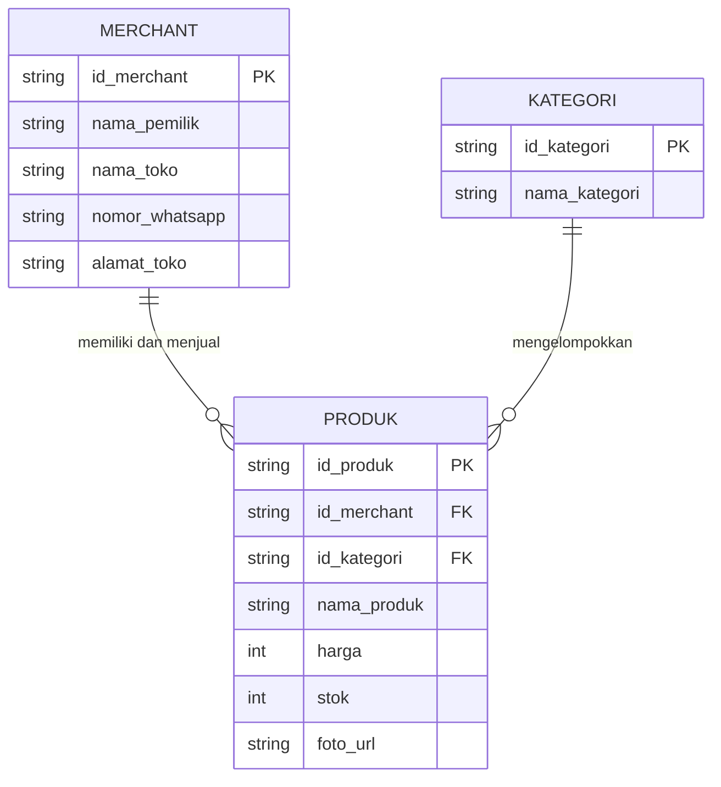

# 02d. ERD Dasar: Merancang Hubungan Data Sebelum Database

**Minggu 2: Computational Thinking & Algoritma | Sesi 4 (Kamis)**  
**Target Waktu:** 90 - 120 Menit  
**Output Sesi:** Draft Pertama ERD Platform Katalog UMKM per Squad

---

## 1. Mengapa Ini Penting?

Sebuah aplikasi pada dasarnya adalah: **Alur Logika + Penyimpanan Data**.

Kemarin kita sudah merancang alur logika menggunakan flowchart. Tapi ke mana data produk, data harga, data penjual, dan data pesanan disimpan? Dan bagaimana data-data tersebut saling terhubung satu sama lain?

Jika kamu salah merancang struktur data sejak awal, aplikasimu akan mengalami masalah besar di kemudian hari:
- Data duplikat di mana-mana (*redundancy*).
- Jika nama toko berganti, ribuan data produk ikut rusak (*inconsistency*).
- Riwayat transaksi masa lalu terhapus saat produk dihapus.

Keterampilan memodelkan data ini disebut **Entity Relationship Diagram (ERD)**. Kita tidak akan langsung menyentuh SQL yang rumit; hari ini kita fokus pada logika relasi di dunia nyata.

---

## 2. Tiga Konsep Fundamental ERD

```text
┌─────────────────┐             ┌─────────────────┐
│     ENTITAS     │             │     ATRIBUT     │
│   (Benda Nyata) │─────────────│ (Informasi/Ciri)│
└─────────────────┘             └─────────────────┘
         │
         │ (Memiliki / Berelasi)
         ▼
┌─────────────────┐
│     RELASI      │ (1:1, 1:N, N:N)
└─────────────────┘
```

### 1. Entitas (*Entity*)
Objek, orang, tempat, atau konsep di dunia nyata yang informasinya ingin kita catat ke dalam sistem. Biasanya berupa kata benda.
- *Contoh:* `Merchant` (Penjual), `Produk`, `Kategori`, `Pesanan`.
- *Catatan:* Nama entitas biasanya ditulis dalam bentuk tunggal.

### 2. Atribut (*Attribute*)
Ciri-ciri, karakteristik, atau data spesifik yang melekat pada suatu entitas.
- *Contoh pada entitas `Produk`:* `id_produk`, `nama_produk`, `harga`, `stok`, `deskripsi`.
- **Primary Key (PK / Kunci Utama):** Satu atribut unik yang membedakan satu baris data dengan data lainnya (misal: `id_produk` atau nomor KTP; tidak boleh ada 2 produk dengan `id` yang sama).

### 3. Kardinalitas Relasi (*Cardinality*)
Bagaimana hubungan jumlah antara dua entitas:

| Tipe Relasi | Penjelasan | Contoh Dunia Nyata |
|---|---|---|
| **One-to-One (1 : 1)** | Satu entitas A hanya berpasangan dengan satu entitas B | 1 Akun Merchant hanya memiliki 1 Profil Toko Resmi. |
| **One-to-Many (1 : N)** | Satu entitas A bisa memiliki banyak entitas B, tapi entitas B hanya dimiliki satu entitas A | 1 `Kategori` (misal: "Makanan") memiliki banyak `Produk` (Keripik, Kue, Roti). Satu produk hanya masuk ke satu kategori utama. |
| **Many-to-Many (N : N)** | Banyak entitas A bisa terhubung ke banyak entitas B | Banyak `Pesanan` bisa berisi banyak `Produk`, dan satu jenis `Produk` bisa dibeli di dalam banyak `Pesanan`. |

---

## 3. Contoh ERD Sederhana dengan Format Mermaid



*Penjelasan Simbol:*
- `||--o{` melambangkan relasi **One-to-Many** (Satu Merchant ke Banyak Produk).
- `PK` (*Primary Key*) adalah identitas unik.
- `FK` (*Foreign Key*) adalah kunci penghubung yang menunjuk ke entitas induknya.

---

## 4. Workshop Praktik Squad (60 Menit)

Rancanglah **Draft ERD Platform Katalog UMKM** untuk squad-mu!

### Kasus yang Harus Dimodelkan:
1. **Entitas Merchant (Penjual):** Menyimpan identitas toko dan kontak WhatsApp.
2. **Entitas Kategori:** Pengelompokan produk (makanan, pakaian, kerajinan).
3. **Entitas Produk:** Informasi detail barang dagangan.
4. **Entitas Pesanan (Order) Sederhana:** Ketika pembeli memesan produk melalui platform. Catat: siapa pembelinya (nama & no telp), produk apa yang dibeli, berapa jumlahnya, dan apa status pesanannya (`Menunggu Bayar`, `Diproses`, `Selesai`).

### Langkah Kerja:
1. **Langkah 1 (Kertas/Whiteboard - 20 Menit):** Tuliskan 4 kotak entitas dan daftar atribut masing-masing. Tandai atribut kunci (`PK`).
2. **Langkah 2 (Tentukan Hubungan - 20 Menit):** Tarik garis antar entitas. Tanyakan pada diri sendiri: *"Apakah 1 pesanan bisa punya banyak produk? Di mana kunci penghubungnya diletakkan?"*
3. **Langkah 3 (Konversi ke Mermaid / Gambar Digital - 20 Menit):** Salin draf kalian ke format Mermaid diagram atau draw.io yang rapi.

---

## 5. Output Sesi

1. Diagram ERD berformat Mermaid (atau gambar dari diagram tool) yang menampilkan minimal **4 Entitas**: `Merchant`, `Kategori`, `Produk`, dan `Pesanan`.
2. Penjelasan Singkat Relasi (1 paragraf per relasi): Alasan mengapa relasi tersebut dipilih (misal: mengapa hubungan Kategori ke Produk adalah 1 ke N).

---

## 6. Cek Pemahaman Diri

1. Apa bedanya *Entitas* dengan *Atribut*? Berikan contoh!
2. Mengapa kita tidak boleh menyimpan nama kategori secara manual berulang-ulang di setiap baris produk, melainkan harus dipisah ke entitas `Kategori` tersendiri?

Lanjut ke: **[02e-latihan-terpadu-ct.md](file:///home/iqbaal/gelombang-3/modul 12 bulan/modul-pra-coding-bulan1/2-Computational-Thinking/02e-latihan-terpadu-ct.md)**
