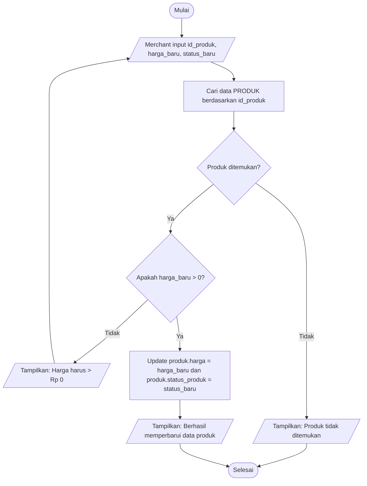
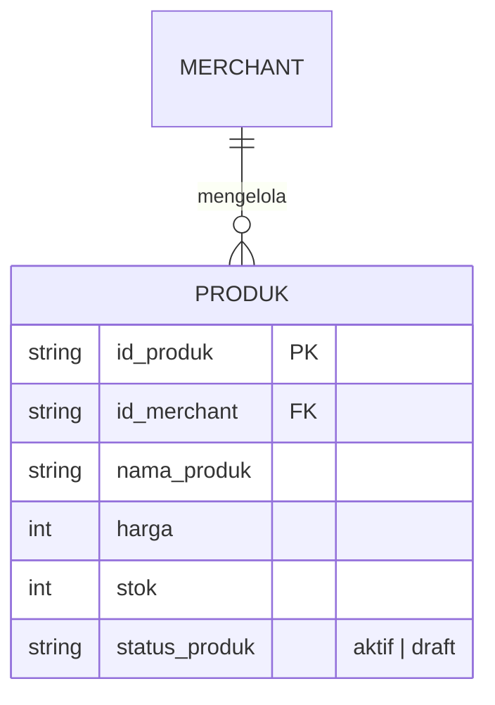
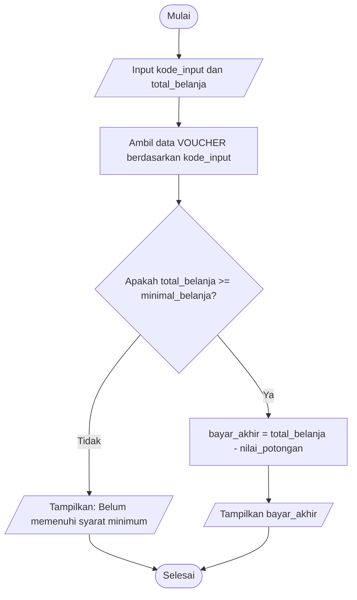
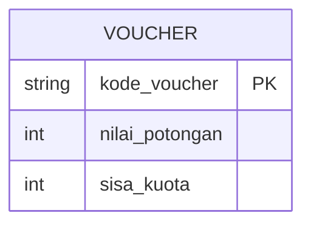

# 02e. Latihan Terpadu CT: Merakit Blueprint Fitur & Audit Konsistensi

**Minggu 2: Computational Thinking & Algoritma | Sesi 4 (Jumat)**  
**Target Waktu:** 90 - 120 Menit  
**Output Sesi:** Blueprint Terpadu 1 Fitur Baru (Dekomposisi + Pseudocode + Flowchart + Potongan ERD + Tabel Audit Konsistensi)

---

## 1. Mengapa Ini Penting?

Sejauh minggu ini, kamu telah mempelajari 4 alat rancang sistem secara bertahap:
- **Selasa (`02a & 02b`):** Memecah masalah (Dekomposisi), mengenali Pola, menyaring data inti (Abstraksi), dan menulis langkah logika (Pseudocode).
- **Rabu (`02c`):** Menggambar visualisasi percabangan alur (Flowchart).
- **Kamis (`02d`):** Merancang struktur tabel penyimpanan dan relasi data (ERD).

Di dunia kerja nyata, kesalahan paling sering terjadi bukan karena programmer tidak bisa membuat Flowchart atau ERD, melainkan karena **ketiga dokumen tersebut tidak nyambung satu sama lain**:
- Di Flowchart ditulis ada pengecekan sesuatu, tapi di Pseudocode terlewat.
- Di Pseudocode ingin mengubah suatu data, tapi waktu dicek ke ERD, kolom datanya **belum pernah dibuat**!

Hari ini kamu akan berlatih menjadi **Arsitek Sistem**: merakit satu paket **Blueprint Fitur Utuh** dan mengaudit konsistensinya agar siap di-coding tanpa kebingungan.

---

## 2. Tiga Aturan Sinkronisasi Antar-Diagram

Agar rancangan sistemmu solid, Pseudocode, Flowchart, dan ERD wajib mematuhi **3 Aturan Sinkronisasi** berikut:

```text
┌────────────────────────┐       Aturan 1:        ┌────────────────────────┐
│       PSEUDOCODE       │ ◄─── Cabang Selaras ──►│       FLOWCHART        │
│ (Urutan & Aturan JIKA) │                        │ (Simbol & Panah Alur)  │
└───────────┬────────────┘                        └───────────┬────────────┘
            │                                                 │
            └───────────────►    Aturan 2 & 3:    ◄───────────┘
                              Data & Nama Kolom
                                 Wajib Ada di
                                      ▼
                            ┌────────────────────┐
                            │        ERD         │
                            │ (Entitas & Atribut)│
                            └────────────────────┘
```

### Aturan 1: Sinkronisasi Cabang Logika (Pseudocode ↔ Flowchart)
Setiap blok `JIKA ... MAKA ... LAINNYA` di Pseudocode **wajib** memiliki padanan belah ketupat *Decision* (`{...}`) lengkap dengan panah **Ya** dan **Tidak** di Flowchart.
- ❌ **Contoh Cacat (Tidak Sinkron):**  
  Di Pseudocode tertulis: *"JIKA `harga <= 0` MAKA tampilkan error"*.  
  Tetapi di Flowchart, dari kotak `Input Harga` panahnya langsung lurus ke `Simpan Produk` tanpa melewati belah ketupat pengecekan harga.

### Aturan 2: Sinkronisasi Ketersediaan Data (Logika ↔ ERD)
Setiap variabel yang dibaca, diperiksa, atau diubah di dalam Pseudocode/Flowchart **wajib memiliki tempat penyimpanan (Entitas & Atribut)** di dalam ERD.
- ❌ **Contoh Cacat (Variabel Siluman):**  
  Di Flowchart ada belah ketupat: *"Apakah toko sedang buka?"*.  
  Tetapi di ERD entitas `MERCHANT` hanya memiliki atribut `id_merchant`, `nama_toko`, dan `nomor_whatsapp`—sama sekali **tidak ada atribut `status_buka`**. Saat mulai ngoding nanti, programmer pasti macet: *"Loh, status toko buka/tutup ini disimpan di tabel mana?!"*

### Aturan 3: Konsistensi Penamaan (*Naming Consistency*)
Gunakan nama atribut yang **sama persis** di Pseudocode, Flowchart, dan ERD. Jangan berganti-ganti istilah untuk data yang sama.
- ❌ **Contoh Cacat (Nama Beda-Beda):**  
  Di Pseudocode ditulis `sisa_barang`, di Flowchart ditulis `kuota_item`, sedangkan di ERD dinamai `stok`. Perbedaan nama ini sering memicu salah panggil variabel (*bug*) saat koding.
- ✅ **Contoh Benar:**  
  Gunakan nama `stok` secara konsisten di Pseudocode, Flowchart, maupun ERD.

---

## 3. Contoh Utuh (*Worked Example*): Fitur "Ubah Harga & Status Aktif Produk"

Mari kita lihat bagaimana **1 fitur utuh** dirakit dari awal sampai akhir dengan mematuhi ketiga aturan sinkronisasi di atas.

> **Cerita Fitur:**  
> Pedagang ingin mengubah `harga` atau `status_produk` (`"aktif"` / `"draft"`) dari halaman dashboard toko. Jika produk sedang habis bahan bakunya namun pedagang tidak ingin menghapus produk tersebut secara permanen, pedagang cukup mengubah statusnya menjadi `"draft"` agar disembunyikan sementara dari katalog pembeli.

### A. Dekomposisi & Abstraksi (5 Langkah Inti)
1. Pedagang memilih 1 produk yang ingin diubah di dashboard (`id_produk`).
2. Pedagang memasukkan nilai `harga_baru` dan memilih `status_baru` (`"aktif"` atau `"draft"`).
3. Sistem memeriksa apakah data produk dengan `id_produk` tersebut ada di database.
4. Sistem memvalidasi apakah `harga_baru > 0`. Jika tidak valid (0 atau minus), tolak perubahan dan tampilkan pesan error.
5. Jika valid, sistem memperbarui atribut `harga` dan `status_produk` pada entitas `PRODUK`, lalu menampilkan pesan sukses.

### B. Pseudocode Baku
```text
ALGORITMA UbahHargaDanStatusProduk
MULAI
    MASUKKAN id_produk, harga_baru, status_baru

    AMBIL produk BERDASARKAN id_produk

    JIKA produk TIDAK DITEMUKAN MAKA
        TAMPILKAN "Error: Produk tidak ditemukan"
        SELESAI
    AKHIR-JIKA

    JIKA harga_baru <= 0 MAKA
        TAMPILKAN "Error: Harga produk harus lebih besar dari Rp 0"
        SELESAI
    LAINNYA
        UBAH produk.harga = harga_baru
        UBAH produk.status_produk = status_baru
        TAMPILKAN "Berhasil memperbarui data produk"
    AKHIR-JIKA
SELESAI
```

### C. Flowchart Alur Sistem


### D. Potongan ERD yang Terlibat
Perhatikan bahwa semua atribut yang disentuh oleh Pseudocode dan Flowchart (`id_produk`, `harga`, `status_produk`) **wajib tercantum** di entitas `PRODUK`:



### E. Tabel Audit Konsistensi
Sebelum mengumpulkan blueprint, kita buktikan keselarasan ketiganya lewat tabel cek silang ini:

| Variabel / Aksi di Pseudocode | Simbol Padanan di Flowchart | Entitas & Atribut di ERD | Status Sinkron |
|---|---|---|---|
| `AMBIL produk BERDASARKAN id_produk` | `[Cari data PRODUK berdasarkan id_produk]` | `PRODUK.id_produk` (PK) | ✅ Sinkron |
| `JIKA produk TIDAK DITEMUKAN` | `{Produk ditemukan?}` (Cabang Ya/Tidak) | `PRODUK.id_produk` | ✅ Sinkron |
| `JIKA harga_baru <= 0` | `{Apakah harga_baru > 0?}` (Cabang Ya/Tidak) | `PRODUK.harga` (`int`) | ✅ Sinkron |
| `UBAH produk.status_produk = status_baru` | `[Update ... produk.status_produk = status_baru]` | `PRODUK.status_produk` (`string`) | ✅ Sinkron |

---

## 4. Workshop Praktik Squad: Rakit Blueprint 1 Fitur Baru (60 Menit)

Sekarang giliran squad-mu! Pilih **salah satu dari 2 fitur baru** di bawah ini (yang belum pernah kalian gambar di sesi Selasa/Rabu), lalu susun Blueprint Terpadunya.

### Pilihan Fitur Baru (Pilih Opsi A atau Opsi B):

#### Opsi A: Fitur "Konfirmasi Pesanan WA oleh Merchant & Potong Stok Otomatis"
- **Latar Belakang Masalah:**  
  Saat pembeli klik tombol *"Pesan via WhatsApp"*, pesanan baru berstatus `"Diteruskan ke WA"` (stok belum dipotong karena bisa saja pembeli batal mengirim chat). Setelah pembeli benar-benar chat dan sepakat, Merchant membuka daftar pesanan di dashboard lalu menekan tombol **"Terima Pesanan"**.
- **Aturan Logika Sistem:**
  1. Merchant memilih `id_pesanan` yang ingin dikonfirmasi.
  2. Sistem mengecek apakah `status_pesanan` saat ini adalah `"Diteruskan ke WA"`. Jika bukan (misal sudah pernah selesai atau batal), tolak aksi dan tampilkan pesan *"Pesanan ini sudah diproses sebelumnya"*.
  3. Untuk item produk di dalam pesanan tersebut, sistem memeriksa apakah `produk.stok >= item_pesanan.jumlah`.
  4. **Jika `produk.stok < item_pesanan.jumlah`:** Tolak konfirmasi, ubah `status_pesanan` menjadi `"Batal"`, dan tampilkan peringatan *"Gagal konfirmasi: Stok produk tidak mencukupi"*.
  5. **Jika `produk.stok >= item_pesanan.jumlah`:** Kurangi `produk.stok` sebanyak `item_pesanan.jumlah`, ubah `status_pesanan` menjadi `"Dikonfirmasi Penjual"`, dan tampilkan pesan sukses.

#### Opsi B: Fitur "Filter Kategori, Pencarian Kata Kunci, & Penanda Stok Habis"
- **Latar Belakang Masalah:**  
  Pembeli membuka halaman katalog toko dan ingin mencari barang berdasarkan kategori serta kata kunci nama produk. Selain itu, produk yang stoknya 0 tetap ditampilkan di katalog tetapi wajib diberi label *"Stok Habis"* agar tidak bisa dipesan.
- **Aturan Logika Sistem:**
  1. Pembeli memilih `id_kategori` dan memasukkan teks `kata_kunci`.
  2. Sistem mengecek: jika `kata_kunci` diisi namun panjangnya kurang dari 2 karakter, tampilkan pesan *"Masukkan minimal 2 huruf untuk mencari"* dan minta input ulang.
  3. Sistem mengambil daftar `PRODUK` yang memiliki `status_produk == "aktif"`, sesuai `id_kategori`, dan `nama_produk` mengandung `kata_kunci`.
  4. **Jika tidak ada produk yang cocok (jumlah hasil = 0):** Tampilkan info *"Produk yang kamu cari tidak ditemukan"*.
  5. **Jika ditemukan produk:** Untuk setiap produk yang tampil, periksa nilai `produk.stok`:
     - Jika `produk.stok == 0`, tampilkan label merah *"Stok Habis"* dan sembunyikan tombol WhatsApp.
     - Jika `produk.stok > 0`, tampilkan tombol hijau *"Pesan via WhatsApp"*.

---

### Tahapan Pengerjaan Squad (60 Menit):
1. **Tahap 1 — Dekomposisi & Pseudocode (20 Menit):**  
   Tuliskan 5–7 langkah dekomposisi dan susun Pseudocode lengkap menggunakan kata kunci baku (`JIKA ... MAKA ... LAINNYA ... AKHIR-JIKA`).
2. **Tahap 2 — Flowchart & Potongan ERD (25 Menit):**  
   Gambarkan Flowchart alur sistem dan potongan ERD (cukup entitas yang terlibat beserta atributnya) menggunakan sintaks Mermaid.
3. **Tahap 3 — Audit Konsistensi Silang (15 Menit):**  
   Buat **Tabel Audit Konsistensi** (seperti pada Bagian 3.E) dan minta anggota squad memeriksa:
   - Apakah setiap `JIKA` di Pseudocode sudah menjadi belah ketupat `{...}` di Flowchart?
   - Apakah setiap variabel yang dicek/diubah sudah ada kolomnya di ERD dengan nama yang sama persis?

---

## 5. Output Sesi

Kumpulkan 1 file Markdown di repositori squad dengan nama `blueprint-fitur-terpadu.md` yang berisi:
1. Nama Fitur Pilihan (Opsi A atau Opsi B) & Dekomposisi (5–7 langkah).
2. Pseudocode lengkap berformat baku.
3. Diagram Flowchart (Mermaid).
4. Potongan ERD (Mermaid) yang memuat seluruh entitas dan atribut yang dipakai fitur tersebut.
5. **Tabel Audit Konsistensi** (minimal 4 baris pengecekan variabel/kondisi).

---

## 6. Tugas Mandiri (Individual): "Detektif Audit Blueprint Cacat"

- **Sifat:** Individu (dikerjakan sendiri di luar jam kelas)
- **Target Waktu:** 25 menit
- **Nama File:** Simpan di folder pribadimu dalam repo squad dengan nama `tugas_02e.md`

### Studi Kasus Blueprint yang Cacat:
Seorang developer pemula membuat rancangan fitur **"Terapkan Kode Voucher Diskon Toko"** di bawah ini, tetapi rancangannya memiliki **3 ketidaksinkronan fatal (Mismatch)** antara Pseudocode, Flowchart, dan ERD:

**1. Pseudocode Pemula:**
```text
ALGORITMA PakaiVoucher
MULAI
    MASUKKAN kode_input, total_belanja
    AMBIL voucher BERDASARKAN kode_input

    JIKA voucher.kuota_pakai <= 0 MAKA
        TAMPILKAN "Kuota voucher sudah habis"
        SELESAI
    AKHIR-JIKA

    JIKA total_belanja < voucher.minimal_belanja MAKA
        TAMPILKAN "Total belanja belum memenuhi syarat minimum voucher"
        SELESAI
    LAINNYA
        HITUNG bayar_akhir = total_belanja - voucher.nilai_potongan
        UBAH voucher.kuota_pakai = voucher.kuota_pakai - 1
        TAMPILKAN bayar_akhir
    AKHIR-JIKA
SELESAI
```

**2. Flowchart Pemula:**


**3. Potongan ERD Pemula:**


### Instruksi Tugas Mandiri:
Temukan **3 ketidaksinkronan (Mismatch)** pada rancangan di atas dengan menjawab 3 pertanyaan berikut di dalam file `tugas_02e.md`:
1. **Mismatch 1 (Pseudocode vs Flowchart):** Pengecekan logika apa yang ada di Pseudocode, tetapi lupa digambar di Flowchart?
2. **Mismatch 2 (Logika vs Atribut ERD):** Kondisi syarat apa yang diperiksa di Pseudocode & Flowchart, tetapi kolom atributnya **belum ada** di tabel ERD `VOUCHER`?
3. **Mismatch 3 (Konsistensi Penamaan):** Atribut apa yang namanya berbeda antara Pseudocode (`voucher.kuota_pakai`) dan ERD (`sisa_kuota`)? Bagaimana perbaikannya?

### Contoh Hasil yang Diharapkan:
```markdown
# Tugas Mandiri 02e — Detektif Audit Blueprint Cacat
Nama: [Nama Kamu]

## 1. Mismatch 1 (Pseudocode vs Flowchart):
Di Pseudocode ada pengecekan `JIKA voucher.kuota_pakai <= 0` serta pengurangan kuota voucher setelah dipakai, tetapi di Flowchart langkah pengecekan kuota dan pengurangan kuota tersebut hilang sama sekali.

## 2. Mismatch 2 (Variabel Siluman yang Tidak Ada di ERD):
Pseudocode dan Flowchart sama-sama memeriksa syarat `minimal_belanja`, tetapi di ERD entitas `VOUCHER` belum memiliki atribut `minimal_belanja (int)`.

## 3. Mismatch 3 (Ketidakkonsistenan Nama Atribut):
Untuk menyimpan jumlah kuota voucher, Pseudocode menulis `kuota_pakai` sedangkan ERD menulis `sisa_kuota`. Selain itu kunci utamanya disebut `kode_input` vs `kode_voucher`.
Perbaikan: Seragamkan nama atribut di seluruh dokumen menjadi `kode_voucher`, `minimal_belanja`, `nilai_potongan`, dan `kuota_pakai`.
```

---

## 7. Cek Pemahaman Diri

1. Apa yang akan terjadi saat tim mulai ngoding di Bulan 2 jika ada variabel di Flowchart yang tidak memiliki kolom atribut di ERD?
2. Mengapa setiap blok `JIKA ... MAKA ... LAINNYA` pada Pseudocode harus selalu berpasangan dengan simbol belah ketupat (*Decision*) pada Flowchart?

---

Lanjut ke: **[02f-review-dan-evaluasi-minggu2.md](02f-review-dan-evaluasi-minggu2.md)**
