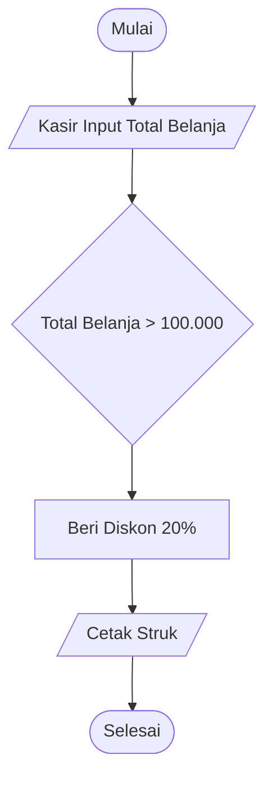

# 02f. Review Mingguan: Sprint Review Gabungan (Minggu 1 & 2) & Bug Hunt

**Minggu 2: Computational Thinking & Algoritma | Sesi Evaluasi (Sabtu)**  
**Target Waktu:** 120 Menit  
**Output Sesi:** Checklist Kapabilitas Minggu 1 & 2, Flowchart & ERD Tervalidasi, Catatan Retrospektif

---

## 1. Format Sesi Hari Sabtu

Hari Sabtu adalah momen akuntabilitas untuk mengunci kembali ritme mingguan Tribe (Senin–Sabtu). Seluruh squad akan mempresentasikan portofolio logika sistem mereka (sekaligus membuktikan penerapan AI Literacy dari Minggu 1) di hadapan mentor dan rekan tribe. Sesi dibagi menjadi 3 babak terstruktur:

```text
┌─────────────────────────────────────────────────────────────┐
│                 AGENDA SPRINT REVIEW SABTU                  │
├─────────────────┬───────────────────────────────────────────┤
│ 1. Showcase     │ Presentasi Portofolio Logika, Diagram, &  │
│    (50 Menit)   │ Bukti Sparring AI (6 squad x 8 menit)     │
├─────────────────┼───────────────────────────────────────────┤
│ 2. Uji Praktik  │ Bug Hunt: Menemukan bug logika pada       │
│    (35 Menit)   │ Flowchart & ERD yang cacat                │
├─────────────────┼───────────────────────────────────────────┤
│ 3. Retrospektif │ Refleksi tim & persiapan rolling squad    │
│    (35 Menit)   │ (evaluasi ritme 2 minggu pertama)         │
└─────────────────┴───────────────────────────────────────────┘
```

---

## 2. Bagian 1: Showcase Portofolio Logika & AI Sparring (50 Menit)

Setiap squad mendemokan hasil kerja mereka (5 menit presentasi + 3 menit sesi kritik/tanya jawab):
1. **Dekomposisi & Pseudocode (`02a-02b`):** Tunjukkan bagaimana proses bisnis warung dan perhitungan diskon/ongkir dipilah secara runtut tanpa instruksi ambigu.
2. **Presentasi Flowchart (`02c`):** Tunjukkan alur pemesanan via WhatsApp dan alur penanganan kondisi stok habis.
3. **Presentasi ERD (`02d`):** Tunjukkan struktur entitas, primary key, relasi 1:N, serta fungsi entitas penghubung `ItemPesanan`.
4. **Bukti AI Sparring & Prompt R-C-I-C-O (Integrasi Minggu 1):** Tunjukkan 1 contoh prompt terbaik berformat R-C-I-C-O yang dipakai squad saat menguji celah logika/diagram bersama AI, serta bagian mana dari saran AI yang dikurasi atau ditolak manual oleh tim.
5. **Tantangan Tracing Mentor:** Mentor akan menunjuk satu kondisi ekstrem secara acak (misal: *"Jika input jumlah pesanan dimasukkan angka minus -3 atau 0, panah diagrammu lari ke mana?"*). Presenter menunjukkan jalurnya dalam hitungan detik.

---

## 3. Bagian 2: Tantangan Praktik — "Bug Hunt: Bedah Diagram Cacat" (35 Menit)

Mentor menampilkan diagram flowchart dan ERD di bawah ini yang sengaja dirancang memiliki **4 kesalahan fatal**. Setiap squad memiliki waktu 15 menit untuk menemukan semua kesalahan dan menuliskannya di lembar kerja tim.

### Skenario Ujian: "Sistem Kasir Warung yang Cacat"



```text
DRAFT ERD KASIR:
Tabel_Produk:
- id_produk
- nama_produk
- nama_kategori
- nama_pembeli_terakhir
- harga
- stok
```

### Pertanyaan Bug Hunt:
1. Temukan **2 kesalahan logika fatal** pada flowchart di atas!
2. Temukan **2 kesalahan arsitektur data** pada draft ERD `Tabel_Produk` di atas!
3. Tuliskan perbaikan yang benar untuk kedua diagram tersebut!

*(Kunci telaah mentor: Flowchart tidak memiliki panah jika belanja <= 100.000 / panah buntu, dan tidak ada kalkulasi pembayaran/uang; ERD mencampur entitas Kategori dan riwayat Pembeli ke dalam tabel master Produk).*

---

## 4. Bagian 3: Sprint Retrospective & Persiapan Rolling Squad (35 Menit)

Karena Minggu 2 adalah akhir dari paruh pertama Bulan 1, ini adalah momen evaluasi siklus squad pertama sebelum dilakukan rolling anggota untuk Minggu 3 & 4:

1. **Evaluasi Dinamika Tim:**
   - Apakah rotasi peran Driver, Navigator, dan Presenter berjalan adil?
   - Apakah semua anggota berkesempatan mencoba menulis logika pseudocode dan flowchart?
2. **Pelajaran Berharga (*Key Learnings*):**
   - Apa hal paling mencerahkan yang didapatkan selama 2 minggu berpikir komputasional?
3. **Pengumuman Rolling Squad:** Mentor mengumumkan komposisi squad baru untuk Minggu 3 & 4 agar semua saling beradaptasi.

---

## 5. Output Sesi

1. Berita acara Sprint Review 2 dan catatan masukan teknis mentor.
2. Lembar jawaban tim untuk sesi Bug Hunt.

---

## 6. Tugas Mandiri (Individual)

- **Sifat:** Individu (dikerjakan sendiri setelah sesi Sabtu)
- **Target Waktu:** 15 menit
- **Nama File:** Simpan di folder pribadimu dalam repo squad dengan nama `tugas_02f.md`

### Instruksi:
Tuliskan refleksi pribadi singkat (3–5 kalimat) yang menjawab 3 hal berikut:
1. Apa 1 hal tentang Computational Thinking (Flowchart atau ERD) yang paling kamu pahami minggu ini?
2. Bagian mana yang menurutmu paling menantang atau masih butuh latihan?
3. Apa 1 komitmenmu untuk menyambut materi Desain Tampilan (Wireframe) dan Wawancara UMKM Nyata di Minggu 3?

### Contoh Hasil yang Diharapkan:
```markdown
# Tugas Mandiri 02f — Refleksi Pribadi Sprint 2
Nama: [Nama Kamu]

1. Hal yang paling saya pahami: Saya memahami bahwa relasi Banyak-ke-Banyak antara Pesanan dan Produk harus dipecah lewat entitas penghubung ItemPesanan agar jumlah tiap barang bisa dicatat dengan rapi.
2. Hal yang masih menantang: Memastikan semua panah keputusan (decision) di flowchart memiliki label Ya dan Tidak yang tidak buntu.
3. Komitmen Minggu 3: Saya siap belajar mendesain wireframe antarmuka yang ramah bagi pengguna awam dan siap ikut mewawancarai pedagang UMKM di sekitar tempat tinggal saya.
```

---

## 7. Checklist Kapabilitas Gabungan (Minggu 1 & Minggu 2)

Mentor memeriksa ketercapaian kapabilitas dengan 3 status: **Siap**, **Hampir Siap**, atau **Perlu Pendampingan**.

| Indikator Kapabilitas | Bukti Evaluasi | Status | Catatan Feedback Mentor |
|---|---|---|---|
| **AI Literacy & Prompt R-C-I-C-O (M1)** | Menggunakan formula R-C-I-C-O, melakukan kurasi manual atas halusinasi AI, dan menuntaskan artefak Minggu 1 | [ ] Siap<br>[ ] Hampir Siap<br>[ ] Perlu Pendampingan | |
| **Dekomposisi & Pseudocode (M2)** | Langkah runtut, menggunakan kata kunci baku, bebas dari makna ganda | [ ] Siap<br>[ ] Hampir Siap<br>[ ] Perlu Pendampingan | |
| **Kebenaran Flowchart (M2)** | Simbol standar, percabangan jelas (Ya/Tidak), alur pemesanan WA lengkap tanpa panah buntu | [ ] Siap<br>[ ] Hampir Siap<br>[ ] Perlu Pendampingan | |
| **Model Data ERD Dasar (M2)** | Entitas dan atribut terpisah benar, relasi 1:N dan N:N (`ItemPesanan`) masuk akal | [ ] Siap<br>[ ] Hampir Siap<br>[ ] Perlu Pendampingan | |
| **Jembatan Kode JavaScript (M2)** | Mampu menerjemahkan pseudocode ke fungsi JS sederhana (`tugas_02b.md`) dan mencocokkan dry run table | [ ] Siap<br>[ ] Hampir Siap<br>[ ] Perlu Pendampingan | |
| **Analisis Bug Hunt (M2)** | Menemukan minimal 3 dari 4 celah kesalahan pada diagram uji Sabtu | [ ] Siap<br>[ ] Hampir Siap<br>[ ] Perlu Pendampingan | |

> *Catatan Mentor:* Murid berstatus **Perlu Pendampingan** akan mendapatkan sesi klinik penelusuran diagram (*tracing clinic*) selama 15 menit bersama mentor atau rekan pairing sebelum memasuki materi UX Minggu 3.

---

## 8. Penutup Minggu 2 & Menatap Minggu 3

Kerja luar biasa! Kamu sudah menyelesaikan paruh pertama Bulan 1. Kamu sekarang mampu membedah masalah seperti programmer sejati: terstruktur, logis, dan teliti.

Namun, sistem yang logikanya sempurna tetap bisa gagal total jika **tampilannya membingungkan pengguna awam (UX buruk)** atau **tidak menyelesaikan masalah nyata pedagang (Value Proposition meleset)**.

Di **Minggu 3**, kita akan mempelajari dunia **Desain Antarmuka (Wireframe) & Riset Pengguna Nyata UMKM**!

---

Lanjut ke: **[3-Desain-Aplikasi-dan-Bisnis/PANDUAN-MENTOR.md](../3-Desain-Aplikasi-dan-Bisnis/PANDUAN-MENTOR.md)**
