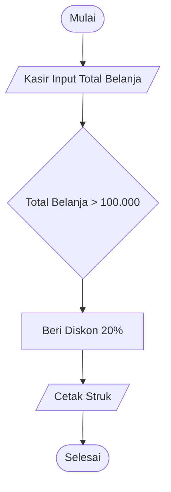

# 02f. Review dan Evaluasi Mingguan: Sprint Review 2

**Minggu 2: Computational Thinking & Algoritma | Sesi 6 (Sabtu)**  
**Target Waktu:** 120 Menit  
**Output Sesi:** Nilai Evaluasi Minggu 2, Flowchart & ERD Tervalidasi, Catatan Retrospektif

---

## 1. Format Sesi Hari Sabtu

Hari ini seluruh squad akan menguji ketajaman logika sistem mereka di hadapan mentor dan rekan-rekan tribe.

```text
┌─────────────────────────────────────────────────────────────┐
│                 AGENDA SPRINT REVIEW SABTU                  │
├─────────────────┬───────────────────────────────────────────┤
│ 1. Showcase     │ Presentasi Portofolio Logika & Diagram    │
│    (60 Menit)   │ (6 squad x 8 menit presentasi + Q&A)      │
├─────────────────┼───────────────────────────────────────────┤
│ 2. Uji Praktik  │ Bug Hunt: Menemukan bug logika pada       │
│    (30 Menit)   │ Flowchart & ERD yang rusak                │
├─────────────────┼───────────────────────────────────────────┤
│ 3. Retrospektif │ Refleksi tim & rolling pembagian squad    │
│    (30 Menit)   │ (evaluasi ritme kerja 2 minggu pertama)   │
└─────────────────┴───────────────────────────────────────────┘
```

---

## 2. Bagian 1: Showcase Portofolio Logika (60 Menit)

Setiap squad mendemokan hasil kerja Minggu 2 (5 menit presentasi + 3 menit sesi kritik/tanya jawab):
1. **Paparan Dekomposisi & Pseudocode:** Tunjukkan bagaimana masalah bisnis UMKM dipilah secara runtut.
2. **Presentasi Flowchart:** Jelaskan alur normal (*happy path*) dan alur penanganan kegagalan (*unhappy path*).
3. **Presentasi ERD:** Tunjukkan struktur entitas, atribut kunci (*Primary Key*), dan logika hubungan (*One-to-Many*).
4. **Tantangan Tracing Mentor:** Mentor akan menunjuk satu kondisi ekstrem secara acak (misal: *"Jika input harga dimasukkan angka minus -5000, diagrammu lari ke mana?"*). Presenter harus mampu melacak panahnya dalam hitungan detik.

---

## 3. Bagian 2: Ujian Praktik — "Bug Hunt: Bedah Diagram Cacat" (30 Menit)

Mentor menampilkan diagram flowchart dan ERD di bawah ini yang sengaja dirancang memiliki **4 kesalahan fatal**. Setiap squad memiliki waktu 15 menit untuk menemukan semua kesalahan dan menuliskannya di lembar jawaban.

### Skenario Ujian: "Sistem Kasir Warung yang Cacat"



```text
DRAFT ERD KASIR:
Tabel_Produk:
- id_produk
- nama_produk
- nama_kategori
- nama_pembeli_terakhir
- harga
- stok
```

### Pertanyaan Ujian:
1. Temukan **2 kesalahan logika fatal** pada flowchart di atas!
2. Temukan **2 kesalahan arsitektur data** pada draft ERD `Tabel_Produk` di atas!
3. Tuliskan perbaikan yang benar untuk kedua diagram tersebut!

*(Kunci jawaban mentor: Flowchart tidak punya cabang jika belanja <= 100rb (panah buntu) dan tidak ada input uang bayar/kembalian; ERD mencampur entitas Kategori dan riwayat Pembeli ke dalam tabel master Produk).*

---

## 4. Bagian 3: Sprint Retrospective & Evaluasi Squad Rolling (30 Menit)

Karena ini adalah akhir dari Minggu ke-2, ini adalah akhir dari siklus squad pertama sebelum mentor melakukan rolling anggota:

1. **Evaluasi Dinamika Tim:**
   - Apakah pembagian peran Driver, Navigator, dan Presenter berjalan adil?
   - Apakah ada anggota yang merasa suaranya kurang didengarkan?
2. **Pelajaran Berharga (*Key Learnings*):**
   - Apa hal paling mencerahkan yang didapatkan selama 2 minggu berpikir komputasional?
3. **Pengumuman Rolling Squad:** Mentor mengumumkan komposisi 6 squad baru untuk Minggu 3 & 4.

---

## 5. Rubrik Penilaian Kelulusan Minggu 2

| Aspek | Bobot | Kriteria Lulus (Skor 3 - 4) |
|---|---|---|
| **Kebenaran Flowchart** | 35% | Menggunakan simbol baku; tidak ada panah buntu; percabangan jelas; tahan uji skenario batas (*edge cases*). |
| **Kematangan ERD** | 35% | Pemisahan entitas dan atribut bersih; kardinalitas relasi 1:N dan N:N masuk akal; primary key jelas. |
| **Hasil Ujian Praktik Bug Hunt** | 30% | Mampu mendeteksi minimal 3 dari 4 kesalahan fatal diagram ujian dan memberikan solusinya. |

---

## 6. Penutup Minggu 2 & Menatap Minggu 3

Kerja luar biasa! Kamu sudah menyelesaikan setengah perjalanan Bulan 1. Kamu sekarang mampu berpikir seperti komputer: runtut, presisi, dan terstruktur.

Namun, sistem yang logikanya sempurna tetap bisa gagal di pasaran jika **tampilannya membingungkan manusia (UX buruk)** atau **tidak menyelesaikan masalah bisnis nyata (Value Proposition salah)**.

Di **Minggu 3**, kita akan mempelajari dunia **Desain Aplikasi (UX & Wireframe) & Desain Bisnis UMKM**!

Lanjut ke: **[3-Desain-Aplikasi-dan-Bisnis/PANDUAN-MENTOR.md](file:///home/iqbaal/gelombang-3/modul%2012%20bulan/modul-pra-coding-bulan1/3-Desain-Aplikasi-dan-Bisnis/PANDUAN-MENTOR.md)**
