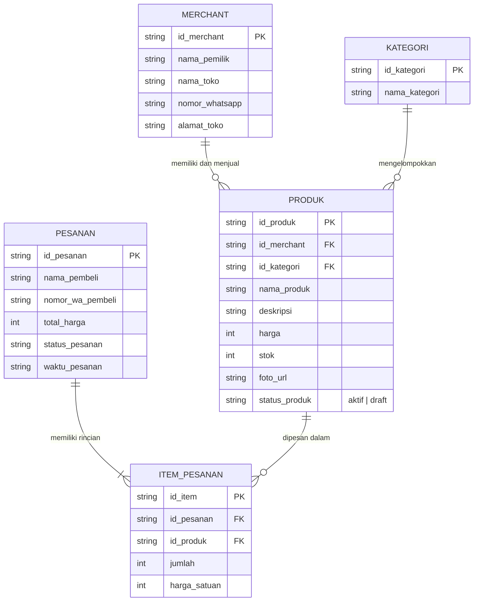
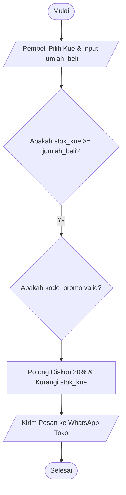
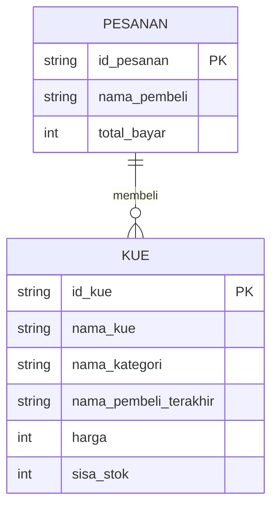

# Panduan Mentor — Minggu 2: Computational Thinking & Algoritma

**Fokus Minggu Ini:** Mengonversi alur masalah UMKM ke dalam logika terstruktur yang dapat dipahami sistem: dekomposisi langkah operasional, penulisan pseudocode bahasa Indonesia baku, visualisasi alur dengan Flowchart (pemesanan via WhatsApp & kelola produk), pemodelan relasi data (ERD dasar dengan entitas penghubung `ItemPesanan`), serta menjaga memori otot ngoding lewat 1 latihan kode JavaScript sederhana.

**Ritme:** 4 Sesi Materi & Workshop (`02a-02b` s/d `02e`, Selasa–Jumat) + 1 Sesi Sprint Review Gabungan Minggu 1 & 2 (`02f`, Sabtu). Materi `02a` dan `02b` digabung pada hari Selasa agar jadwal mingguan kembali terkunci dengan evaluasi di hari Sabtu. Alokasi per sesi: ±90-120 menit.

---

## 1. Peta Sesi Minggu 2

| Sesi | Hari | File Modul | Poin Mini-Lesson Mentor (20-30 Menit) | Output Sesi / Workshop Tim |
|---|---|---|---|---|
| 1 | Selasa | `02a-02b-empat-pilar-ct-dan-pseudocode.md` | 4 Pilar CT terpadu: Dekomposisi alur WA (6-8 langkah), Pola validasi berulang, Abstraksi data inti, & Pseudocode baku (`JIKA ... MAKA ... LAINNYA ... AKHIR-JIKA`) + Dry Run Table. | **Dokumen Terpadu 4 Pilar CT & Pseudocode Diskon/Ongkir** |
| 2 | Rabu | `02c-flowchart.md` | Simbol baku industri (Terminator, Proses, Decision, Data I/O); Flowchart 1: Tambah Produk, Flowchart 2: Pemesanan via WhatsApp (bukan checkout COD/transfer). | **Minimal 2 Flowchart Fitur Platform UMKM** |
| 3 | Kamis | `02d-erd-dasar.md` | Model data ERD: Entitas, Atribut, PK, Relasi 1:N dan N:N; Entitas penghubung `ItemPesanan`; penjelasan data Pembeli (tanpa login); Status alur WA. | **Draft ERD Platform Katalog UMKM** |
| 4 | Jumat | `02e-latihan-terpadu-ct.md` | 3 Aturan Sinkronisasi (Pseudocode ↔ Flowchart ↔ ERD); contoh utuh blueprint fitur *Ubah Harga & Status Produk*; workshop merakit 1 fitur baru (Konfirmasi Pesanan WA atau Filter/Search Katalog) + Tabel Audit Konsistensi. | **Blueprint Terpadu 1 Fitur Baru + Tabel Audit** |
| 5 | Sabtu | `02f-review-dan-evaluasi-minggu2.md` | Sprint Review Gabungan (M1 & M2): Presentasi tiap squad (5m pitch + 3m Q&A termasuk bukti prompt R-C-I-C-O); Ujian "Bug Hunt" melacak diagram cacat; Retrospektif tim rolling. | **Checklist Kapabilitas Minggu 1 & 2 + Refleksi** |

---

## 2. Beban Tugas Mandiri Minggu 2 (Individual)

Setiap murid mengerjakan tugas mandiri individual pada hari Selasa–Jumat dan menyimpannya di folder masing-masing dalam repo squad (`tugas_<kode-sesi>.md`). **Hari Sabtu (`02f`) bebas tugas mandiri** agar akhir pekan bersih dari beban PR. Total estimasi waktu di luar kelas: **100 menit (1 jam 40 menit)**.

| Sesi | Kode File | Nama Tugas Mandiri | Estimasi Waktu |
|---|---|---|---|
| 02a-02b | `tugas_02b.md` | **Jembatan Kode 1:** Terjemahkan Pseudocode Diskon/Ongkir ke Fungsi JavaScript Sederhana + Dry Run Table | 25 menit |
| 02c | `tugas_02c.md` | Flowchart Sederhana Validasi Nomor WhatsApp | 25 menit |
| 02d | `tugas_02d.md` | Menentukan Entitas, Atribut, & Relasi Fitur Ulasan Ringkas | 25 menit |
| 02e | `tugas_02e.md` | Detektif Audit Blueprint Cacat: Menemukan 3 Mismatch antara Pseudocode, Flowchart, & ERD | 25 menit |
| 02f | *(Tidak ada)* | *Sabtu bebas PR — seluruh evaluasi & retrospektif tuntas di kelas* | 0 menit |
| **Total** | | | **100 menit (1 jam 40 menit)** |

---

## 3. Jebakan Mental Model Siswa Minggu Ini

1. **Flowchart "menggantung" tanpa Terminator:** Siswa sering membuat percabangan decision (*Ya/Tidak*), tapi salah satu cabang tidak berujung ke mana-mana (*dead end*) atau lupa diberi panah `Selesai`. Ingatkan bahwa komputer tidak boleh berhenti di kondisi buntu tanpa instruksi penutup.
2. **Kondisi decision tidak jelas label Ya/Tidak-nya:** Siswa menulis pertanyaan di diamond, tapi garis keluar tidak diberi keterangan.
3. **Bingung membedakan Entitas vs Atribut pada ERD:** Siswa sering membuat "Harga" atau "Nama Produk" sebagai kotak entitas tersendiri, padahal itu adalah atribut dari entitas `Produk`. Gunakan analogi formulir fisik (Entitas = Kertas Formulir, Atribut = Kolom Isian pada formulir).
4. **Relasi Pesanan ke Produk (N:N):** Siswa sering bingung bagaimana 1 pesanan bisa membeli banyak produk sekaligus. Jelaskan mengapa kita membutuhkan tabel penghubung `ItemPesanan` (*Junction Table*).

---

## 4. Checklist Kapabilitas Sprint Review 2 (Sabtu)

Evaluasi dilakukan melalui checklist kapabilitas (status: **Siap**, **Hampir Siap**, atau **Perlu Pendampingan**) bersama catatan masukan konkret.

| # | Indikator Kapabilitas | Bukti Observasi | Status (Siap / Hampir Siap / Perlu Pendampingan) | Catatan Masukan Mentor |
|---|---|---|---|---|
| 1 | **Dekomposisi & Algoritma** | Menulis langkah runtut dengan format baku `JIKA ... MAKA ... LAINNYA ... AKHIR-JIKA`, tidak bermakna ganda. | | |
| 2 | **Kebenaran Flowchart** | Menggunakan simbol standar, percabangan Ya/Tidak lengkap, tidak ada panah buntu, alur pemesanan WA jelas. | | |
| 3 | **Model Data ERD Dasar** | Membedakan entitas dan atribut; relasi 1:N terhubung jelas; memahami fungsi entitas `ItemPesanan`. | | |
| 4 | **Sentuhan Kode JavaScript** | Murid mampu menuliskan fungsi JS sederhana untuk logika diskon/ongkir dan mencocokkan dengan dry run table. | | |
| 5 | **Analisis Bug Hunt** | Mampu menemukan minimal 3 dari 4 celah kesalahan pada diagram uji Sabtu. | | |

---

## 5. Panduan Mentor untuk Siswa "Perlu Pendampingan"

Jika seorang murid mendapat status *Perlu Pendampingan* pada Minggu 2:
1. **Latihan Tracing Menggunakan Jari (15 Menit):** Cetak atau tampilkan satu diagram flowchart sederhana. Minta murid menggerakkan jari telunjuknya menelusuri alur langkah demi langkah untuk satu kasus input konkret. Hal ini langsung memperjelas konsep percabangan logika.
2. **Klinik ERD Benda Nyata:** Ambil secarik kertas kwitansi belanja warung. Bimbing murid melingkari mana yang merupakan Toko, mana Pesanan, mana Barang, dan mana rincian per baris barang (`ItemPesanan`).
3. **Pendampingan Kode JS:** Bantu murid mengecek kembali penulisan tanda kurung kurawal `{}` dan sintaks `if / else` pada tugas 02b agar tidak trauma dengan error syntax.

---

## 6. Kunci Jawaban / Acuan Mentor: ERD Katalog UMKM (Sesi `02d`)

Di modul siswa (`02d-erd-dasar.md`), contoh Mermaid yang ditampilkan menggunakan kasus *Perpustakaan Sekolah* agar peserta tidak sekadar melakukan *copy-paste* saat Workshop. Berikut adalah **Kunci Jawaban ERD Platform Katalog UMKM** yang menjadi acuan mentor saat memeriksa hasil kerja squad di Sesi `02d`:

---

## 7. Soal & Kunci Jawaban "Live Bug Hunt" (Khusus Ditampilkan Mentor di Sesi `02f`)

Soal di bawah ini **tidak ditampilkan di file modul siswa (`02f`)** agar menjadi tantangan *live* yang otentik saat hari Sabtu. Tampilkan diagram berikut di layar proyektor dan beri waktu **15 menit** bagi tiap squad untuk menemukan **4 kesalahan fatal**:

### Soal yang Ditampilkan di Proyektor: "Blueprint Sistem Checkout Toko Kue yang Cacat"

**A. Flowchart Alur Pemesanan:**

**B. Draft ERD Toko Kue:**

### Pertanyaan untuk Squad:
1. Temukan **2 kesalahan logika alur** pada Flowchart di atas!
2. Temukan **2 kesalahan arsitektur data / ketidaksinkronan** pada ERD di atas!
3. Tuliskan cara memperbaikinya!

### Kunci Telaah Mentor (4 Kesalahan Fatal):
1. **Bug 1 — Cabang Decision Buntu di Flowchart:**  
   Pada belah ketupat `{Apakah stok_kue >= jumlah_beli?}`, **tidak ada panah keluar untuk kondisi `Tidak`** (jika stok habis). Selain itu, pada belah ketupat `{Apakah kode_promo valid?}`, garis keluarnya tidak memiliki label `Ya/Tidak` (bagaimana jika pembeli tidak memakai promo atau promonya tidak valid?).
2. **Bug 2 — Mismatch Logika vs ERD (Variabel Siluman & Beda Nama):**  
   Flowchart memeriksa `{Apakah kode_promo valid?}`, tetapi di ERD sama sekali **tidak ada entitas/atribut promo**. Selain itu, Flowchart menggunakan nama variabel `stok_kue`, sedangkan di ERD tertulis `sisa_stok`.
3. **Bug 3 — Tabel `KUE` Mencampur Data Kategori & Riwayat Pembeli (*Redundancy*):**  
   Atribut `nama_kategori` seharusnya dipisah ke entitas `KATEGORI` (`id_kategori FK`), dan `nama_pembeli_terakhir` tidak boleh disimpan di tabel master `KUE` karena setiap kali ada pembeli baru, data pembeli sebelumnya akan tertimpa.
4. **Bug 4 — Relasi `PESANAN` ke `KUE` Langsung `1:N` Tanpa Entitas Penghubung (`ITEM_PESANAN`):**  
   Satu pesanan bisa membeli banyak jenis kue, dan satu jenis kue bisa dibeli di banyak pesanan (`N:N`). Wajib ada entitas penghubung `ITEM_PESANAN` yang menyimpan `id_pesanan FK`, `id_kue FK`, `jumlah_beli`, dan `harga_satuan`.
