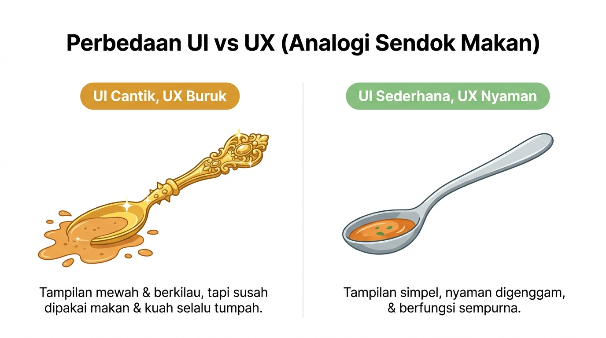
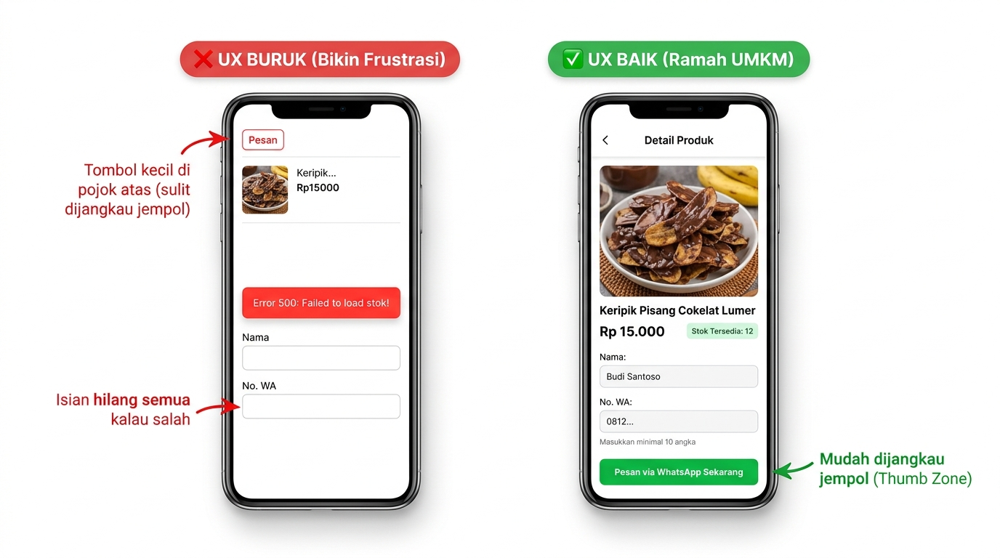

# 03a. Prinsip UX Dasar: Membangun Aplikasi yang Mudah Dipakai Manusia

**Minggu 3: Desain Aplikasi & Bisnis | Sesi 1 (Senin)**  
**Target Waktu:** 90 - 120 Menit (Sesi Kelas)  
**Output Sesi:** Laporan "Audit UX" Aplikasi Nyata + 3 Aturan UX Wajib untuk Katalog UMKM (Push ke Repo Squad & Presentasi di Daily Standup)

---

## 1. Mengapa Ini Penting?

Minggu lalu kamu sudah merancang **"otak" sistem** lewat Pseudocode, Flowchart, dan ERD. Namun, otak sistem yang logikanya sempurna tetap bisa **gagal total** jika antarmukanya membuat pengguna bingung lalu menutup aplikasi dalam 30 detik pertama:
- *"Tombol pesannya di mana ya?"*
- *"Kok muter-muter terus nggak ada keterangan apa-apa?"*
- *"Udah capek-capek ngetik form panjang, pas salah satu huruf malah kereset semua!"*

Sebagai pembuat software, kamu tidak merancang aplikasi untuk dirimu sendiri yang melek teknologi. Kamu merancangnya untuk **pembeli dan pemilik warung UMKM** dengan berbagai usia dan tingkat literasi digital.

Hari ini kita mulai merancang **"pengalaman pakainya" (User Experience / UX)** agar sistem kita nyaman, jelas, dan anti-tersesat.

---

## 2. UI vs UX: Apa Bedanya?

```text
┌───────────────────────────────────────┬───────────────────────────────────────┐
│        UI (User Interface)            │        UX (User Experience)           │
├───────────────────────────────────────┼───────────────────────────────────────┤
│ "Bagaimana tampilannya terlihat"      │ "Bagaimana rasanya saat digunakan"    │
│ Warna, font, icon, keindahan visual,  │ Kecepatan alur, kemudahan menemukan   │
│ animasi transisi, konsistensi tombol. │ menu, kejelasan pesan error, rasa     │
│                                       │ puas tanpa kebingungan.               │
└───────────────────────────────────────┴───────────────────────────────────────┘
```

> **Analogi Sendok Makan:**  
> Sendok makan berbahan emas berkilau dengan ukiran bunga indah adalah **UI yang cantik**.  
> Tetapi jika gagangnya terlalu berat ke belakang dan cekungannya sangat ceper sehingga kuah sup selalu tumpah saat disendok, sendok itu memiliki **UX yang sangat buruk**.



---

## 3. Empat Prinsip Emas UX untuk Aplikasi UMKM

### 1. Prinsip Kebiasaan Pengguna (Jangan Bikin Pusing dengan Pola Aneh)
> *"Orang terbiasa dengan pola yang sering mereka temui di aplikasi lain."*

Jangan membuat tata letak yang aneh-aneh hanya demi terlihat "beda". Jika di hampir semua aplikasi tombol keranjang/pesanan atau menu utama ada di posisi yang sudah umum, ikutilah pola itu! Mengubah pola yang sudah mendarah daging hanya akan membuat pengguna merasa tersesat.

### 2. Prinsip Tombol Mudah Dijangkau Jempol (Hierarki Ukuran & Jarak)
> *"Semakin penting sebuah tindakan, semakin besar tombolnya dan semakin dekat dengan jangkauan jempol."*

- **Tombol Utama (*Call to Action* / CTA):** Harus berukuran paling besar dengan warna kontras tegas (misal: tombol hijau besar *"Pesan via WhatsApp"*).
- **Tombol Sekunder:** Cukup garis tepi atau warna redup (misal: tombol *"Batal"* atau *"Kembali"*).
- **Zona Jempol (*Thumb Zone*):** Karena pembeli membuka katalog dari smartphone dengan satu tangan, letakkan tombol aksi utama di bagian bawah layar agar mudah disentuh jempol tanpa harus meregangkan jari.

### 3. Visibilitas Status Sistem (Beri Kabar Cepat)
Sistem harus selalu memberi tahu pengguna apa yang sedang terjadi melalui umpan balik yang jelas:
- **Saat tombol ditekan:** Tampilkan teks *"Sedang membuka WhatsApp..."* atau indikator loading. Jangan biarkan layar membeku tanpa respon.
- **Saat sukses:** Tampilkan centang hijau atau pesan konfirmasi singkat.
- **Saat error:** Jangan tampilkan kode teknis asing seperti *"Error 500"* atau *"NullPointerException"*! Tampilkan pesan ramah: *"Koneksi internetmu terputus. Silakan coba kirim ulang."*

### 4. Pencegahan & Pengampunan Kesalahan (*Error Prevention*)
- **Cegah sebelum salah:** Jika kolom nomor WhatsApp hanya boleh angka, langsung munculkan keyboard angka di layar ponsel pengguna. Jika stok barang `0`, nonaktifkan tombol pesan dengan label *"Stok Habis"* sebelum pembeli capek mengisi nama.
- **Jangan hukum pengguna saat salah:** Jika pengguna salah mengisi satu kolom form, jangan mengosongkan kembali kolom lain yang sudah diketik dengan susah payah. Beri penanda merah tepat di kolom yang salah disertai petunjuk cara membenarkannya.

---

### Contoh Penerapan Langsung: Halaman Detail Produk Katalog UMKM

Perhatikan perbedaan desain layar HP yang **mengabaikan UX** vs yang **mematuhi 4 Prinsip Emas UX**:



| Aspek Desain | ❌ Versi UX Buruk (Bikin Frustrasi) | ✅ Versi UX Baik (Ramah UMKM) |
|---|---|---|
| **Posisi Tombol Utama** | Tombol `[Pesan]` kecil di pojok atas, susah dijangkau jempol. | Tombol hijau lebar `💬 PESAN VIA WHATSAPP SEKARANG` tepat di zona jempol bawah layar. |
| **Kejelasan Info Produk** | Foto kecil, nama terpotong (`Keripik...`), format harga membingungkan. | Foto besar jernih, judul lengkap, harga `Rp 15.000`, serta info stok yang jelas. |
| **Pesan Error & Bantuan** | Menampilkan kode teknis (`Error 500: Failed to load stok!`). | Validasi langsung di kolom input (misal: `⚠ Masukkan minimal 10 angka`) tanpa menghapus isian lain. |

> [!NOTE]
> **Istilah Tambahan / Referensi Desain (Opsional):**  
> Di dunia profesional UI/UX, Prinsip Kebiasaan Pengguna dikenal sebagai **Hukum Jakob (*Jakob’s Law*)**, sedangkan prinsip ukuran dan jangkauan tombol dikenal sebagai **Hukum Fitts (*Fitts’s Law*)**.

---

## 4. Workshop Praktik Squad: Audit UX Aplikasi Nyata

Workshop dimulai di kelas (60 menit), lalu hasil akhirnya di-*push* ke repositori squad untuk **dipresentasikan pada sesi Daily Standup besok pagi**.

### Langkah 1: Pilih Pasangan Aplikasi Pembanding (Maksimal 5 Menit)
Agar tidak menghabiskan waktu berdebat memilih aplikasi, pilih salah satu pasangan di bawah ini (atau aplikasi lain yang disepakati cepat oleh tim):
- **Opsi 1:** Aplikasi Belanja / Ojek Online populer (UX Nyaman) vs Website Pendaftaran / Layanan Publik yang berbelit (UX Membingungkan).
- **Opsi 2:** WhatsApp / GoFood (UX Nyaman) vs Salah satu situs e-commerce/berita yang penuh pop-up iklan & tombol tersembunyi (UX Membingungkan).

### Langkah 2: Isi Tabel Audit Berbasis 4 Prinsip Emas (35 Menit)
Bedah kedua aplikasi tersebut menggunakan tabel di bawah ini. **Fokus pada pengalaman alur & kemudahan pakai (UX), bukan sekadar komentar warna atau selera estetika (UI)!**

| Prinsip Emas UX | Temuan di Aplikasi Nyaman (+) | Temuan di Aplikasi Membingungkan (-) | Saran Perbaikan Konkret |
|---|---|---|---|
| **1. Kebiasaan Pengguna** *(Pola familiar)* | *Contoh: Tombol cari selalu di atas & keranjang di pojok kanan.* | *Contoh: Menu utama disembunyikan di ikon aneh yang tidak dikenali.* | |
| **2. Tombol & Jangkauan Jempol** *(CTA jelas)* | | | |
| **3. Visibilitas Status Sistem** *(Loading/Error)* | | | |
| **4. Pencegahan Kesalahan** *(Validasi/Form)* | | | |

### Langkah 3: Rumuskan 3 Aturan UX Wajib Katalog UMKM (20 Menit)
Dari hasil audit di atas, simpulkan **3 Aturan UX Wajib** yang disepakati squad untuk langsung diterapkan saat menggambar Wireframe besok di Sesi `03b` (contoh: *"Setiap form gagal wajib mempertahankan input lama & menampilkan pesan error berbahasa Indonesia di bawah kolom terkait"*).

---

## 5. Output Sesi

*Push* dokumen Markdown `audit-ux-squad.md` ke repositori squad (siap dipresentasikan saat **Daily Standup besok pagi**) berisi:
1. Nama kedua aplikasi yang diaudit + tangkapan layar (*screenshot*) bagian antarmuka yang dibahas.
2. **Tabel Audit 4 Prinsip Emas UX** yang sudah terisi lengkap dengan saran perbaikan konkret.
3. **3 Aturan UX Wajib** yang akan diterapkan pada Wireframe Katalog UMKM squad kalian.

---

## 6. Tugas Mandiri (Individual)

- **Sifat:** Individu (dikerjakan di luar jam kelas dan di-*push* ke folder pribadimu di repo squad untuk dibahas saat Daily Standup besok pagi)
- **Target Waktu:** 20 menit
- **Nama File:** Simpan di folder pribadimu dalam repo squad dengan nama `tugas_03a.md`

### Instruksi:
1. Amati orang tua, saudara, atau tetangga di sekitarmu saat mereka sedang menggunakan smartphone (atau refleksikan pengalaman pribadimu).
2. Temukan **1 momen di mana mereka sempat bingung, salah pencet, atau mengeluh** saat memakai sebuah aplikasi.
3. Tuliskan dalam 4 poin:
   - Apa aplikasi yang digunakan dan apa yang ingin mereka lakukan?
   - Mengapa antarmuka aplikasi tersebut membingungkan mereka?
   - **Prinsip Emas UX nomor berapa yang dilanggar** pada kejadian tersebut?
   - Bagaimana solusi perbaikan tombol/tata letak yang lebih ramah pengguna?

### Contoh Hasil yang Diharapkan:
```markdown
# Tugas Mandiri 03a — Observasi Hambatan UX
Nama: [Nama Kamu]

## 1. Situasi Pengamatan:
Ibu saya ingin mencari resep opor ayam di sebuah website resep masakan lokal.

## 2. Masalah UX yang Ditemukan:
Ketika membuka halaman, layar langsung tertutup 3 jendela pop-up iklan yang bertumpuk. Tombol tanda silang (X) untuk menutup iklan sangat kecil di pojok kanan atas, sehingga ibu saya berulang kali salah memencet iklan dan terlempar ke halaman lain. Ibu saya langsung merasa panik dan mengira HP-nya terkena virus.

## 3. Prinsip Emas UX yang Dilanggar:
- **Prinsip 2 (Ukuran & Jangkauan Tombol):** Tombol tutup (X) terlalu kecil dan berada jauh di pojok atas layar, sehingga jari pengguna mudah meleset.
- **Prinsip 4 (Pencegahan Kesalahan):** Iklan menutupi area baca dan memicu pengguna tidak sengaja menekan link keluar halaman.

## 4. Solusi Perbaikan Berdasarkan Prinsip UX:
Jangan memasang pop-up yang menutupi konten utama. Jika ada jendela pemberitahuan penting, tombol tutup (X) harus berukuran minimal 44x44 pixel, kontras jelas, dan mudah disentuh jari pengguna paruh baya.
```

---

## 7. Cek Pemahaman Diri

1. Apa perbedaan utama antara **UI** (*User Interface*) dan **UX** (*User Experience*)? Berikan contoh kasus nyata di mana UI-nya bagus tetapi UX-nya buruk!
2. Mengapa tombol penting seperti *"Pesan via WhatsApp"* harus diletakkan di bagian bawah layar smartphone (bukan di pojok atas)?
3. Mengapa menampilkan kode error teknis seperti *"Error 404"* atau *"Error 500"* sangat buruk bagi pengalaman pengguna awam UMKM?

---

Lanjut ke: **[03b-wireframe-dan-merancang-tampilan.md](03b-wireframe-dan-merancang-tampilan.md)**
