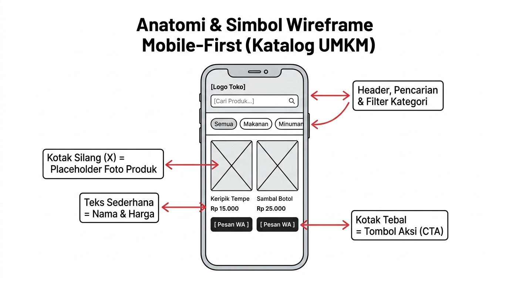

# 03b. Wireframe: Merancang Struktur Tampilan Sebelum Coding

**Minggu 3: Desain Aplikasi & Bisnis | Sesi 2 (Selasa)**  
**Target Waktu:** 90 - 120 Menit  
**Output Sesi:** Wireframe 3 Halaman Utama Platform Katalog UMKM + Alur Interaksi *(di-push ke repo squad untuk dipresentasikan saat Daily Standup besok pagi)*

---

## 1. Mengapa Ini Penting?

Jika seorang tukang bangunan langsung menyusun batu bata dan mengecat tembok tanpa melihat gambar denah arsitektur, rumah itu kemungkinan besar akan memiliki pintu yang menabrak jendela atau kamar mandi tanpa saluran pipa pembuangan.

Dalam pengembangan perangkat lunak, **Wireframe adalah denah biru (*blueprint*) antarmuka**.

Wireframe sengaja dibuat **hitam-putih (grayscale), tanpa warna-warni brand, tanpa foto produk asli, dan tanpa dekorasi estetik**. Tujuannya satu: memastikan tata letak (*layout*), alur navigasi tombol, dan hierarki informasi sudah benar sebelum kita menulis kode komponen React di Bulan 2.

> [!NOTE]
> **Jangan Tertukar:**  
> **Wireframe** fokus pada *struktur & fungsi* (kotak hitam-putih kasar di tahap awal), sedangkan **Mockup / Desain Visual** baru memikirkan *warna, font estetik, dan foto asli*.

---

## 2. Anatomi & Simbol Menggambar Wireframe

Saat membuat wireframe di kertas atau aplikasi gambar (*Excalidraw* / *Figma*), gunakan simbol konvensi standar berikut:



| Simbol pada Wireframe | Arti & Fungsi |
|---|---|
| **Kotak dengan silang (`X`)** | *Placeholder* area gambar atau foto produk (belum perlu foto asli). |
| **Teks polos / garis horizontal** | Judul produk, harga, atau blok teks deskripsi singkat. |
| **Kotak berbingkai tebal / blok gelap** | Tombol aksi utama (*Call to Action* / CTA) seperti `[ Pesan WA ]`. |
| **Garis panah antar layar** | Alur perpindahan halaman ketika sebuah tombol disentuh atau diklik. |

---

## 3. Tiga Halaman Inti Platform Katalog UMKM

Mulai Bulan 2, produk pertama yang akan kalian bangun dengan React adalah **Mini Katalog UMKM**. Hari ini kita merancang cetak birunya dengan pendekatan **Mobile-First** (mengutamakan tampilan layar smartphone tegak terlebih dahulu, karena mayoritas pembeli dan pemilik UMKM lokal mengakses toko online lewat ponsel).

### Halaman 1: Katalog Utama (Daftar Produk)
- **Tujuan Pengguna:** Pembeli ingin melihat-lihat dagangan yang tersedia, mencari barang, atau menyaring kategori.
- **Komponen Kunci:** Header Nama Toko, Kolom Pencarian, Tombol Filter Kategori (*Tabs/Pills*), dan Grid Kartu Produk (Foto `X`, Nama, Harga, penanda **Stok Habis** jika stok `0`, serta tombol pesan/lihat detail).

### Halaman 2: Detail Produk
- **Tujuan Pengguna:** Pembeli ingin memeriksa detail barang, menentukan jumlah beli, lalu langsung memesan ke WhatsApp pedagang.
- **Komponen Kunci:** Tombol Kembali, Foto produk besar, Nama lengkap barang, Harga satuan & **Info Stok Tersedia**, Deskripsi singkat, Pemilih Jumlah (`-` / `+`), Form singkat (Nama & No. WA), serta Tombol Utama **"Pesan via WhatsApp"** di zona jempol bagian bawah layar *(atau tombol nonaktif jika stok habis)*.

### Halaman 3: Dashboard Kelola Produk Merchant
*(Scope: Merchant mengelola dagangan secara ringkas tanpa sistem login yang rumit).*
- **Tujuan Pengguna:** Pemilik UMKM ingin menambah produk baru atau memperbarui stok barang yang sudah habis dengan cepat.
- **Komponen Kunci:**
  1. **Form Tambah Produk:** Input Nama Produk, Harga (rupiah), Pilihan Kategori, Jumlah Stok, Kolom URL Foto, serta tombol **"Simpan Produk"** dan **"Batal"**.
  2. **Daftar Produk Ringkas:** Tabel/kartu produk milik toko dengan aksi cepat untuk **ubah stok / tandai habis / hapus**.

---

## 4. Workshop Praktik Squad (60 Menit)

### Langkah Pengerjaan Tim:
1. **Langkah 1 — Terapkan Aturan `03a` & Sketsa Kertas Mobile-First (30 Menit):**  
   Buka kembali **3 Aturan UX Wajib** yang disepakati squad pada Sesi `03a`. Gambarkan sketsa 3 halaman di atas pada kertas HVS dalam rasio layar ponsel tegak (`9:16`).  
   *Pastikan juga kalian menggambar kondisi khusus (edge case)*, seperti tampilan kartu saat **Stok = 0** dan pesan error form berbahasa Indonesia yang ramah.
2. **Langkah 2 — Uji Alur Jari / *Paper Prototyping* (15 Menit):**  
   Minta satu anggota squad berpura-pura menjadi pembeli awam. Sentuhkan ibu jari ke tombol di kertas Halaman 1, lalu balik kertas ke Halaman 2.  
   - Apakah tombol utama mudah dijangkau satu jempol?  
   - Gambarkan **garis panah alur** yang menghubungkan tombol mana menuju layar mana.
3. **Langkah 3 — Dokumentasi Rapi ke Repo Squad (15 Menit):**  
   Foto sketsa kertas dengan pencahayaan jelas (atau salin ulang ke *Excalidraw* / *Figma* hitam-putih), lalu simpan file gambar beserta catatan alur ke folder `minggu-3/wireframe/` di repositori squad.

---

## 5. Output Sesi

*Push* dokumen `wireframe-squad.md` beserta file gambar sketsa/ekspor ke repositori squad (siap dipresentasikan saat **Daily Standup besok pagi**) berisi:
1. Gambar **Wireframe Halaman 1** (Katalog Utama — termasuk contoh kartu *Stok Habis*).
2. Gambar **Wireframe Halaman 2** (Detail Produk + Form Pemesanan WA).
3. Gambar **Wireframe Halaman 3** (Dashboard Kelola Produk Merchant).
4. Penjelasan singkat **alur interaksi** (tombol mana menuju halaman mana) dan **bukti penerapan 3 Aturan UX Wajib** dari Sesi `03a`.

---

## 6. Tugas Mandiri (Individual): Jembatan ke Kode HTML & CSS

- **Sifat:** Individu (dikerjakan di luar jam kelas dan di-*push* ke folder pribadimu di repo squad untuk dibahas saat Daily Standup besok pagi)
- **Target Waktu:** 25 menit
- **Nama File:** Simpan di folder pribadimu dalam repo squad dengan nama `tugas_03b.md`

> [!TIP]
> **Bekal Pre-Program → Jembatan Menuju Bulan 2:**  
> Di **2 bulan pre-program sebelumnya**, kamu sudah mempelajari dasar HTML dan CSS. Sekarang ubah rancangan kartu produk dari Wireframe Halaman 1 menjadi kode HTML & CSS statis hitam-putih dalam dua kondisi: **Stok Tersedia** dan **Stok Habis**!

### Instruksi:
1. Tulis kode HTML sederhana untuk 2 kartu produk versi wireframe (satu produk normal, satu produk dengan status **Stok Habis**).
2. Tulis CSS minimal hitam-putih (`border`, `padding`, `font-family: sans-serif`, dan style tombol aktif vs tombol nonaktif/`disabled`) agar menyerupai wireframe.
3. Simpan cuplikan kode beserta refleksi singkatmu di file `tugas_03b.md`.

### Contoh Hasil yang Diharapkan:
````markdown
# Tugas Mandiri 03b — Wireframe HTML/CSS Hitam-Putih
Nama: [Nama Kamu]

## 1. Kode HTML & CSS:
```html
<style>
  .daftar-produk {
    display: flex;
    gap: 12px;
    font-family: sans-serif;
  }
  .card-produk {
    width: 200px;
    border: 2px solid #000;
    padding: 12px;
    background-color: #fff;
  }
  .placeholder-img {
    height: 120px;
    background-color: #eee;
    border: 1px dashed #666;
    display: flex;
    align-items: center;
    justify-content: center;
    font-weight: bold;
    color: #666;
    margin-bottom: 8px;
  }
  .nama-produk {
    font-size: 16px;
    margin: 4px 0;
  }
  .harga-produk {
    font-size: 14px;
    color: #333;
    margin-bottom: 12px;
  }
  .btn-wa {
    width: 100%;
    padding: 10px;
    background-color: #000;
    color: #fff;
    border: 2px solid #000;
    font-weight: bold;
    cursor: pointer;
  }
  .btn-habis {
    width: 100%;
    padding: 10px;
    background-color: #e5e5e5;
    color: #666;
    border: 2px dashed #999;
    font-weight: bold;
    cursor: not-allowed;
  }
</style>

<div class="daftar-produk">
  <div class="card-produk">
    <div class="placeholder-img">[ FOTO X ]</div>
    <h3 class="nama-produk">Keripik Balado</h3>
    <p class="harga-produk">Rp 15.000 • Stok: 12</p>
    <button class="btn-wa">Pesan via WhatsApp</button>
  </div>

  <div class="card-produk">
    <div class="placeholder-img">[ FOTO X ]</div>
    <h3 class="nama-produk">Sambal Roa</h3>
    <p class="harga-produk">Rp 25.000 • Stok: 0</p>
    <button class="btn-habis" disabled>Stok Habis</button>
  </div>
</div>
```

## 2. Refleksi Singkat:
Mengubah wireframe menjadi HTML/CSS hitam-putih membantu saya melihat struktur komponen secara nyata—termasuk cara membedakan tampilan tombol saat stok masih ada vs saat stok habis untuk persiapan React di Bulan 2.
````

---

## 7. Cek Pemahaman Diri

1. Mengapa desainer dilarang memasukkan warna-warni estetik dan foto asli pada tahap pembuatan wireframe?
2. Mengapa pendekatan *Mobile-First* wajib diterapkan sejak awal saat merancang wireframe aplikasi UMKM lokal?
3. Bagaimana cara menandai produk yang stoknya `0` di wireframe Halaman 1 dan Halaman 2 agar selaras dengan prinsip pencegahan kesalahan (*Error Prevention*) dari Sesi `03a`?

---

Lanjut ke: **[03c-value-proposition-dan-model-bisnis.md](03c-value-proposition-dan-model-bisnis.md)**
