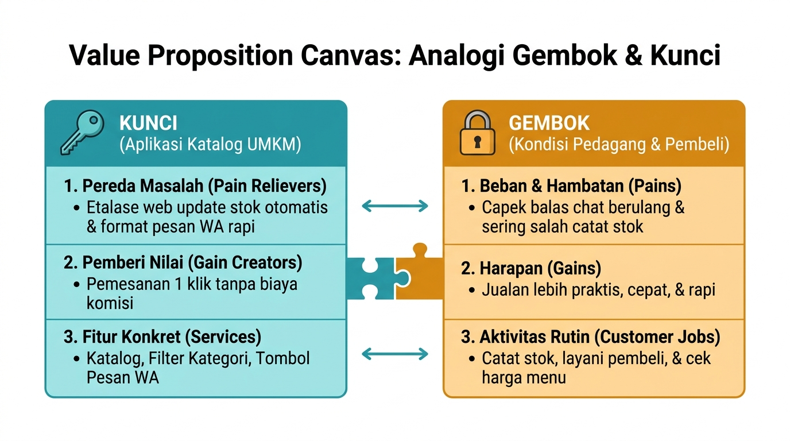

# 03c. Desain Bisnis: Mencocokkan Masalah Nyata UMKM dengan Nilai Solusi

**Minggu 3: Desain Aplikasi & Bisnis | Sesi 3 (Rabu)**  
**Target Waktu:** 90 - 120 Menit  
**Output Sesi:** Value Proposition Canvas Platform UMKM & Catatan Wawancara Squad *(di-push ke repo squad untuk dipresentasikan saat Daily Standup besok pagi)*

---

## 1. Mengapa Ini Penting?

Sebuah aplikasi bisa saja memiliki kode yang bersih dan tampilan visual yang menarik, tetapi jika **tidak ada orang yang butuh memakainya**, aplikasi tersebut adalah produk gagal.

Sebagai insinyur perangkat lunak, kamu bukan sekadar "tukang ketik kode yang disuruh bos". Kamu adalah pemecah masalah nyata (*problem solver*).

Hari ini kita membedah sisi bisnis dari Platform UMKM: **Kenapa pedagang mau repot-repot memajang produk di aplikasi katalog kita? Dan kenapa pembeli mau memesan lewat katalog web daripada sekadar chat biasa?**

> [!IMPORTANT]
> Jawaban untuk dua pertanyaan di atas, saat ini, baru **dugaan (hipotesis)** kita. Tugas hari ini adalah menyusun dugaan itu dengan rapi, lalu **mengujinya lewat wawancara dengan pelaku UMKM nyata**.

---

## 2. Memetakan Masalah vs Solusi (Analogi Gembok dan Kunci)

Alat bantu yang kita pakai adalah peta kecocokan solusi: mempertemukan **Penderitaan Pengguna** dengan **Fitur Aplikasi**:



| Kunci (Aplikasi Kita) | ↔ | Gembok (Kondisi Pengguna) | Contoh Katalog UMKM |
|---|---|---|---|
| **Pereda Masalah** (*Pain Relievers*) | ↔ | **Beban Masalah** (*Pains*) | Pesan WA otomatis tersusun rapi ↔ pedagang capek mengetik ulang daftar menu |
| **Pemberi Nilai** (*Gain Creators*) | ↔ | **Harapan** (*Gains*) | Link etalase dengan stok terbaru ↔ pedagang ingin jualan terasa praktis dan terlihat profesional |
| **Fitur Produk** (*Products & Services*) | ↔ | **Aktivitas Rutin** (*Customer Jobs*) | Halaman katalog & tombol pesan ↔ melayani pembeli & mencatat stok |

> [!NOTE]
> **Istilah Tambahan (Opsional):**  
> Di dunia bisnis teknologi, peta pencocokan gembok dan kunci ini secara formal disebut **Value Proposition Canvas (VPC)**.

---

## 3. Dua Sisi Pengguna: Pedagang (Merchant) vs Pembeli (Buyer)

Platform Katalog UMKM melayani dua kelompok manusia yang memiliki kebutuhan berbeda. Setiap sisi punya **ketiga pasangan** VPC (Jobs, Pains, Gains). Di bawah ini contoh awal yang masih berupa **hipotesis**, yang nanti kamu uji lewat wawancara.

### Sisi 1: Pedagang UMKM (Merchant)
| Elemen | Hipotesis Awal |
|---|---|
| **Aktivitas Rutin (*Jobs*)** | Menyiapkan bahan dagangan, melayani pembeli, mencatat sisa stok, menghitung pemasukan harian. |
| **Penderitaan (*Pains*)** | Sering ditanya hal berulang di WhatsApp (*"Masih ada nggak? Harganya berapa?"*), chat pembeli tertimbun, salah catat pesanan. |
| **Harapan (*Gains*)** | Pesanan tercatat rapi, tidak kehilangan pembeli, jualan tetap lancar saat sedang sibuk. |
| **Pereda Masalah (*Pain Relievers*)** | Satu link etalase yang stoknya selalu update, tombol pesan yang menyusun pesan WA otomatis. |
| **Pemberi Nilai (*Gain Creators*)** | Pedagang terlihat lebih profesional dan tidak perlu mengetik ulang daftar menu setiap hari. |

### Sisi 2: Pembeli Lokal (Buyer)
| Elemen | Hipotesis Awal |
|---|---|
| **Aktivitas Rutin (*Jobs*)** | Mencari camilan atau kebutuhan dapur segar di sekitar tempat tinggal. |
| **Penderitaan (*Pains*)** | Malas bertanya menu satu per satu lewat chat panjang; tidak tahu apakah barang masih tersedia. *(Dugaan lain, seperti ongkos kirim marketplace mahal, perlu dibuktikan.)* |
| **Harapan (*Gains*)** | Cepat tahu menu, harga, dan stok tanpa menunggu balasan. |
| **Pereda Masalah (*Pain Relievers*)** | Foto, harga, dan status stok terlihat langsung di katalog. |
| **Pemberi Nilai (*Gain Creators*)** | Pesan ke pedagang langganan dengan 1 klik ke WhatsApp. |

---

## 4. Panduan Riset Wawancara 1 UMKM Nyata (Tugas Kunci Squad)

Agar aplikasi kita tidak dibangun di atas angan-angan, **setiap squad wajib mewawancarai 1 pelaku UMKM nyata di sekitar** (misal: warung kelontong, penjual kue basah, pedagang sate, atau warung jus).

### Teknik Wawancara yang Baik
- **Tanya kejadian nyata, bukan pendapat.** *"Ceritakan terakhir kali ada pembeli yang salah pesan"* lebih jujur dibanding *"Apakah Bapak/Ibu sering salah catat?"*.
- **Jangan menawarkan solusi dulu.** Kalau kamu bilang "bagaimana kalau ada aplikasi X?", narasumber cenderung menjawab sopan "bagus". Jawaban itu **bukan bukti**.
- **Tanya lanjutan.** Kalau ada jawaban menarik, gali dengan *"Kenapa begitu?"* atau *"Terus bagaimana?"*.
- **Dengarkan lebih banyak daripada bicara,** dan jangan menyela.
- **Catat kutipan asli** dengan kata-kata mereka, jangan langsung diubah ke bahasamu.

### Etika & Keselamatan
- Pergi **berdua atau lebih** (jangan sendirian), pilih tempat umum, dan jangan terlalu malam.
- **Minta izin** sebelum mencatat atau merekam, dan tanya apakah **nama toko dan foto boleh dipakai**. Kalau tidak boleh, samarkan identitasnya.
- Jelaskan bahwa ini **tugas belajar**, bukan penjualan atau survei komersial.

### 5 Pertanyaan Wawancara Terarah
1. *"Bapak/Ibu menjual apa saja, dan bagaimana cara mencatat barang yang masih ada atau sudah habis?"*
2. *"Ceritakan, biasanya pembeli memesan lewat cara apa (datang langsung, WhatsApp, atau lainnya)?"*
3. *"Ceritakan kejadian terakhir yang paling merepotkan saat melayani pesanan lewat HP atau WhatsApp."*
4. *"Pernah ada pesanan yang salah catat atau barang yang ternyata sudah habis? Bagaimana kejadiannya dan apa yang Bapak/Ibu lakukan?"*
5. *"Kalau Bapak/Ibu memakai teknologi baru di HP, hal apa yang biasanya paling membuat ragu atau bingung?"*

> [!TIP]
> Setelah 5 pertanyaan di atas, **baru boleh** menunjukkan ide katalog dan menanyakan kesan narasumber. Catat terpisah dan jangan dihitung sebagai bukti utama.

### Latihan Wawancara dengan AI (Opsional, 10 Menit)
Sebelum ke lapangan, latihlah pertanyaanmu. Satu anggota meminta AI berperan sebagai pedagang kecil, anggota lain berlatih bertanya. Setelah selesai, minta AI menilai: mana pertanyaan yang **menggiring**, mana yang **terlalu panjang**, dan mana yang berhasil menggali cerita.

> **Template prompt:**  
> *"Berperanlah sebagai Bu Marni, pedagang gorengan berusia 52 tahun yang tidak terlalu paham teknologi. Jawablah pertanyaanku secara singkat dan natural. Setelah sesi selesai, nilai pertanyaanku: mana yang menggiring, mana yang terlalu panjang, dan beri saran perbaikan."*

AI hanya untuk latihan. Jawaban AI **bukan data riset**, dan wawancara asli tetap wajib dilakukan.

---

## 5. Workshop Praktik Squad (60 Menit)

1. **Langkah 1 (Diskusi Target UMKM Nyata - 15 Menit):**  
   Tentukan 1 pelaku UMKM nyata di sekitar tempat tinggal atau sekolah yang akan diwawancarai. Bagi peran (siapa bertanya, siapa mencatat sebagai **notulis** yang akan menyusun `catatan-wawancara-squad.md`). Siapkan **rencana cadangan** (UMKM kedua, atau wawancara lewat telepon/chat) kalau target utama tidak bisa ditemui.
2. **Langkah 2 (Rakit Peta Masalah vs Solusi - 30 Menit):**  
   Susun tabel pencocokan hipotesis untuk Pedagang dan Pembeli (Jobs, Pains, Gains vs Pain Relievers, Gain Creators). Tandai bagian yang ingin **dibuktikan** lewat wawancara.
3. **Langkah 3 (Rumuskan Kalimat Nilai Solusi - 15 Menit):**  
   Tuliskan 1 kalimat inti yang padat:
   > *"Platform Katalog UMKM kami membantu [target pedagang] untuk [pekerjaan jualan] dengan cara [solusi unik katalog WhatsApp], sehingga mereka terbebas dari [kerepotan chat manual berulang]."*

   *Fokus MVP kita ada di sisi **pedagang**, jadi kalimat nilai utama ditulis untuk pedagang. Sisi pembeli cukup dipetakan di tabel.*

---

## 6. Output Sesi

Ada **dua dokumen squad** yang di-*push* ke repositori squad (siap dipresentasikan saat **Daily Standup besok pagi**):

**A. `value-proposition-squad.md`** (dikerjakan di sesi hari ini), berisi:
1. Peta Pencocokan Nilai (*Value Map*) untuk Pedagang dan Pembeli, lengkap dengan penanda hipotesis yang diuji.
2. Rumusan 1 Kalimat Nilai Solusi (*Value Proposition Statement*).
3. Rencana Wawancara Lapangan: nama toko sasaran, jenis usaha, lokasi, pembagian peran anggota, dan rencana cadangan.

**B. `catatan-wawancara-squad.md`** (diisi **notulis** squad setelah wawancara selesai). Dokumen inilah yang menjadi bahan persona di sesi `03d` dan pitching di Minggu 4. Template:

```markdown
# Catatan Wawancara Squad — [Nama Squad]
> [ILUSTRASI CONTOH — bukan data nyata, jangan disalin]

## 1. Profil Narasumber:
- Nama: Ibu Marni (52 tahun) — *izin nama dan foto: boleh / tidak (samarkan)*
- Usaha: Warung Nasi Gurih & Gorengan Bu Marni
- Lokasi: Jalan Melati, RT 02 (dekat tempat tinggal)
- Yang mewawancarai: [Nama anggota] | Notulis: [Nama anggota]

## 2. Temuan Fakta Lapangan (minimal 3):
1. Bu Marni sama sekali tidak mencatat stok makanan di buku tulis; hanya mengandalkan ingatan dan melihat sisa baskom gorengan.
2. Setiap jam sarapan (06.30 - 08.00), Bu Marni kerepotan membalas chat WA tetangga yang pesan lontong sayur karena tangannya sedang basah memegang spatula.
3. Bu Marni sering menolak pembeli via WA karena lontong sayur sudah habis dibeli orang yang datang langsung ke warung.

## 3. Kutipan Asli Narasumber (minimal 1):
"Kadang pusing mas kalau HP getar terus pas lagi goreng tempe. Mau dibalas tangan minyak semua, kalau nggak dibalas pelanggan ngambek dikira sombong."

## 4. Hipotesis yang Diuji:
- Hipotesis: "Pedagang sering ditanya stok berulang di WhatsApp."
- Hasil: **Terbukti.** Bu Marni mengaku kewalahan membalas pesan di jam sibuk, dan stoknya berubah cepat.
- Hipotesis lain yang **terbantah / belum terbukti:** [tulis kalau ada]
```

---

## 7. Tugas Mandiri (Individual): Jurnal Belajar Wawancara

- **Sifat:** Pribadi. Ini **catatan untuk dirimu sendiri** agar kamu belajar dari pengalaman wawancara. Isinya tidak menjadi bahan materi sesi lain (persona dan pitching memakai `catatan-wawancara-squad.md`, bukan jurnal ini).
- **Target Waktu:** 30 menit
- **Nama File:** Simpan di folder pribadimu dalam repo squad dengan nama `tugas_03c.md` (di-*push* untuk dibahas saat Daily Standup besok pagi)

### Instruksi:
Setelah ikut wawancara (atau membaca catatan squad), tulis jurnal singkat dengan 4 poin:
1. **Pertanyaan yang paling berhasil** menggali cerita, dan mengapa menurutmu berhasil.
2. **1 pertanyaan yang kurang berhasil atau menggiring**, lalu tulis versi perbaikannya.
3. **1 hal yang mengejutkan** dari cara narasumber berjualan, yang tidak kamu duga sebelumnya.
4. **Satu hal yang akan kamu lakukan berbeda** di wawancara berikutnya.

### Contoh Hasil yang Diharapkan:
```markdown
# Tugas Mandiri 03c — Jurnal Belajar Wawancara
> [ILUSTRASI CONTOH — jangan disalin]

Nama: [Nama Kamu]

## 1. Pertanyaan yang paling berhasil:
"Ceritakan kejadian terakhir yang paling merepotkan lewat WhatsApp." Bu Marni langsung bercerita panjang soal tangan penuh minyak, jadi aku dapat detail yang tidak mungkin kudapat dari pertanyaan ya/tidak.

## 2. Pertanyaan kurang berhasil:
Aku sempat tanya "Pasti repot ya Bu balas chat terus?" Beliau hanya menjawab "iya". Perbaikan: "Terakhir kali balas chat saat sibuk, apa yang terjadi?"

## 3. Hal yang mengejutkan:
Ternyata Bu Marni tidak mencatat stok sama sekali, hanya lihat sisa baskom.

## 4. Yang akan kulakukan berbeda:
Aku akan lebih banyak diam menunggu jawaban dan tidak buru-buru menyela dengan contoh.
```

---

## 8. Cek Pemahaman Diri

1. Apa bedanya daftar fitur aplikasi (*features*) dengan nilai manfaat nyata (*value*) bagi seorang pedagang?
2. Mengapa kutipan langsung dari pelaku UMKM nyata jauh lebih berharga daripada asumsi di kepala programmer?
3. Jelaskan pasangan **Gembok dan Kunci** dengan contoh sendiri: satu *Pain* pedagang dan satu fitur katalog yang meredakannya!
4. Mana pertanyaan wawancara yang **menggiring**, dan bagaimana kamu memperbaikinya?
   - *"Bapak/Ibu pasti repot kan membalas chat pelanggan satu per satu?"*
   - *"Apakah katalog online akan sangat membantu jualan Bapak/Ibu?"*

---

Lanjut ke: **[03d-sudut-pandang-pelanggan-umkm.md](03d-sudut-pandang-pelanggan-umkm.md)**
