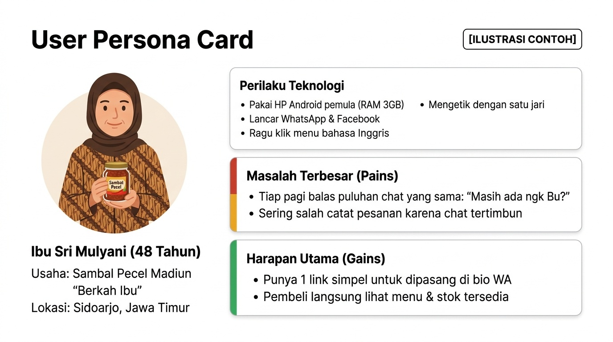

# 03d. Sudut Pandang Pelanggan: Persona Berbasis Riset Nyata & Prioritas Fitur

**Minggu 3: Desain Aplikasi & Bisnis | Sesi 4 (Kamis)**  
**Target Waktu:** 90 - 120 Menit  
**Output Sesi:** Dokumen Persona UMKM (Berbasis Wawancara Nyata) + Daftar Fitur Prioritas *(di-push ke repo squad untuk dipresentasikan saat Daily Standup besok pagi)*

---

## 1. Mengapa Ini Penting?

Bila kamu bertanya ke sembarang orang: *"Kamu mau aplikasi yang seperti apa?"*  
Jawabannya hampir pasti: *"Mau yang serba bisa! Ada game berhadiah, ada live streaming, ada pinjaman modal, ada gratis ongkir!"*

Jika seorang engineer mencoba mengabulkan semua permintaan itu sekaligus:
- Proyek akan macet berbulan-bulan (*scope creep*).
- Aplikasi menjadi terlalu berat dan rumit.
- Produk akhirnya tidak pernah selesai dirilis.

Kunci sukses produk software adalah **fokus tajam pada satu profil pengguna nyata (Persona)** dan **keberanian memprioritaskan fitur mana yang wajib dibangun sekarang vs mana yang ditunda**.

---

## 2. Mengenal User Persona Berbasis Riset Lapangan

**User Persona** adalah representasi ringkas dari sosok pengguna utama yang kita bantu.

> [!IMPORTANT]
> **Aturan Wajib Squad:**  
> Persona yang disusun squad-mu hari ini **wajib berbasis dokumen `catatan-wawancara-squad.md`**, yaitu hasil wawancara UMKM nyata dari sesi `03c`. Jangan mengarang data. Hanya masukkan hal yang **benar-benar terbukti** dari wawancara. Hipotesis yang ternyata salah juga penting: catat sebagai pelajaran, jangan dimasukkan ke persona.

### Dari Mana Isi Persona Diambil?

| Bagian Persona | Sumber di Wawancara `03c` |
|---|---|
| **Profil** (nama/samaran, usia, usaha, lokasi) | Pertanyaan 1 + profil narasumber (patuhi izin nama dan foto) |
| **Perilaku Teknologi** (HP, aplikasi yang dipakai, hal yang bikin ragu) | Pertanyaan 2 dan 5 |
| **Masalah Terbesar (*Pains*)** | Pertanyaan 3 dan 4 + kutipan asli narasumber |
| **Harapan Utama (*Gains*)** | Cerita narasumber soal hal yang ingin lebih mudah (bukan jawaban "ya/bagus" atas ide kita) |

### Contoh Format Persona (Ilustrasi Panduan):



Rincian lengkap *User Persona* di atas:
- **Profil:** Ibu Sri Mulyani (48 Tahun) — Sambal Pecel Madiun *"Berkah Ibu"*, Sidoarjo `[ILUSTRASI CONTOH]`
- **Perilaku Teknologi:** Pakai HP Android kelas pemula (RAM 3GB), lancar WhatsApp & Facebook, ragu klik menu berbahasa Inggris, mengetik layar HP dengan satu jari telunjuk.
- **Masalah Terbesar (*Pains*):** Tiap pagi harus membalas puluhan chat yang sama (*"Masih ada sambal pedas sedang nggak Bu? Harganya?"*) dan sering salah catat pesanan karena chat tertimbun.
- **Harapan Utama (*Gains*):** Punya satu link simpel yang bisa dipasang di bio/info WA sehingga pembeli bisa langsung lihat daftar menu & stok tersedia.

Saat merancang fitur, kamu tidak lagi bertanya: *"Keren nggak ya kalau ditambah fitur X?"*  
Melainkan: *"Apakah pedagang nyata yang kami wawancarai bisa memakai fitur ini dengan mudah?"*

---

## 3. Prioritas Fitur: Analogi Tas Ransel Mendaki Gunung

Bayangkan kamu akan mendaki gunung dengan tas ransel kecil. Kamu tidak bisa membawa kasur, kulkas, dan sofa sekaligus. Kamu harus memilah barang bawaan dengan tegas:

| Kategori | Arti (Analogi Ransel) | Contoh untuk Katalog UMKM |
|---|---|---|
| **1. WAJIB ADA** (*Must*) | Barang mutlak untuk bertahan hidup. Tanpa ini, jangan berangkat! | Menampilkan daftar produk & tombol pesan WA |
| **2. PENTING** (*Should*) | Sangat berguna, tapi masih ada alternatif darurat jika belum ada. | Filter pencarian kategori produk |
| **3. PELENGKAP** (*Could*) | Menambah kenyamanan jika kapasitas tas masih tersisa. | Fitur simpan catatan pesanan otomatis |
| **4. NANTI DULU** (*Won't*) | Jangan dibawa sekarang, tinggalkan di rumah! | Pembayaran kartu kredit, live chat AI |

> [!NOTE]
> **Istilah Tambahan (Opsional):**  
> Kerangka pemilahan prioritas ini dalam manajemen produk dikenal dengan singkatan **MoSCoW** (*Must-have, Should-have, Could-have, Won't-have*).

### Uji Cepat: Wajib Ada atau Nanti Dulu?
Untuk tiap ide fitur, tanyakan tiga hal:
1. **Kalau fitur ini tidak ada, apakah persona kita masih bisa menyelesaikan masalah utamanya?** Kalau masih bisa, berarti bukan "Wajib Ada".
2. **Apakah fitur ini menjawab *Pain* yang terbukti** di wawancara kita, atau hanya terdengar keren?
3. **Apakah squad kita realistis bisa membangunnya** di Bulan 2 dengan waktu yang ada?

---

## 4. Workshop Praktik Squad (60 Menit)

### Tugas 1: Susun 1 Persona Merchant Berdasarkan Wawancara Nyata (20 Menit)
Buka `catatan-wawancara-squad.md` dari sesi `03c`. Susun persona pedagang yang diwawancarai squad-mu (cantumkan nama atau samaran sesuai izin narasumber, usia, jenis usaha, alat teknologi yang dipakai, penderitaan utama, dan kutipan keluhan aslinya). Tambahkan satu catatan singkat: **hipotesis mana yang terbukti dan mana yang ternyata salah**.

### Tugas 2: Pemilahan Fitur Prioritas Platform Tim (30 Menit)
1. Kumpulkan sebanyak mungkin ide fitur untuk katalog UMKM kalian (target ±10 ide).
2. Kelompokkan ke 4 kategori (Wajib Ada, Penting, Pelengkap, Nanti Dulu) memakai **Uji Cepat** di atas. Tulis alasan singkat untuk tiap fitur.
3. **Kunci maksimal 3 fitur "Wajib Ada"** untuk scope rilis pertama di Bulan 2.

   > *Sebagai gambaran, banyak squad memilih: (1) Tampilan Katalog Produk (foto, nama, harga, stok), (2) Form Tambah/Ubah Produk bagi Pedagang, dan (3) Tombol Pemesanan Otomatis ke WhatsApp Penjual.* Ini **hanya contoh**. Pilihan squad-mu harus bisa dijelaskan lewat persona dan hasil wawancara kalian sendiri.

### Tugas 3: Minta AI Mengkritik, Squad yang Memutuskan (10 Menit)
Berikan persona dan daftar fitur "Wajib Ada" ke asisten AI, lalu minta kritik.

> **Template prompt:**  
> *"Ini persona pedagang UMKM kami: [tempel persona]. Ini 3 fitur 'Wajib Ada' untuk versi pertama katalog: [tempel fitur]. Menurutmu, apakah persona ini terlalu generik? Apakah ada fitur yang sebenarnya bisa ditunda? Beri 3 pertanyaan kritis yang harus kami jawab dari hasil wawancara."*

AI hanya memberi sudut pandang. **Keputusan akhir dan alasannya tetap dari squad**, berdasarkan data wawancara.

---

## 5. Output Sesi

*Push* dokumen `persona-dan-prioritas-fitur.md` ke repositori squad (siap dipresentasikan saat **Daily Standup besok pagi**) berisi:
1. Lembar Persona Pedagang UMKM (wajib berbasis `catatan-wawancara-squad.md`), termasuk catatan hipotesis terbukti dan terbantah.
2. Tabel Prioritas Fitur dengan alasan mengapa fitur tertentu masuk kategori Wajib Ada vs Nanti Dulu.
3. Catatan singkat hasil kritik AI: 1 masukan yang dipakai dan 1 yang ditolak, beserta alasannya.

---

## 6. Tugas Mandiri (Individual)

- **Sifat:** Pribadi. Ini **catatan untuk dirimu sendiri** untuk melatih berpikir dari sudut pandang pengguna. Isinya tidak menjadi bahan materi sesi lain.
- **Target Waktu:** 25 menit
- **Nama File:** Simpan di folder pribadimu dalam repo squad dengan nama `tugas_03d.md` (di-*push* untuk dibahas saat Daily Standup besok pagi)

### Instruksi:
1. Baca kembali `catatan-wawancara-squad.md`, lalu ambil 1 poin penderitaan (*pain point*) terbesar dari pedagang yang diwawancarai squad-mu.
2. Tuliskan dalam 1 halaman ringkas:
   - Apa penderitaan tersebut dan bagaimana cara pedagang mengatasinya saat ini?
   - Mengapa penderitaan tersebut kamu masukkan ke dalam kategori fitur **"Wajib Ada"** (atau mengapa menurutmu sebaiknya ditunda)?
   - Berikan 1 usulan desain tombol atau tampilan sederhana yang bisa langsung menghapus rasa sakit tersebut.

### Contoh Hasil yang Diharapkan:
```markdown
# Tugas Mandiri 03d — Analisis Kebutuhan Persona Nyata
> [ILUSTRASI CONTOH — bukan data nyata, jangan disalin]

Nama: [Nama Kamu]
Narasumber: Ibu Marni (Warung Nasi Gurih & Gorengan)

## 1. Penderitaan Utama:
Bu Marni sering menolak pembeli via WhatsApp karena lontong sayur sudah habis dibeli orang yang datang langsung ke warung. Bu Marni tidak sempat mengetik chat pemberitahuan satu per satu.

## 2. Mengapa Ini Fitur "Wajib Ada":
Tanpa fitur penanda stok habis yang jelas di katalog web, pembeli akan terus merasa kecewa karena sudah capek-capek kirim chat pesanan ternyata makanannya sudah ludes.

## 3. Usulan Solusi Antarmuka:
Pada kartu produk lontong sayur, jika stok diubah menjadi 0 di dashboard, kartu otomatis diberi lapisan abu-abu redup dengan tulisan besar merah: "HABIS HARI INI", dan tombol pesan WA otomatis dinonaktifkan sehingga pembeli tahu sebelum mengirim chat.
```

---

## 7. Cek Pemahaman Diri

1. Mengapa seorang engineer dilarang keras mencoba membuat semua fitur yang diminta pengguna sekaligus pada versi awal aplikasinya?
2. Bagaimana profil persona nyata narasumbermu mempengaruhi keputusan pemilihan ukuran tombol di katalog?
3. Sebuah squad menaruh "Live Chat AI" sebagai fitur Wajib Ada. Gunakan **Uji Cepat** untuk menilai: apakah keputusan itu tepat? Berikan alasannya!
4. Mengapa hipotesis yang ternyata **salah** tetap berharga dan sebaiknya dicatat, bukan dimasukkan ke persona?

---

Lanjut ke: **[03e-dari-desain-ke-rencana-fitur.md](03e-dari-desain-ke-rencana-fitur.md)**
