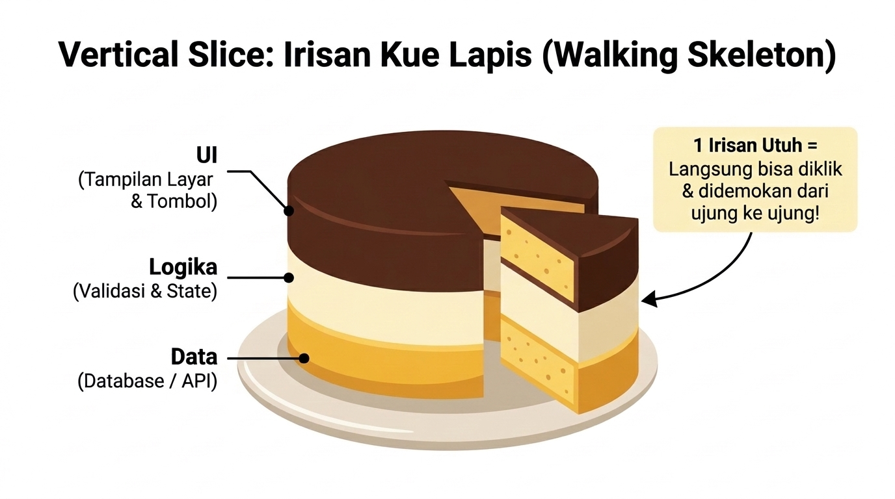

# 03e. Dari Desain ke Rencana Fitur: Menyusun Backlog Siap Bangun

**Minggu 3: Desain Aplikasi & Bisnis | Sesi 5 (Jumat)**  
**Target Waktu:** 90 - 120 Menit  
**Output Sesi:** Draf Rencana Fitur (*Backlog*) Slice 0–2 *(di-push ke repo squad untuk dipresentasikan saat Daily Standup besok pagi)*

---

## 1. Mengapa Ini Penting?

Banyak tim pemula memiliki riset persona nyata (`03d`), wireframe rapi (`03b`), dan ERD lengkap (`02d`), tetapi ketika hari pertama coding tiba di Bulan 2, mereka tetap bingung:
- *"Siapa mengerjakan bagian apa dulu ya?"*
- *"Bikin form tambah produk dulu atau tampilan katalog dulu?"*
- *"Kapan sebuah tugas dianggap benar-benar selesai dan siap dites?"*

Hari ini kita menerjemahkan seluruh artefak desain tersebut menjadi **Daftar Rencana Fitur (*Product Backlog*)** yang dibagi dalam potongan kerja bertahap yang disebut **Slices**.

---

## 2. Cara Kerja "Potongan Vertikal" (Analogi Kue Lapis)

Di kurikulum ini, kita **menghindari metode kerja lama per lapisan horizontal** (bikin database 1 bulan → bikin API/server 1 bulan → bikin UI 1 bulan → pas digabung ternyata error dan tidak cocok semua).

Sebagai gantinya, kita memakai metode **Potongan Vertikal (*Vertical Slicing / Walking Skeleton*)**:
Bayangkan memotong kue lapis dari lapisan atas (cokelat), tengah (krim), sampai lapisan dasar (bolu). Dengan satu irisan tegak lurus, kita langsung bisa mencicipi rasa kuenya secara utuh sejak hari pertama!



Satu irisan vertikal penuh (*Vertical Slice*) mencakup ketiganya sekaligus agar langsung bisa diklik dan didemokan:
1. **Lapisan Atas (UI):** Tampilan kartu produk di layar browser.
2. **Lapisan Tengah (Logika Komponen):** Filter/pemrosesan data & pengelolaan *state*.
3. **Lapisan Bawah (Data):** Sumber data produk (*mock data* di awal, lalu server API).

> [!NOTE]
> **Istilah Tambahan (Opsional):**  
> Fondasi kerangka awal yang ramping tetapi sudah menyambungkan ujung-ke-ujung antarmuka hingga data sering disebut **Walking Skeleton**.

---

## 3. Rumus Menulis Tugas: User Story & Syarat Selesai

Agar pembagian tugas di tim developer jelas dan tidak menimbulkan debat saat *review*:

### 1. Format Cerita Pengguna (*User Story*):
> *"Sebagai **[Peran Pengguna]**, saya ingin **[Aksi / Tindakan]**, sehingga **[Tujuan / Manfaat]**."*

### 2. Format Syarat Selesai (*Acceptance Criteria*):
*Acceptance Criteria* (AC) adalah **checklist pengujian biner (hanya ada jawaban Lulus ✅ atau Gagal ❌)**. Jangan menulis syarat yang mengandalkan selera pribadi (*ambigu*).

| ❌ Contoh AC Ambigu (Jangan Dipakai) | ✅ Contoh AC Terukur & Bisa Dites (Dipakai) |
|---|---|
| *"Tampilan katalog harus bagus dan menarik."* | *"Saat halaman dimuat, tiap kartu menampilkan foto, nama produk, harga format Rupiah, dan jumlah stok."* |
| *"Tombol pesan harus ramah kalau barang habis."* | *"Jika `stok === 0`, kartu menampilkan label `Stok Habis` dan tombol pemesanan berstatus nonaktif (`disabled`)."* |
| *"Form tidak boleh gampang error."* | *"Jika kolom harga diisi angka `<= 0` atau kosong, tombol simpan tidak mengirim data dan muncul pesan error merah di bawah kolom harga."* |

---

## 4. Peta Tahapan Slice Mini Katalog UMKM (Bekal Bulan 2)

Berikut urutan irisan kerja yang akan langsung kalian bangun di Bulan 2 (*TypeScript + React Dasar*):

| # | Tahapan Slice | User Story Inti | Wujud Nyata yang Terlihat |
|---|---|---|---|
| **0** | **Katalog Tampil** | Sebagai pembeli, saya ingin melihat daftar produk UMKM di layar utama agar tahu apa saja yang dijual. | Halaman web menampilkan daftar kartu produk statis rapi dari *mock data* lokal. |
| **1** | **Katalog Sinkron** | Sebagai pembeli, saya ingin data produk diambil otomatis dari server lokal agar stok & harga selalu terbaru. | Kartu produk termuat dari API lokal (`json-server`) lengkap dengan indikator *loading* dan penanganan error. |
| **2** | **Tambah Produk** | Sebagai pedagang, saya ingin memasukkan barang dagangan baru lewat form agar katalog bertambah. | Form tambah produk dengan validasi input; produk baru langsung tersimpan dan muncul di katalog. |
| **3** | **Kelola & Hapus** | Sebagai pedagang, saya ingin memperbarui harga/stok dan menghapus barang lama agar etalase tetap akurat. | Fitur **edit harga & stok langsung di kartu (*inline*)** serta **tombol hapus dengan dialog konfirmasi**. |
| **4** | **Halaman Detail & Navigasi** | Sebagai pembeli, saya ingin membuka halaman khusus per produk lewat URL unik agar bisa membaca info lengkap dengan tenang. | Klik kartu membuka rute `/products/:id` berisi detail lengkap, penanganan error `404` jika produk tidak ada, serta kesiapan tombol lanjut ke WhatsApp penjual. |

---

## 5. Workshop Praktik Squad (60 Menit)

Agar rencana tim fokus tanpa menyusun dokumen berlebihan:

1. **Langkah 1 — Rincikan SLICE 0 Secara Lengkap (30 Menit):**
   - Tuliskan **User Story** lengkap untuk Slice 0.
   - **Tautkan dengan Artefak Sebelumnya:**
     - *Persona & Prioritas (`03d`):* Kebutuhan pedagang/pembeli mana yang dijawab Slice 0 ini?
     - *Wireframe (`03b`) & Aturan UX (`03a`):* Bagian mana dari Wireframe Halaman 1 yang dihidupkan, dan bagaimana aturan kondisi `stok = 0` diterapkan?
     - *ERD (`02d`):* Atribut apa saja dari entitas `PRODUK` yang wajib tampil di kartu?
   - Tuliskan minimal **3 Syarat Selesai (*Acceptance Criteria*)** yang dapat diuji secara biner.
2. **Langkah 2 — Rangkum SLICE 1 dan SLICE 2 (20 Menit):**
   - Untuk masing-masing Slice 1 dan Slice 2, cukup tuliskan **1 User Story** + **2 Acceptance Criteria utama** yang terukur.
3. **Langkah 3 — Audit Ambiguitas dengan AI (10 Menit):**
   - Tempel draf Slice 0–2 ke asisten AI untuk mencari kalimat AC yang masih kabur atau terlalu berat untuk satu slice.
   > **Template prompt:**  
   > *"Ini rencana Slice 0–2 untuk aplikasi Mini Katalog UMKM pemula React: [tempel draf]. Cek apakah ada Acceptance Criteria yang masih ambigu (bukan Ya/Tidak saat dites) atau ada scope fitur yang sebaiknya ditunda ke slice berikutnya."*
   - Gunakan saran yang masuk akal untuk memperjelas kalimat AC squad.

---

## 6. Output Sesi

*Push* dokumen `rencana-fitur-backlog.md` ke repositori squad (siap dipresentasikan saat **Daily Standup besok pagi**) mengikuti struktur berikut:

````markdown
# Backlog Fitur Mini Katalog UMKM — [Nama Squad]

## 1. Spesifikasi Mendalam: Slice 0 (Katalog Tampil)
- **User Story:** Sebagai ..., saya ingin ..., sehingga ...
- **Kaitan Desain & Data:**
  - Persona & Prioritas (`03d`): ...
  - Wireframe & Aturan UX (`03a`/`03b`): Halaman 1 (termasuk aturan stok = 0 ...)
  - Atribut ERD `PRODUK` (`02d`): `nama_produk`, `harga`, `stok`, `url_foto` (sesuaikan dengan ERD squad)
- **Acceptance Criteria (Syarat Selesai):**
  1. [ ] ...
  2. [ ] ...
  3. [ ] ...

## 2. Rangkuman Slice 1 (Katalog Sinkron)
- **User Story:** Sebagai ..., saya ingin ..., sehingga ...
- **Acceptance Criteria Utama:**
  1. [ ] ...
  2. [ ] ...

## 3. Rangkuman Slice 2 (Tambah Produk)
- **User Story:** Sebagai ..., saya ingin ..., sehingga ...
- **Acceptance Criteria Utama:**
  1. [ ] ...
  2. [ ] ...
````

---

## 7. Tugas Mandiri (Individual)

- **Sifat:** Pribadi. Ini **catatan latihan untuk dirimu sendiri** agar terbiasa menulis *User Story* dan *Acceptance Criteria* yang terukur (bukan menjadi bahan/dependensi dokumen squad atau sesi lain).
- **Target Waktu:** 25 menit
- **Nama File:** Simpan di folder pribadimu dalam repo squad dengan nama `tugas_03e.md` *(di-push untuk dibahas saat Daily Standup besok pagi)*

### Instruksi:
1. Sebagai latihan tambahan di luar Slice 0–2 *(fitur ini baru akan dibangun pada fase lanjutan di Bulan 3)*, pilih fitur: **Pencarian Produk Berdasarkan Nama**.
2. Tuliskan 1 kalimat **User Story** lengkap dengan format: *"Sebagai [peran], saya ingin [aksi], sehingga [manfaat]"*.
3. Tuliskan **2 Syarat Selesai (*Acceptance Criteria*)** yang biner (jelas Lulus/Gagal saat diuji di browser) untuk fitur pencarian tersebut.

### Contoh Hasil yang Diharapkan:
```markdown
# Tugas Mandiri 03e — Menulis User Story & Syarat Selesai
> [ILUSTRASI CONTOH — tulis dengan kalimatmu sendiri]

Nama: [Nama Kamu]
Fitur Latihan: Pencarian Produk di Katalog

## 1. User Story:
Sebagai pembeli lokal, saya ingin mengetikkan nama barang di kolom pencarian, sehingga saya bisa langsung menemukan produk yang saya cari tanpa harus men-scroll seluruh halaman katalog.

## 2. Syarat Selesai (Acceptance Criteria):
1. Ketika pembeli mengetikkan kata kunci (misal: "keripik"), kartu produk yang tampil di layar hanya kartu yang namanya mengandung kata "keripik".
2. Jika kata kunci tidak cocok dengan produk mana pun (misal: "sepatu"), sistem menampilkan pesan ramah: "Maaf, produk tidak ditemukan. Coba kata kunci lain."
```

---

## 8. Cek Pemahaman Diri

1. Apa bedanya membagi pekerjaan developer secara **horizontal** (bikin tampilan dulu berbulan-bulan lalu API belakangan) vs secara **vertikal** (*Vertical Slice*)?
2. Mengapa sebuah tugas developer tidak boleh hanya diberi judul *"Bikin Form"* tanpa menuliskan *Acceptance Criteria*?
3. Ubah syarat yang masih ambigu ini menjadi **2 Acceptance Criteria yang terukur (Lulus / Gagal)**:  
   *"Halaman tambah produk harus gampang dipakai dan tidak boleh menerima data yang salah."*

---

Lanjut ke: **[03f-review-dan-evaluasi-minggu3.md](03f-review-dan-evaluasi-minggu3.md)**
