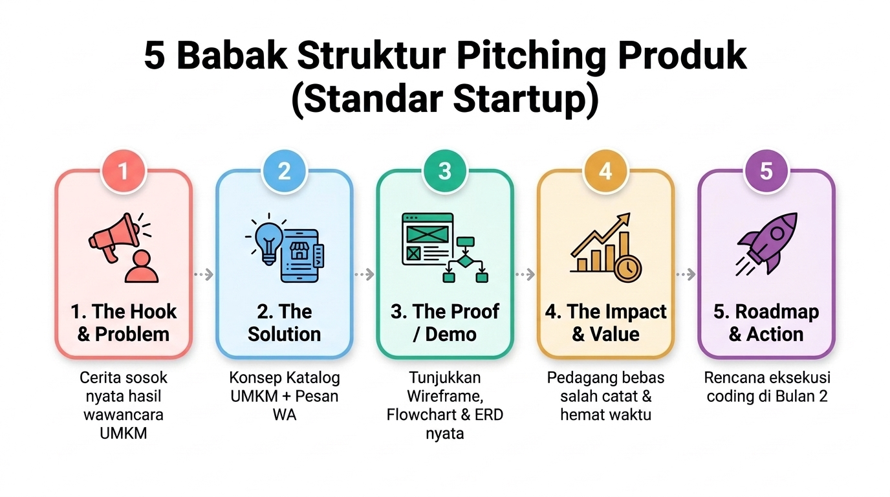

# 04a. Pitching Dasar: Menyampaikan Ide Teknis Secara Memukau

**Minggu 4: Pitching & Showcase | Sesi 1 (Senin)**  
**Target Waktu:** 90 - 120 Menit  
**Output Sesi:** Naskah Pembuka (*The Hook*) 30 Detik + Umpan Balik Pasangan *(di-push ke repo squad untuk dipresentasikan saat Daily Standup besok pagi)*

---

## 1. Mengapa Ini Penting?

Banyak engineer berbakat memiliki ide brilian dan kode yang canggih, namun gagal meyakinkan timnya, gagal mendapatkan dukungan, atau gagal membuat aplikasinya dipakai orang hanya karena satu hal: **mereka tidak bisa menjelaskan nilainya secara sederhana kepada manusia lain**.

Jika kamu hanya bisa berbicara dengan komputer lewat kode, nilaimu sebagai profesional akan terbatas. Namun jika kamu bisa menjembatani antara **masalah manusia nyata** dan **solusi teknologi** melalui komunikasi yang lugas, kamu akan menjadi software engineer yang sangat dihargai.

Hari ini kita membedah formula presentasi produk berstandar startup teknologi.

---

## 2. Struktur Anatomi Pitching yang Kuat

Sebuah presentasi pitch yang efektif selalu mengikuti alur emosional dan logika berikut:



Rincian tiap babak dalam presentasi:
1. **The Hook & The Problem:** Ceritakan satu sosok manusia nyata (*persona* hasil riset wawancara UMKM squad) yang mengalami masalah pedih.
2. **The Solution:** Tunjukkan konsep katalog UMKM + pemesanan WA kita sebagai pemecah masalah yang praktis.
3. **The Proof / Demo:** Bukan sekadar kata-kata; tunjukkan artefak desain (*wireframe* Figma, *flowchart*, dan ERD nyata).
4. **The Impact & Value:** Jelaskan bagaimana hidup pedagang dan pembeli jadi lebih mudah dan bebas salah catat.
5. **Roadmap & Call to Action:** Paparkan apa yang akan langsung dieksekusi tim saat masuk ke Bulan 2 (fase *coding*).

### Formula Menghidupkan Cerita (*The Persona Hook*):
❌ **Jangan Mulai Seperti Ini:**  
> *"Selamat pagi teman-teman, hari ini kami dari Squad 3 ingin mempresentasikan web aplikasi katalog UMKM berbasis React..."* (Membosankan, perhatian penonton langsung buyar).

✅ **Mulailah dengan Cerita Manusia Nyata** *([ILUSTRASI CONTOH — ganti dengan narasumber wawancara squad-mu]):*  
> *"Ini adalah Ibu Marni, pedagang sarapan yang kami wawancarai langsung di dekat tempat tinggal kami. Setiap jam 6 pagi, Bu Marni kerepotan membalas belasan chat WhatsApp dari tetangga yang memesan lontong sayur sambil tangannya memegang wajan penggorengan panas. Sering kali pesanan salah catat dan pembeli kecewa karena makanan sudah ludes dibeli orang yang datang langsung ke warung. Di Indonesia, jutaan pelaku usaha mikro menghadapi kerepotan serupa setiap hari. Karena itulah kami merancang Platform Katalog UMKM..."*

> [!TIP]
> **Jika Ingin Menyebut Angka Statistik di Panggung:**  
> Kalau kamu ingin menyebut angka nasional (misalnya jumlah UMKM di Indonesia), pastikan kamu cek dan catat dulu sumber resminya (seperti Kementerian Koperasi dan UKM atau BPS) sebelum tampil—jangan pernah mengarang angka!

---

## 3. Tiga Kunci Penguasaan Panggung

1. **Bahasa Manusia, Bukan Pamer Jargon:** Jangan katakan *"Kami mengimplementasikan relational database 3NF dengan foreign key constraint..."*. Katakan *"Sistem kami memastikan riwayat pesanan Ibu Marni tidak pernah tercampur atau hilang meskipun daftar menunya bertambah banyak."*
2. **Kontak Mata & Postur Terbuka:** Tatap mata penonton bergantian (kiri, tengah, kanan). Jangan menatap lantai atau terus-menerus membelakangi penonton demi membaca slide.
3. **Mengatasi Gugup (*Nervousness*):** Tarik napas dalam 4 detik, tahan 4 detik, hembuskan 4 detik. Ingat: audiens ingin melihatmu berhasil, mereka bukan musuh yang sedang mengadilimu.

---

## 4. Workshop Praktik Pairing: Latihan Hook 30 Detik (60 Menit)

Latihan hari ini dilakukan secara **berpasangan (pairing)** di dalam squad.

1. **Persiapan Mandiri (10 Menit):**  
   Buka kembali `catatan-wawancara-squad.md` (`03c`) dan `persona-dan-prioritas-fitur.md` (`03d`). Tuliskan 3–4 kalimat pembuka (*Hook*) berdurasi **30 detik pertama** berdasarkan pedagang nyata yang diwawancarai squad-mu (gunakan nama/samaran sesuai izin narasumber).
2. **Putaran 1 (15 Menit):**  
   Peserta A membawakan kalimat pembuka secara live di depan Peserta B (gunakan timer HP). Peserta B mencatat:
   - Apakah masalah pedagang terdengar jelas dan menyentuh?
   - Apakah intonasi bicaranya tegas dan tidak berbisik-bisik?
   - Apakah durasinya pas di kisaran 25–35 detik?
3. **Putaran 2 (15 Menit):**  
   Tukar peran: Peserta B melakukan pitch pembuka, Peserta A memberi feedback.
4. **Iterasi & Putaran Final (20 Menit):**  
   Ulangi sekali lagi dengan menerapkan masukan dari rekan pasangan, lalu pilih versi terbaik untuk draf pembuka squad.

---

## 5. Output Sesi

*Push* dokumen `hook-pembuka-squad.md` ke repositori squad (siap dipresentasikan saat **Daily Standup besok pagi**) berisi naskah pembuka (*The Hook*) berdurasi 30 detik yang paling kuat sebagai bahan Slide 1–2 tim.

---

## 6. Tugas Mandiri (Individual)

- **Sifat:** Pribadi. Ini **catatan latihan untuk dirimu sendiri** agar artikulasi bicaramu semakin matang (bukan menjadi bahan wajib dokumen tim).
- **Target Waktu:** 20 menit
- **Nama File:** Simpan di folder pribadimu dalam repo squad dengan nama `tugas_04a.md` *(di-push untuk dibahas saat Daily Standup besok pagi)*

### Instruksi:
1. Sempurnakan naskah pembuka 30 detik versimu sendiri menjadi teks yang alami saat diucapkan lisan.
2. Rekam dirimu berbicara menggunakan perekam suara HP (*voice note*) dengan stopwatch.
3. Catat di file `tugas_04a.md`:
   - Naskah pembuka finalmu.
   - Durasi waktu riil yang kamu capai (apakah pas di 25–35 detik?).
   - 1 kata atau kalimat yang sempat membuat lidahmu terpeleset saat berlatih, serta cara memperhalusnya.

### Contoh Hasil yang Diharapkan:
```markdown
# Tugas Mandiri 04a — Naskah Pembuka Pitching
> [ILUSTRASI CONTOH — gunakan tokoh hasil wawancara nyata squad-mu]

Nama: [Nama Kamu]

## 1. Naskah Pembuka (The Hook):
"Bayangkan kamu sedang menggoreng tempe panas, lalu HP-mu bergetar sepuluh kali berturut-turut karena pelanggan bertanya: 'Bu, masih ada lontong sayur nggak?'. Inilah kenyataan harian Ibu Marni, pedagang sarapan yang kami wawancarai langsung. Hari ini, kami hadir membawa solusi: sebuah katalog web yang langsung menunjukkan stok tersisa kepada pembeli dan meneruskan pesanan otomatis ke WhatsApp."

## 2. Catatan Latihan Waktu:
- Durasi Latihan 1: 38 detik (terlalu lambat).
- Durasi Latihan 2: 29 detik (pas dan bertenaga!).

## 3. Titik Evaluasi Lidah:
Saya sempat tersendat saat mengucapkan kata 'menunjukkan sisa stok secara live'. Saya ubah menjadi 'menunjukkan stok tersisa secara langsung' agar lebih lancar diucapkan.
```

---

## 7. Cek Pemahaman Diri

1. Mengapa mengawali presentasi dengan cerita satu sosok manusia nyata jauh lebih memikat penonton daripada langsung memaparkan fitur aplikasi?
2. Jika kamu ingin menyebut angka statistik UMKM di Indonesia saat pitching, apa yang wajib kamu lakukan sebelum naik panggung?

---

Lanjut ke: **[04b-ai-untuk-merancang-alur-aplikasi.md](04b-ai-untuk-merancang-alur-aplikasi.md)**
