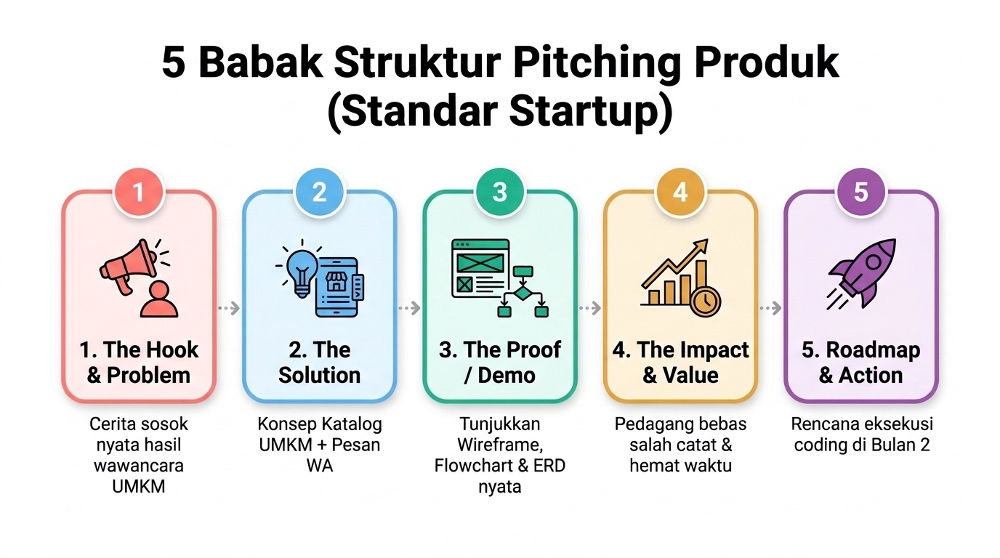

# 04a. Pitching Dasar: Menyampaikan Ide Teknis Secara Memukau

**Minggu 4: Pitching & Showcase | Sesi 1 (Senin)**  
**Target Waktu:** 90 - 120 Menit  
**Output Sesi:** Latihan Hook Pembuka 30 Detik per Murid + Umpan Balik Pasangan

---

## 1. Mengapa Ini Penting?

Banyak engineer berbakat memiliki ide brilian dan kode yang canggih, namun gagal meyakinkan timnya, gagal mendapatkan pendanaan, atau gagal membuat aplikasinya dipakai orang hanya karena satu hal: **mereka tidak bisa menjelaskan nilainya secara sederhana kepada manusia lain**.

Jika kamu hanya bisa berbicara dengan komputer lewat kode, nilaimu sebagai profesional akan terbatas. Namun jika kamu bisa menjembatani antara **masalah manusia nyata** dan **solusi teknologi** melalui komunikasi yang lugas, kamu akan menjadi software engineer yang sangat dicari dan dihargai.

Hari ini kita akan membedah formula presentasi produk berstandar industri startup teknologi.

---

## 2. Struktur Anatomi Pitching yang Kuat

Sebuah presentasi pitch yang efektif selalu mengikuti alur emosional dan logika berikut:



Rincian tiap babak dalam presentasi:
1. **The Hook & The Problem:** Ceritakan satu sosok manusia nyata (*persona* hasil riset UMKM) yang mengalami masalah pedih.
2. **The Solution:** Tunjukkan konsep katalog UMKM + pemesanan WA kita sebagai pemecah masalah yang praktis.
3. **The Proof / Demo:** Bukan sekadar kata-kata; tunjukkan artefak desain (*wireframe*, *flowchart*, dan ERD nyata).
4. **The Impact & Value:** Jelaskan bagaimana hidup pedagang dan pembeli jadi lebih mudah dan bebas salah catat.
5. **Roadmap & Call to Action:** Paparkan apa yang akan langsung dieksekusi tim saat masuk ke Bulan 2 (fase *coding*).

### Formula Menghidupkan Cerita (*The Persona Hook*):
❌ **Jangan Mulai Seperti Ini:**  
> *"Selamat pagi teman-teman, hari ini kami dari Squad 3 ingin mempresentasikan web aplikasi katalog UMKM berbasis React..."* (Membosankan, semua orang langsung membuka HP).

✅ **Mulailah dengan Cerita Manusia Nyata:**  
> *"Ini adalah Ibu Marni, pedagang sarapan yang kami wawancarai langsung di dekat asrama kemarin. Setiap jam 6 pagi, Bu Marni kerepotan membalas belasan chat WhatsApp dari tetangga yang memesan lontong sayur sambil tangannya memegang wajan penggorengan panas. Sering kali pesanan salah catat dan pembeli kecewa karena makanan sudah ludes dibeli orang yang datang langsung ke warung. Jutaan pelaku usaha mikro di Indonesia menghadapi kerepotan yang persis sama setiap hari (cek data resmi Kementerian Koperasi dan UKM / BPS untuk angka statistik terbarunya). Hari ini, kami memperkenalkan Platform Katalog UMKM..."* (Audiens langsung terikat secara emosional dan fokus mendengarkan).

---

## 3. Tiga Kunci Penguasaan Panggung

1. **Bahasa Manusia, Bukan Pamer Jargon:** Jangan katakan *"Kami mengimplementasikan relational database 3NF dengan foreign key constraint..."*. Katakan *"Sistem kami memastikan riwayat pesanan Ibu Marni tidak akan pernah hilang meskipun tokonya berganti nomor HP."*
2. **Kontak Mata & Postur Terbuka:** Tatap mata penonton bergantian (kiri, tengah, kanan). Jangan menatap lantai atau terus-menerus menatap slide di belakangmu.
3. **Mengatasi Gugup (*Nervousness*):** Tarik napas dalam 4 detik, tahan 4 detik, hembuskan 4 detik. Ingat: audiens ingin melihatmu berhasil, mereka bukan musuh yang sedang mengadilimu.

---

## 4. Workshop Praktik Pairing: Latihan Hook 30 Detik (60 Menit)

Latihan hari ini dilakukan secara **berpasangan (pairing)** di dalam squad.

1. **Persiapan Mandiri (10 Menit):**  
   Tuliskan 3–4 kalimat pembuka (*Hook*) berdurasi 30 detik pertama berdasarkan hasil wawancara UMKM nyata yang dilakukan squad-mu di Minggu 3.
2. **Putaran 1 (15 Menit):**  
   Peserta A membawakan kalimat pembuka secara live di depan Peserta B (gunakan timer HP). Peserta B mencatat:
   - Apakah masalah pedagang terdengar jelas dan menyentuh?
   - Apakah intonasi bicaranya tegas dan tidak berbisik-bisik?
3. **Putaran 2 (15 Menit):**  
   Tukar peran: Peserta B melakukan pitch pembuka, Peserta A memberi feedback.
4. **Iterasi & Putaran Final (20 Menit):**  
   Ulangi sekali lagi dengan menerapkan masukan dari rekan pasangan.

---

## 5. Output Sesi

Lembar kerja naskah pembuka pribadi (*The Hook*) berdurasi 30 detik yang siap digabungkan ke dalam naskah slide tim.

---

## 6. Tugas Mandiri (Individual)

- **Sifat:** Individu (dikerjakan sendiri di luar jam kelas)
- **Target Waktu:** 20 menit
- **Nama File:** Simpan di folder pribadimu dalam repo squad dengan nama `tugas_04a.md`

### Instruksi:
1. Sempurnakan naskah pembuka 30 detik pribadimu menjadi teks yang sangat mengalir dan alami saat diucapkan dengan mulut.
2. Rekam dirimu berbicara menggunakan perekam suara HP (voice note) dengan stopwatch.
3. Catat di file `tugas_04a.md`:
   - Naskah pembuka finalmu.
   - Durasi waktu riil yang kamu capai (apakah tepat 25–35 detik?).
   - 1 Kata atau kalimat yang sempat membuat lidahmu terpeleset saat berlatih.

### Contoh Hasil yang Diharapkan:
```markdown
# Tugas Mandiri 04a — Naskah Pembuka Pitching
Nama: [Nama Kamu]

## 1. Naskah Pembuka (The Hook):
"Bayangkan kamu sedang menggoreng tempe panas, lalu HP-mu bergetar sepuluh kali berturut-turut karena pelanggan bertanya: 'Bu, masih ada lontong sayur nggak?'. Inilah kenyataan harian Ibu Marni, pedagang sarapan yang kami wawancarai langsung kemarin. Hari ini, kami hadir membawa solusi: sebuah katalog web yang langsung menunjukkan sisa stok secara live ke pembeli dan meneruskan pesanan otomatis ke WhatsApp."

## 2. Catatan Latihan Waktu:
- Durasi Latihan 1: 38 detik (terlalu lambat).
- Durasi Latihan 2: 29 detik (pas dan bertenaga!).

## 3. Titik Evaluasi Lidah:
Saya sempat tersendat saat mengucapkan kata 'menunjukkan sisa stok secara live'. Saya perhalus menjadi 'menunjukkan stok yang tersisa secara langsung' agar lebih lancar diucapkan.
```

---

## 7. Cek Pemahaman Diri

1. Mengapa mengawali presentasi dengan cerita satu sosok manusia nyata jauh lebih memikat penonton daripada langsung menampilkan diagram data?
2. Mengapa klaim statistik besar (seperti jumlah UMKM di Indonesia) sebaiknya disertai catatan untuk memeriksa sumber data resmi sebelum dipakai?

---

Lanjut ke: **[04b-ai-untuk-merancang-alur-aplikasi.md](04b-ai-untuk-merancang-alur-aplikasi.md)**
