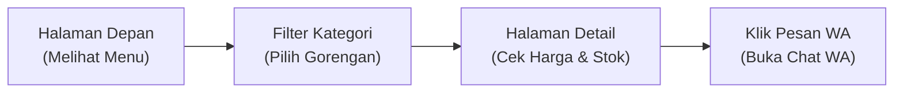

# 04b. AI untuk Merancang Alur Aplikasi: User Flow Pemesanan WhatsApp Tervalidasi

**Minggu 4: Pitching & Showcase | Sesi 2 (Selasa)**  
**Target Waktu:** 90 - 120 Menit  
**Output Sesi:** Dokumen User Flow Tervalidasi Lengkap *(di-push ke repo squad untuk dipresentasikan saat Daily Standup besok pagi)*

---

## 1. Mengapa Ini Penting?

Sebelum memasukkan artefak ke dalam slide pitch deck, kita harus memastikan tidak ada "lubang hitam" dalam pengalaman pengguna aplikasi kita:
- Pengguna masuk dari mana?
- Setelah menekan tombol atau memilih produk, layar apa yang terbuka?
- Bagaimana jika stok produk `0`, atau jika halaman produk yang dibuka ternyata tidak ditemukan?

Kombinasi antara **User Flow** (perjalanan langkah pengguna dari awal sampai akhir) dan **Flowchart Sistem** adalah bukti nyata bahwa rancanganmu matang dan siap dibangun dengan React di Bulan 2.

Hari ini kita memanfaatkan AI untuk melakukan audit uji ketahanan (*stress-test*) terhadap *user flow* aplikasi kita.

---

## 2. Apa Itu User Flow?

Jika *flowchart* berfokus pada **logika mesin** (*"Apakah stok > 0?"*), maka **User Flow** berfokus pada **layar dan tindakan yang dilalui manusia**:



---

## 3. Menggunakan AI untuk Mencari Celah Alur (*Blindspot Audit*)

AI sangat tajam dalam memetakan skenario tak terduga yang sering terlupakan oleh manusia.

### Template Prompt Audit User Flow Alur WhatsApp:
> **[Role]** Bertindaklah sebagai Lead UX Architect & QA Engineer aplikasi web UMKM Indonesia.  
> **[Context]** Kami sedang merancang User Flow untuk Platform Katalog UMKM. Pengguna utama kami adalah pembeli lokal yang memesan produk kuliner/camilan dari pedagang kecil. Pemesanan diteruskan langsung ke WhatsApp penjual tanpa sistem login atau checkout kartu kredit yang rumit.  
> **[Instruction]** Berikut draf alur kami:  
> 1. Pembeli membuka link katalog toko via browser HP.  
> 2. Pembeli menyaring produk atau langsung memilih barang di katalog.  
> 3. Pembeli membuka halaman detail produk (`/products/:id`).  
> 4. Pembeli menekan tombol 'Pesan via WhatsApp'.  
> 5. Sistem memeriksa stok: jika tersedia, sistem merakit pesan otomatis dan membuka aplikasi WhatsApp penjual.  
> **[Constraint]** Berikan 3 skenario kegagalan atau kendala nyata di lapangan (misal: stok tiba-tiba 0, link produk tidak ditemukan/404, atau penjual salah pasang nomor HP) beserta solusi penanganan antarmukanya yang tetap sederhana tanpa login.  
> **[Output]** Sajikan dalam bentuk tabel ringkas: Skenario Kendala, Dampak bagi User, dan Solusi Antarmuka.

> [!IMPORTANT]
> **Aturan Kendali Scope (Jangan Telan Mentah Saran AI):**  
> AI sering menyarankan fitur berat seperti *"tambahkan login OTP"* atau *"integrasikan payment gateway"*. Ingat batas scope MVP kita di Bulan 1–2: **tanpa login rumit dan transaksi diteruskan ke WhatsApp**. Tolak saran AI yang melampaui scope, dan tetap pilih solusi UI yang simpel!

---

## 4. Workshop Praktik Squad (60 Menit)

Setiap squad menyempurnakan **2 Alur Perjalanan Utama**:

### Alur A: Perjalanan Pembeli (*Buyer Journey*)
Dari pertama kali membuka tautan katalog toko → melihat daftar produk → membuka halaman detail (`/products/:id`) → mengecek status stok (termasuk kondisi **Stok = 0** dan kondisi **Produk tidak ditemukan / 404**) → menekan tombol pesan → membuka aplikasi WhatsApp dengan template pesan rapi terisi.

### Alur B: Perjalanan Pedagang (*Merchant Journey*)
*(Scope: Masuk langsung ke dashboard kelola toko tanpa login akun/password yang rumit).*  
Dari pedagang membuka halaman dashboard kelola toko → melihat daftar barang & sisa stok → mengedit harga/stok secara langsung (*inline*) atau menghapus barang dengan konfirmasi → menambah produk baru lewat formulir → melihat perubahan langsung muncul di katalog toko.

### Langkah Pengerjaan Tim:
1. **Langkah 1 — Susun Draf Alur (15 Menit):**  
   Tuliskan urutan langkah Alur A dan Alur B menggunakan sintaks Mermaid (`flowchart LR`).
2. **Langkah 2 — Audit dengan AI (20 Menit):**  
   Jalankan prompt audit di atas untuk mencari titik buntu. Seleksi 3 skenario gagal yang paling masuk akal dan sesuai scope MVP (tolak jika AI mengusulkan fitur di luar scope).
3. **Langkah 3 — Validasi Silang dengan Wireframe, Flowchart, & ERD (25 Menit):**
   - Pastikan setiap langkah di User Flow memiliki layar/tombol pendukung di Figma Wireframe (`03b`).
   - Pastikan data yang dipakai (nomor WhatsApp, nama produk, harga, stok) cocok dengan atribut di ERD (`02d`).

---

## 5. Output Sesi

*Push* dokumen `user-flow-tervalidasi.md` ke repositori squad (siap dipresentasikan saat **Daily Standup besok pagi**) yang memuat:
1. Diagram User Flow Alur A (Pembeli) dan Alur B (Pedagang) menggunakan sintaks Mermaid (`flowchart LR`).
2. Daftar 3 potensi titik buntu yang ditemukan bersama AI beserta solusi antarmuka yang dipilih (plus catatan jika ada saran AI yang ditolak karena di luar scope).
3. Konfirmasi keselarasan silang dengan Wireframe Figma (`03b`) dan ERD (`02d`).

---

## 6. Tugas Mandiri (Individual)

- **Sifat:** Pribadi. Ini **catatan latihan untuk dirimu sendiri** melatih kepekaan QA (*edge-case thinking*), bukan menjadi bahan wajib dokumen tim.
- **Target Waktu:** 20 menit
- **Nama File:** Simpan di folder pribadimu dalam repo squad dengan nama `tugas_04b.md` *(di-push untuk dibahas saat Daily Standup besok pagi)*

### Instruksi:
1. Pikirkan satu skenario gagal yang mungkin dialami pembeli saat menekan tombol *"Pesan via WhatsApp"* (misal: nomor WhatsApp pedagang yang tersimpan salah format, atau stok berubah `0` sesaat sebelum dipesan).
2. Tuliskan dalam 1 halaman ringkas:
   - Apa skenario kendala tersebut?
   - Mengapa kendala itu bisa merusak kepercayaan pembeli?
   - Bagaimana solusi antarmuka atau pesan ramah yang harus ditampilkan aplikasi untuk mencegah/mengatasinya?

### Contoh Hasil yang Diharapkan:
```markdown
# Tugas Mandiri 04b — Antisipasi Kendala Alur WhatsApp
> [ILUSTRASI CONTOH — pilih skenario dan solusimu sendiri]

Nama: [Nama Kamu]

## 1. Skenario Kendala:
Nomor WhatsApp yang dimasukkan pedagang saat mengatur toko tidak lengkap (misal kurang 1 digit atau salah format).

## 2. Dampak bagi Pengguna:
Saat pembeli menekan tombol 'Pesan via WhatsApp', aplikasi WhatsApp menampilkan error: "Nomor telepon tidak terdaftar di WhatsApp". Pembeli bingung dan membatalkan pesanan.

## 3. Solusi Pencegahan Antarmuka:
Pada dashboard saat pedagang memasukkan nomor HP, buat validasi otomatis yang memastikan nomor diawali '08' atau '62', memiliki panjang 10-13 digit, dan sediakan tombol "Uji Coba Kirim Chat ke Nomor Saya" sebelum toko dibagikan ke pembeli.
```

---

## 7. Cek Pemahaman Diri

1. Apa perbedaan fokus antara diagram *User Flow* (langkah manusia) dan *Flowchart Sistem* (logika mesin)?
2. Mengapa saat mengaudit alur dengan AI, squad tetap harus menyaring saran AI terhadap batas *scope* MVP?

---

Lanjut ke: **[04c-menyusun-pitch-deck.md](04c-menyusun-pitch-deck.md)**
