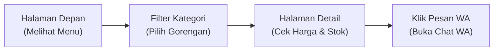

# 04b. AI untuk Merancang Alur Aplikasi: User Flow Pemesanan WhatsApp Tervalidasi

**Minggu 4: Pitching & Showcase | Sesi 2 (Selasa)**  
**Target Waktu:** 90 - 120 Menit  
**Output Sesi:** Dokumen User Flow Terpadu & Flowchart Tervalidasi Lengkap

---

## 1. Mengapa Ini Penting?

Sebelum memasukkan artefak ke dalam slide pitch deck, kita harus memastikan tidak ada "lubang hitam" dalam pengalaman pengguna aplikasi kita:
- Pengguna masuk dari mana?
- Setelah menekan tombol pesan, layar apa yang terbuka?
- Bagaimana alur pedagang saat ingin mengelola produk di dashboard?

Kombinasi antara **User Flow** (perjalanan langkah pengguna dari awal sampai akhir) dan **Flowchart Sistem** adalah bukti otentik bahwa produkmu matang dan siap dibangun dengan React di Bulan 2.

Hari ini kita akan memanfaatkan AI untuk melakukan audit uji ketahanan (*stress-test*) terhadap user flow aplikasi kita.

---

## 2. Apa Itu User Flow?

Jika flowchart berfokus pada **logika mesin** (*"Apakah stok > 0?"*), maka **User Flow** berfokus pada **layar dan tindakan yang dilalui manusia**:



---

## 3. Menggunakan AI untuk Mencari Celah Alur (*Blindspot Audit*)

AI sangat tajam dalam memetakan skenario tak terduga yang sering terlupakan oleh manusia.

### Template Prompt Audit User Flow Alur WhatsApp:
> **[Role]** Bertindaklah sebagai Lead UX Architect & QA Engineer aplikasi web UMKM Indonesia.  
> **[Context]** Kami sedang merancang User Flow untuk Platform Katalog UMKM. Pengguna utama kami adalah pembeli lokal yang memesan produk kuliner/camilan dari pedagang kecil. Pemesanan diteruskan langsung ke WhatsApp penjual tanpa alur checkout kartu yang rumit.  
> **[Instruction]** Berikut draf alur kami:  
> 1. Pembeli membuka link katalog toko via browser HP.  
> 2. Pembeli menyaring produk berdasarkan kategori.  
> 3. Pembeli membuka halaman detail produk.  
> 4. Pembeli menekan tombol 'Pesan via WhatsApp'.  
> 5. Sistem memeriksa stok: jika ada, sistem merakit pesan otomatis dan membuka aplikasi WhatsApp penjual.  
> **[Constraint]** Berikan 3 skenario kegagalan atau kendala nyata di lapangan (misal: penjual salah pasang nomor HP atau pembeli tidak punya aplikasi WA) beserta solusi penanganan antarmukanya.  
> **[Output]** Sajikan dalam bentuk tabel ringkas: Skenario Kendala, Dampak bagi User, dan Solusi Antarmuka.

---

## 4. Workshop Praktik Squad (60 Menit)

Setiap squad menyempurnakan **2 Alur Perjalanan Utama**:

### Alur A: Perjalanan Pembeli (Buyer Journey)
Dari pertama kali membuka tautan katalog toko → melihat daftar produk & filter kategori → membuka halaman detail → mengecek status stok → menekan tombol pesan → membuka aplikasi WhatsApp dengan template pesan rapi terisi.

### Alur B: Perjalanan Pedagang (Merchant Journey)
*(Scope: Masuk langsung ke dashboard kelola toko tanpa login akun/password yang rumit).*  
Dari pedagang membuka halaman dashboard kelola toko → melihat ringkasan daftar barang & sisa stok → mengedit harga atau stok produk → menambah produk baru lewat formulir → melihat perubahan langsung ter-update di katalog toko.

### Langkah Pengerjaan Tim:
1. **Langkah 1 (Susun Draf Alur - 15 Menit):** Tuliskan urutan langkah Alur A dan Alur B di dokumen squad.
2. **Langkah 2 (Audit dengan AI - 20 Menit):** Jalankan prompt audit di atas untuk mencari titik buntu.
3. **Langkah 3 (Validasi Silang dengan Wireframe & ERD - 25 Menit):**
   - Pastikan setiap langkah di User Flow memiliki gambar wireframe pendukung (dari Minggu 3).
   - Pastikan data yang dikirimkan (nomor WhatsApp, nama barang, jumlah pesan) memiliki atribut yang cocok di ERD (dari Minggu 2).

---

## 5. Output Sesi

Dokumen Markdown squad (`user-flow-tervalidasi.md`) yang memuat:
1. Diagram User Flow Alur A (Pembeli) dan Alur B (Pedagang) menggunakan sintaks Mermaid (`graph LR`).
2. Daftar 3 potensi titik buntu yang ditemukan bersama AI beserta solusi antarmuka yang diadopsi.
3. Konfirmasi keselarasan silang dengan Wireframe dan ERD.

---

## 6. Tugas Mandiri (Individual)

- **Sifat:** Individu (dikerjakan sendiri di luar jam kelas)
- **Target Waktu:** 20 menit
- **Nama File:** Simpan di folder pribadimu dalam repo squad dengan nama `tugas_04b.md`

### Instruksi:
1. Pikirkan satu skenario gagal yang mungkin dialami pembeli saat menekan tombol *"Pesan via WhatsApp"* (misal: nomor WhatsApp pedagang yang tersimpan salah atau tidak aktif).
2. Tuliskan dalam 1 halaman ringkas:
   - Apa skenario kendala tersebut?
   - Mengapa kendala itu bisa merusak kepercayaan pembeli?
   - Bagaimana solusi antarmuka atau pesan ramah yang harus ditampilkan aplikasi untuk mengatasi kendala tersebut?

### Contoh Hasil yang Diharapkan:
```markdown
# Tugas Mandiri 04b — Antisipasi Kendala Alur WhatsApp
Nama: [Nama Kamu]

## 1. Skenario Kendala:
Nomor WhatsApp yang dimasukkan pedagang saat mendaftarkan toko tidak lengkap (misal kurang 1 digit atau salah format).

## 2. Dampak bagi Pengguna:
Saat pembeli menekan tombol 'Pesan via WhatsApp', aplikasi WhatsApp menampilkan error: "Nomor telepon tidak terdaftar di WhatsApp". Pembeli bingung dan membatalkan pesanan.

## 3. Solusi Pencegahan Antarmuka:
Pada dashboard saat pedagang memasukkan nomor HP, buat validasi otomatis yang memastikan nomor diawali '08' atau '+62', memiliki panjang minimal 10-13 digit, dan sediakan tombol "Uji Coba Kirim Chat ke Nomor Saya Sendiri" sebelum toko dipublikasikan secara live.
```

---

## 7. Cek Pemahaman Diri

1. Apa perbedaan fokus antara diagram *User Flow* (langkah manusia) dan *Flowchart Sistem* (logika mesin)?
2. Mengapa alur masuk ke dashboard toko di Bulan 1 disederhanakan tanpa sistem login password yang rumit?

---

Lanjut ke: **[04c-menyusun-pitch-deck.md](04c-menyusun-pitch-deck.md)**
