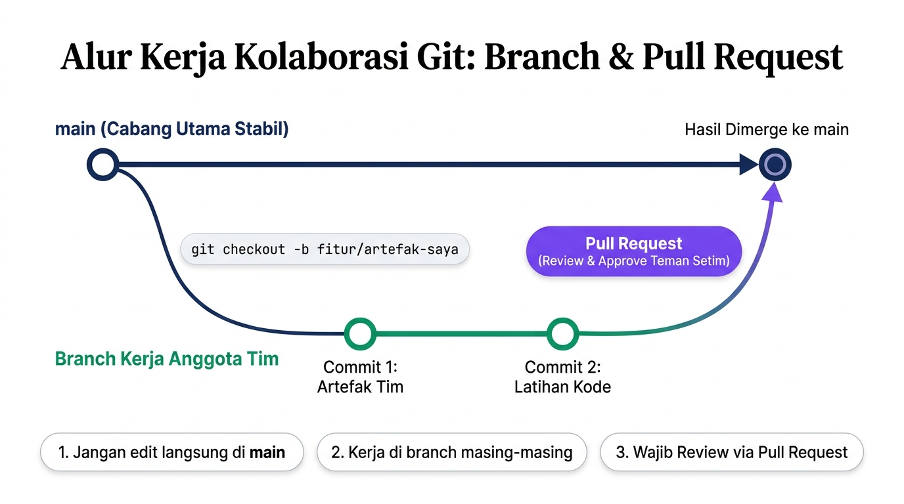

# 04e. Git untuk Mengelola Artefak: Membiasakan Workflow Kolaborasi

**Minggu 4: Pitching & Showcase | Sesi 5 (Jumat)**  
**Target Waktu:** 90 - 120 Menit  
**Output Sesi:** Repositori GitHub Squad Rapi & Terverifikasi *(di-push ke repo squad siap dipresentasikan saat Daily Standup / Showcase)*

---

## 1. Mengapa Ini Penting?

Banyak orang mengira Git hanya digunakan untuk menyimpan kode program. Ini salah kaprah!

Di tim rekayasa modern, **semua aset proyek dikelola dengan Version Control (Git)**:
- Spesifikasi produk dan rencana fitur (*Product Backlog*).
- Diagram alur dan model data (file Markdown & Mermaid).
- Catatan riset wawancara pengguna, ekspor wireframe, dan slide presentasi.

Kamu sudah mempelajari dasar-dasar Git pada **2 bulan pre-program sebelumnya**. Oleh karena itu, hari ini kita tidak mengulang teori perintah dasar dari nol, melainkan langsung mempraktikkan **alur kolaborasi tim profesional**: bekerja di cabang terpisah (*branch*), menulis pesan commit yang informatif, membuat *Pull Request (PR)*, dan saling mereview sebelum digabungkan ke cabang utama (*main*).

Hari ini kita memastikan **seluruh artefak tim serta latihan kode JS dan HTML/CSS dari Bulan 1** tersusun rapi dan bersih di repositori GitHub squad kalian sebelum Showcase besok.

---

## 2. Alur Kerja Kolaborasi Git: Branch & Pull Request



### Urutan Langkah di Atas:
1. Mulai dari cabang stabil (`main`), buat cabang kerja baru dengan `git checkout -b fitur/...`.
2. Simpan kemajuan tugasmu secara bertahap lewat `commit` di cabang kerja tersebut.
3. Ajukan **Pull Request (PR)** agar rekan squad me-review hasil kerjamu sebelum digabungkan (*merge*) ke `main`.

### Tiga Aturan Wajib Tim:
1. **Jangan bekerja langsung di `main`:** Cabang `main` adalah etalase resmi tim yang harus selalu bersih dan rapi.
2. **Satu tugas/orang, satu *branch*:** Setiap anggota membuat branch sendiri saat mengunggah atau merapikan berkas.
3. **Review dulu lewat *Pull Request*:** Rekan setim memeriksa kelengkapan dokumen atau kode yang diajukan, menyetujui (*Approve*), lalu me-*merge* ke `main`.

---

## 3. Struktur Standar Repositori Squad Bulan 1

Pastikan repositori bersama squad di GitHub (`katalog-umkm-pra-coding-squad-[X]`) memiliki susunan folder rapi yang selaras dengan nama dokumen dari Minggu 1 sampai Minggu 4:

```text
katalog-umkm-pra-coding/
├── README.md                          # Profil proyek, nama anggota squad, link Figma & slide
│
├── 1-ai-literacy/
│   ├── piagam-etika.md                # Piagam etika AI squad (01a)
│   ├── lembar-analisis-masalah.md     # Analisis masalah & sparring AI (01b)
│   ├── prompt-cheat-sheet.md          # Formula R-C-I-C-O & 3 prompt teruji (01c)
│   └── studi-kasus-umkm-asumsi.md     # Draf solusi UMKM berbasis asumsi (01d)
│
├── 2-computational-thinking/
│   ├── dekomposisi-dan-pseudocode.md  # 4 Pilar CT & Pseudocode Diskon/Ongkir (02a-02b)
│   ├── flowchart-sistem.md            # Flowchart Pemesanan WA & Tambah Produk (02c)
│   ├── erd-model-data.md              # ERD (ItemPesanan & data pembeli) (02d)
│   ├── blueprint-terpadu.md           # Blueprint hasil audit terpadu (02e)
│   └── latihan-kode-diskon.js         # JEMBATAN KODE: Fungsi JS Minggu 2 (02b)
│
├── 3-desain-dan-bisnis/
│   ├── audit-ux-squad.md              # Tabel audit UX & 3 aturan UX wajib (03a)
│   ├── wireframe-squad.md             # Link Figma & catatan alur interaksi (03b)
│   ├── wireframe/                     # Ekspor PNG wireframe 3 halaman dari Figma (03b)
│   ├── value-proposition-squad.md     # Peta masalah vs solusi (03c)
│   ├── catatan-wawancara-squad.md     # Hasil wawancara 1 UMKM nyata (03c)
│   ├── persona-dan-prioritas-fitur.md # Persona nyata & prioritas MoSCoW (03d)
│   ├── rencana-fitur-backlog.md       # Backlog Slice 0-2 & Acceptance Criteria (03e)
│   └── wireframe-statis.html          # JEMBATAN KODE: Kartu HTML/CSS Minggu 3 (03b)
│
├── 4-pitching/
│   ├── script-pitch-squad.md          # Script pitch deck full 5 babak (04a)
│   ├── user-flow-tervalidasi.md       # Diagram User Flow tervalidasi AI (04b)
│   ├── catatan-gladi-resik.md         # Evaluasi waktu & masukan I Like/Wish/What If (04d)
│   └── pitch-deck-final.pdf           # File PDF atau link slide 7 halaman (04c)
│
└── tugas-mandiri/                     # Folder catatan belajar pribadi masing-masing siswa
    ├── [nama-murid-1]/                # Catatan pribadi siswa (tugas_01a.md s/d tugas_04e.md)
    ├── [nama-murid-2]/
    ├── [nama-murid-3]/
    └── [nama-murid-4]/
```

*(Catatan: `tugas-mandiri/` adalah folder catatan pribadi masing-masing anggota di repositori, bukan artefak produk utama tim.)*

---

## 4. Perintah Cepat Alur Branch & Pull Request

```bash
# 1. Pastikan repo lokal terhubung dan update dengan main terbaru
git checkout main
git pull origin main

# 2. Buat branch kerja baru
git checkout -b rapikan-artefak-[nama-kamu]

# 3. Masukkan file artefak tim atau latihan kode ke folder yang tepat
# Contoh: menambahkan latihan kode JS dan merapikan folder Minggu 2
git add 2-computational-thinking/

# 4. Buat commit dengan pesan yang jelas
git commit -m "docs: rapikan artefak minggu 2 dan tambah latihan-kode-diskon.js"

# 5. Push branch kerja ke GitHub
git push origin rapikan-artefak-[nama-kamu]
```

Setelah push berhasil:
1. Buka repositori tim di web GitHub.
2. Klik tombol hijau **Compare & pull request**.
3. Tuliskan deskripsi singkat file apa saja yang kamu rapikan atau tambahkan.
4. Minta rekan se-squad untuk mereview dan mengklik tombol **Merge pull request**.

---

## 5. Workshop Praktik Squad (60 Menit)

1. **Langkah 1 — Audit & Bagi Folder per Anggota (10 Menit):**
   Periksa repo squad kalian: dokumen mana yang belum rapi atau masih di folder acak? Bagi 4 folder untuk **4 anggota squad**:
   - Anggota 1: Merapikan & mengunggah folder `1-ai-literacy/`.
   - Anggota 2: Merapikan & mengunggah folder `2-computational-thinking/` (termasuk `latihan-kode-diskon.js`).
   - Anggota 3: Merapikan & mengunggah folder `3-desain-dan-bisnis/` (termasuk `wireframe/`, `catatan-wawancara-squad.md`, dan `wireframe-statis.html`).
   - Anggota 4: Merapikan & mengunggah folder `4-pitching/` (`script-pitch-squad.md`, `user-flow-tervalidasi.md`, `catatan-gladi-resik.md`, `pitch-deck-final.pdf`/link).
   - Masing-masing anggota juga memastikan folder catatan pribadinya di `tugas-mandiri/[nama]/` sudah rapi.
2. **Langkah 2 — Eksekusi Branch & PR Paralel (35 Menit):**  
   Setiap anggota bekerja di branch masing-masing (di folder yang berbeda agar tidak bentrok!), push ke GitHub, dan buat *Pull Request*. Anggota lain mereview sebelum di-*merge* ke `main`.
3. **Langkah 3 — Sempurnakan `README.md` Utama (15 Menit):**  
   **Setelah semua PR pada Langkah 2 selesai di-merge ke `main`**, **satu orang perwakilan** menarik `git pull origin main` lalu membuat branch khusus untuk memperbarui `README.md` (memuat nama platform, nama anggota squad, tautan Figma, tautan slide deck, serta ringkasan struktur repo), lalu di-PR dan merge terakhir. *(Cara ini mencegah merge conflict saat mengedit file yang sama!)*

---

## 6. Output Sesi

*Push* seluruh perubahan hingga cabang `main` **Repositori GitHub Squad** bersih dan lengkap (siap ditampilkan tautannya di Slide 7 atau saat **Showcase besok pagi**), memuat seluruh artefak tim Minggu 1–4 serta kode latihan JS & HTML/CSS.

---

## 7. Tugas Mandiri (Individual)

- **Sifat:** Pribadi. Ini **catatan pengecekan pribadi** agar kamu terbiasa memeriksa riwayat PR dan memastikan branch `main` bersih (bukan bahan wajib untuk presentasi).
- **Target Waktu:** 25 menit
- **Nama File:** Simpan di folder pribadimu dalam repo squad dengan nama `tugas_04e.md` *(di-push untuk dibahas saat Daily Standup besok pagi)*

### Instruksi:
1. Pastikan branch kerjamu di GitHub sudah berhasil di-merge ke branch `main`.
2. Buka riwayat *Pull Request* (*Closed PRs*) dan *commits history* repositori tim di browser.
3. Catat di file `tugas_04e.md`:
   - Tautan URL Pull Request (PR) yang kamu buat hari ini.
   - Siapa rekan se-squad yang mereview dan meng-approve PR-mu.
   - Konfirmasi bahwa file latihan kode (`latihan-kode-diskon.js` atau `wireframe-statis.html`) dan artefak bagianmu sudah masuk rapi di dalam branch `main`.

### Contoh Hasil yang Diharapkan:
```markdown
# Tugas Mandiri 04e — Verifikasi Commit & Pull Request
> [ILUSTRASI CONTOH — isi dengan tautan PR nyatamu]

Nama: [Nama Kamu]
Squad: Squad 3

## 1. Bukti Tautan Pull Request:
- URL PR: https://github.com/tribe-umkm/katalog-umkm-pra-coding-squad-3/pull/2
- Judul PR: "docs: rapikan artefak minggu 3 dan tambah wireframe-statis.html"
- Di-review dan di-merge oleh: [Nama Rekan Squad]

## 2. Konfirmasi File di Branch main:
- [x] File `wireframe-statis.html` dan `catatan-wawancara-squad.md` sudah ada di folder `3-desain-dan-bisnis/` di branch main.
- [x] Folder pribadi saya di `tugas-mandiri/[nama-saya]/` sudah rapi.
```

---

## 8. Cek Pemahaman Diri

1. Mengapa bekerja di *branch* terpisah dan membagi folder per anggota jauh lebih aman daripada semua orang langsung mengedit `README.md` bersamaan di branch `main`?
2. Mengapa artefak desain (ekspor Figma, ERD, backlog) penting disimpan di Git bersama dengan kode aplikasi?

---

Lanjut ke: **[04f-showcase-pitch-day.md](04f-showcase-pitch-day.md)**
