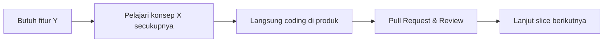

# 0.1 Tentang Modul Ini

## Cara belajar di program ini berbeda dari kelas biasa

Kalau di sekolah biasanya teori ditumpuk dulu baru ujian, di sini kita belajar berbasis kebutuhan produk nyata (*Product-Driven Learning*):

**Produk latihan yang kita bangun bertahap:** **Mini Katalog UMKM** — aplikasi untuk menampilkan, mencari, menambah, mengedit, dan menghapus produk jualan UMKM. Produk ini hidup sejak hari pertama, dan tumbuh sedikit demi sedikit lewat potongan kerjaan kecil yang kita sebut **slice**.

> [!NOTE]
> **Hubungan dengan Rancangan Bulan 1:**  
> Di Bulan 1 kalian sudah merancang **Katalog & Dashboard Penjual (*Must-Have*)** beserta ide lanjutan seperti **Built-in WhatsApp (WAHA), Automation Chatbot, dan Integrasi Ekspedisi (*Could-Have*)**.  
> Pada Bulan 2–3, kita fokus mematangkan inti **Must-Have (Katalog & Kelola Produk)** di frontend React + mock API terlebih dahulu. Fitur lanjutan (*Could-Have*) baru akan masuk ke backlog produk asli setelah fondasi backend NestJS & PostgreSQL selesai di Bulan 4 ke atas.

## Apa itu "slice"?

Satu **slice** = satu potongan kerja vertikal kecil yang langsung bisa dicoba dan dilihat hasilnya di browser, dari tampilan (*UI*) sampai ke *data*. Bukan belajar semua teori React dulu baru membuat produk di akhir bulan.

Modul ini mencakup dua bulan pembelajaran frontend:
- **Bulan 2 (`1-TypeScript-React-Dasar`):** Slice 0–4 (*Mini Katalog UMKM v1*)
- **Bulan 3 (`2-React-Lanjutan`):** Slice 5–8 (*Mini Katalog UMKM v2*)

### Peta Lengkap Slice 0–8

| # | Bulan | Slice | Isinya |
|---|---|---|---|
| **0** | Bulan 2 | **Katalog tampil** | Daftar produk muncul di halaman dari data statis |
| **1** | Bulan 2 | **Katalog dari API** | Data diambil dari mock API (`json-server`), lengkap dengan loading & error |
| **2** | Bulan 2 | **Tambah produk** | Form terkendali untuk menambah produk baru (`POST`) |
| **3** | Bulan 2 | **Edit & hapus** | Edit harga/stok langsung di kartu (`PATCH`) & hapus dengan konfirmasi (`DELETE`) |
| **4** | Bulan 2 | **Halaman detail** | Klik produk → pindah ke URL `/products/:id` + penanganan 404 |
| **5** | Bulan 3 | **Kategori, Tailwind & Custom Hook** | Tampilan baru Tailwind CSS v4, relasi kategori, & ekstraksi `useProducts` |
| **6** | Bulan 3 | **Validasi & Global Toast** | Validasi input murni & notifikasi mengambang berbasis Context API |
| **7** | Bulan 3 | **Cari, Filter, Urutkan & Pagination** | Query server-side, debounce input, & state tersimpan di URL (`useSearchParams`) |
| **8** | Bulan 3 | **Responsif, Kontrak API & Showcase** | Tampilan mobile-first UMKM, dokumen `docs/kontrak-api.md` untuk backend Bulan 4 |

Tiap slice, alurnya tetap sama: baca konsep singkat → coba kode → commit → **Pull Request (PR)** → direview teman → revisi kalau ada masukan → merge → tunjukkan hasilnya (demo kecil).

## Kenapa harus tahu ini dari awal

Supaya kamu tidak bingung kenapa "belum belajar semua React" tapi sudah disuruh bikin form atau routing. Memang begitu maksudnya — kita belajar sambil membangun produk, bukan menghafal dokumentasi terlebih dahulu.

## Sebelum lanjut

Pastikan bekal ini siap:
- **Bulan 1 — Fondasi Pra-Coding** (`1-modul-pra-coding-bulan1`): Computational Thinking, AI Literacy, Wireframe Figma & UX, Value Proposition Canvas, dan kolaborasi Git.
- **Pre-program 2 Bulan**: HTML, CSS, Git/GitHub, dan JavaScript modern (termasuk `fetch` dan `async/await`).
- Kalau ada bagian pre-program yang masih samar (terutama `fetch`, `Promise`, dan `async/await`), bilang ke mentor atau pasangan pairingmu **sekarang**. Rujukan modul React (`modul-react-programmer-pit-master`) juga bisa dibuka kapan saja saat kelas.

---

Lanjut ke: **[02-setup-starter.md](02-setup-starter.md)**
