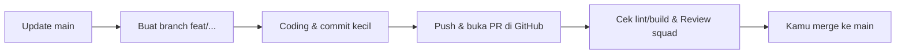

# 0.3 Alur Git & Pull Request

Kamu sudah mempraktikkan alur branch dan PR untuk dokumen desain pada Bulan 1 (`04e`). Di sini kita terapkan alur kerja tim yang sama untuk **kode React & TypeScript**: **update `main` → branch → coding & commit → cek manual lint/build → Pull Request (PR) → review → merge**.

## Kenapa tidak langsung push ke `main`

Cabang `main` harus selalu dalam kondisi bisa dijalankan (*buildable*). Kalau semua perubahan langsung di-push ke `main`, bug mudah masuk dan sulit melacak sumber error-nya. Solusinya: selalu bekerja di **branch baru**, baru digabung ke `main` lewat PR setelah dicek dan direview.

## Alur lengkap



Langkah perintah di terminal:
1. `git checkout main && git pull origin main` *(pastikan berangkat dari `main` terbaru)*
2. `git checkout -b feat/nama-slice` *(buat branch baru)*
3. Kerjakan potongan fitur kecil, lalu jalankan `npm run lint` dan `npm run build`
4. `git add . && git commit -m "feat: pesan singkat & jelas"`
5. `git push -u origin feat/nama-slice`
6. Buka **Pull Request** ke `main` di **GitHub**
7. Minta **1 rekan squad / pasangan pairing** mereview PR-mu
8. Jika ada komentar perbaikan → revisi di branch yang sama → commit & push lagi *(PR otomatis ikut terbarui)*
9. Setelah di-approve → **KAMU sendiri yang menekan tombol Merge** di GitHub

> [!NOTE]
> **Mengapa sekarang pembuat PR yang menekan Merge?**  
> Di Bulan 1 (saat masih mengelola dokumen awal), rekanmu membantu menekan merge. Mulai fase coding di Bulan 2, **pembuat PR sendiri yang melakukan merge setelah di-approve** — supaya kamu bertanggung jawab mengecek kondisi akhir branch (lint, build, dan conflict) sebelum masuk ke `main`.

## Penamaan branch & pesan commit

Gunakan konvensi penamaan yang rapi dan seragam di seluruh tribe:
- **Nama branch:** `feat/slice-0-katalog-tampil`, `fix/harga-negatif`, `docs/readme-cara-jalan`
- **Awalan pesan commit:**
  - `feat:` untuk fitur atau slice baru (contoh: `feat: tampilkan daftar produk slice 0`)
  - `fix:` untuk perbaikan bug (contoh: `fix: cegah input harga bernilai negatif`)
  - `docs:` untuk catatan atau dokumentasi (contoh: `docs: tambah catatan tugas 01a`)

## Isi Pull Request (Template Wajib 3 Pertanyaan)

Saat membuat PR di GitHub (atau membuat `.github/pull_request_template.md` di repo proyekmu), biasakan mengisi 3 hal ini secara jujur:
1. **Apa yang dibuat?**
2. **Cara mencobanya?**
3. **Bagian mana yang masih bikin bingung / minta perhatian reviewer?**

Pertanyaan ketiga **bukan tanda kamu gagal** — justru bagian paling berguna agar reviewer langsung fokus membantu bagian yang masih meragukan.

## Checklist review wajib (Pembuat PR & Reviewer)

Karena proyek latihanmu **belum memakai CI otomatis di GitHub**, pengecekan kualitas dilakukan secara **manual di terminal** sebelum PR di-merge:
- [ ] Kode bisa dijalankan di browser sesuai *"Cara mencobanya"* di deskripsi PR
- [ ] `npm run build` dan `npm run lint` lolos **tanpa error** di terminal lokal
- [ ] Nama variabel (`camelCase`), tipe/komponen (`PascalCase`), dan field API (`snake_case`) konsisten
- [ ] Ada penanganan untuk kondisi loading, data kosong, atau error (jika slice memanggil API)

Komentar review ditulis **spesifik dan sopan**:
- ❌ *"Kodenya jelek."*
- ✅ *"Bagian `handleSubmit` ini bisa dipecah jadi fungsi validasi terpisah biar lebih mudah dibaca — mau coba?"*

## PR kecil itu wajib, bukan saran

Target: reviewer bisa membaca PR-mu dalam **±15 menit**. Pecah per slice atau per unit belajar agar perubahan tidak menumpuk ratusan baris sekaligus.

## Kalau ada conflict

Conflict artinya ada perubahan yang bertumpuk di baris file yang sama. Ini normal di kerja tim. Selesaikan **di branch-mu sendiri** dengan perintah yang aman:
```bash
git fetch origin
git merge origin/main
```
Perbaiki bagian yang ditandai conflict di VS Code, jalankan ulang `npm run lint` dan `npm run build`, lalu commit dan push kembali.

## Cek pemahaman

1. Mengapa pembuat PR (bukan reviewer) yang bertanggung jawab menekan tombol *Merge* setelah di-approve?
2. Mengapa kamu tetap harus menjalankan `npm run lint` dan `npm run build` secara manual sebelum PR di-merge?
3. Apa yang terjadi kalau kamu push commit baru ke branch yang PR-nya sudah terbuka di GitHub?

---

Lanjut ke: **[04-format-minta-bantuan.md](04-format-minta-bantuan.md)**
