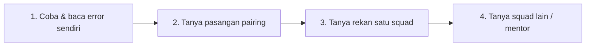

# 0.4 Format Minta Bantuan

Di tim software, minta bantuan itu **skill**, bukan tanda lemah. Yang bikin beda: cara memintanya agar rekan atau mentor bisa langsung membantumu dalam hitungan detik.

## Format 4 Poin

```text
Aku mau ...       (apa yang ingin dicapai)
Sudah coba ...    (apa yang sudah dicoba)
Hasilnya ...      (apa yang terjadi — sertakan pesan error lengkap, bukan "error aja")
Dugaanku ...      (menurutmu kira-kira kenapa, meski tebakan salah tidak masalah)
```

**Contoh buruk:** *"eh kok error ya, tolong dong"*

**Contoh baik:**
```text
Aku mau: menampilkan nama produk di kartu.
Sudah coba: pakai {product.name} di JSX.
Hasilnya: muncul error "Cannot read properties of undefined (reading 'name')" di console.
Dugaanku: mungkin product-nya belum ada isinya pas komponen pertama kali render?
```

Yang kedua bisa langsung dibantu seketika. Yang pertama memaksa penolong bertanya balik berkali-kali.

## Urutan minta bantuan

Kalau kamu macet lebih dari **15–20 menit** pada error yang sama:



*(Catatan: Mulai Bulan 4 nanti, akan ada **Chapter** lintas squad sebagai jalur bantuan teknis tambahan sebelum ke mentor.)*

Jangan langsung memanggil mentor sebelum melewati langkah 1–3 — bukan soal aturan kaku, tetapi karena proses membaca error dan berdiskusi dengan pasangan adalah bagian inti dari belajar *debugging*.

## Langkah Debug Clinic (Sebelum Memanggil Bantuan)

Kalau macetnya soal bug atau error di kode:
1. Baca pesan error di terminal atau Console browser **kata per kata** (jangan langsung panik).
2. Buka **nama file dan nomor baris** yang disebut oleh pesan error.
3. Gunakan `console.log(...)` pada variabel yang dicurigai tepat sebelum baris error tersebut.
4. Kalau masih buntu — barulah minta bantuan menggunakan **Format 4 Poin** di atas beserta hasil temuanmu dari langkah 1–3.

## Cek pemahaman

- Kalau kamu mengalami error dan meminta bantuan tanpa menyertakan pesan error lengkap maupun langkah yang sudah dicoba, kendala apa yang terjadi?

---

**Kamu sudah siap!** Lanjut ke Bulan 2: **[01a-orientasi-react.md](../1-TypeScript-React-Dasar/01a-orientasi-react.md)**
