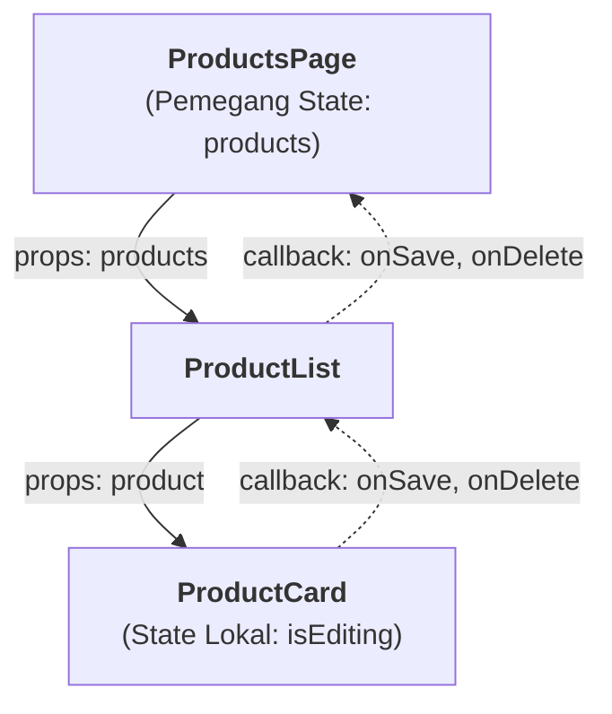

# 3.0c State Management Patterns — Lifting State & Alur Data

## Tujuan Sesi Ini

Merapikan pemahaman arsitektur data aplikasi Katalog: **di mana sebuah state seharusnya diletakkan**, **kapan sebuah state harus diangkat ke komponen induk (*Lifting State Up*)**, dan memahami filosofi **alur data satu arah (*one-way data flow*)** di React.

> Ini adalah sesi refleksi dan konsolidasi arsitektur dari apa yang telah kamu bangun di Slice 0 sampai Slice 3. Tidak ada penambahan fitur baru di Katalog hari ini — kita memperkokoh fondasi berpikir sebelum melangkah ke routing multi-halaman.

---

## Aktivitas Terbimbing di Kelas (Blok 1 — Mini-Lesson ±25 Menit + Diskusi Arsitektur)

Mentor akan memandu diskusi diagram di papan tulis:
- Konsep *Lifting State Up*: mengangkat state saat dua atau lebih komponen bersaudara (*siblings*) membutuhkan data yang sama.
- Filosofi *One-Way Data Flow* (Alur Data Satu Arah): data mengalir ke bawah lewat props, pemberitahuan aksi mengalir ke atas lewat callback.
- Aturan emas meletakkan state: letakkan di level komponen terendah yang masih mencakup semua pihak yang membutuhkan data tersebut.
- Sekilas tentang mengapa aplikasi kita belum membutuhkan `useReducer` atau Context API yang rumit di Bulan 2.

*(Bahan bacaan pendalaman opsional: Modul React Bootcamp Bab 2.5 tentang State Management Lanjutan).*

---

## Ringkasan Konsep Kunci & Analogi

### 1. Apa itu Lifting State Up?

> **Analogi Papan Jadwal di Pintu Kulkas:**  
> Bayangkan sebuah keluarga dengan dua anak (Adik dan Kakak).  
> Jika Kakak menyimpan jadwal les di buku pribadinya di dalam kamar, Adik dan Orang Tua tidak bisa melihat jadwal tersebut. Jika Adik ingin tahu kapan Kakak senggang, ia tidak bisa mengaksesnya.  
> **Solusinya (Lifting State):** Jadwal les diangkat dan ditempel di **pintu kulkas di ruang tengah (komponen induk/parent)**.  
> Sekarang, seluruh anggota keluarga bisa melihat jadwal (data props mengalir ke anak-anak), dan jika Kakak punya jadwal baru, ia melapor ke Orang Tua untuk mencatatnya di pintu kulkas (fungsi callback naik ke induk).

### 2. Alur Data Satu Arah (One-Way Data Flow)

React mengadopsi prinsip air terjun:



1. **Turun ke Bawah (Top-Down):** Data produk hanya mengalir dari atas ke bawah melalui **props**.
2. **Naik ke Atas (Bottom-Up):** Ketika user mengeklik tombol "Hapus" atau "Simpan" di kartu paling bawah, anak tidak boleh mengubah data induk secara lancang. Anak hanya **memanggil fungsi callback** yang diberikan oleh induk (`onDelete(id)`). Induklah yang berhak mengubah state-nya sendiri.

---

## Tabel Keputusan: Di Mana State Seharusnya Berada?

| Nama Variabel State | Komponen Tempat Tinggal | Alasan Arsitektur |
|---|---|---|
| `products` (daftar array) | `ProductsPage` | Dibutuhkan bersama oleh `ProductList` (untuk ditampilkan) dan `ProductForm` (untuk disisipi produk baru). |
| `isLoading` & `errorMessage` | `ProductsPage` | Terkait erat dengan siklus hidup pemanggilan API katalog secara keseluruhan. |
| `isEditing` (boolean) | `ProductCard` | Hanya relevan untuk satu kartu tertentu. Tidak boleh diketahui atau mengganggu kartu tetangganya. |
| `values` (isi teks form) | `ProductForm` | Bersifat sementara selama pengguna mengetik di form tersebut. Induk tidak perlu tahu huruf per huruf sebelum form disubmit. |
| `price` & `stock` di edit | `ProductEditForm` | Hanya dibutuhkan saat koreksi harga/stok satu produk berlangsung. |

---

## Analisis Bug & Prediksi (Aktivitas Blok 2)

Diskusikan bersama rekan pairing:

1. **Analisis Komunikasi Sibling:**  
   Misalkan kita ingin membuat komponen baru bernama `TotalInventorySummary` yang menampilkan total nilai uang seluruh stok barang (`total = harga * stok`).  
   Di mana komponen `TotalInventorySummary` ini harus diletakkan, dan dari mana komponen tersebut mendapatkan data produknya?
2. **Temukan Pelanggaran Alur Data:**  
   Perhatikan kode di dalam `ProductCard.tsx`:
   ```tsx
   function ProductCard({ product }: ProductCardProps) {
     function handleDiscount() {
       product.price = product.price * 0.9 // Memotong harga langsung 10%
     }
     // ...
   }
   ```
   Sebutkan pelanggaran prinsip React apa yang terjadi pada kode di atas dan mengapa hal itu dilarang keras!

---

## Tugas Mandiri (Blok 3, Estimasi 20-30 Menit)

Kerjakan secara mandiri di kelas. Simpan hasilnya di repo proyekmu pada:  
`tugas/tugas_03c.md` *(atau sesuai struktur folder arahan mentor)*

### Instruksi Pengerjaan

1. Buat berkas baru sesuai path di atas.
2. Tuliskan identitas diri (Nama, Squad, Tanggal).
3. Buat sebuah diagram alur data berbasis teks atau Mermaid untuk fitur penambahan produk di aplikasi Katalog UMKM:
   - Komponen apa yang menyimpan state formulir penambahan produk?
   - Komponen apa yang memegang state daftar produk utama?
   - Bagaimana data berpindah dari formulir saat tombol "Simpan Produk" diklik hingga kartu baru berhasil muncul di layar?
4. Jawab 2 pertanyaan pemahaman:
   - Apa yang dimaksud dengan istilah *Lifting State Up*? Kapan seorang frontend engineer tahu bahwa sebuah state harus diangkat ke atas?
   - Jelaskan konsep alur data satu arah (*one-way data flow*) di React! Apa keuntungan konsep ini dibanding sistem di mana komponen anak bisa bebas mengubah state komponen induk secara langsung?
5. Ajukan Pull Request di GitHub untuk direview rekan squad.

### Contoh Format Hasil (`tugas_03c.md`)

````markdown
# Tugas Mandiri 03c — State Management & Alur Data
Nama: Dina Mariana
Squad: Squad 1
Tanggal: 18 November 2026

## 1. Alur Data Tambah Produk
1. **Ketik di Formulir (`ProductForm`):** Nilai teks disimpan sementara di state lokal `values`.
2. **Klik "Simpan Produk":** `ProductForm` menjalankan `handleSubmit()`, mengubah angka via `toInput(values)`, lalu memanggil callback prop `onSubmit(input)`.
3. **Naik ke Induk (`ProductsPage`):** `handleCreateProduct(input)` mengirim HTTP `POST` ke server (`createProduct`) dan memperbarui state `products` dengan `[...prev, newProduct]`.
4. **Mengalir Turun (`ProductList` → `ProductCard`):** State `products` terbaru dikirim ulang lewat props dan dirender menjadi kartu baru di layar.

## 2. Jawaban Pertanyaan Pemahaman
1. *Lifting State Up* adalah tindakan memindahkan kepemilikan sebuah state dari komponen anak ke komponen induk terdekat yang menaungi mereka. Kita tahu sebuah state harus diangkat jika ada dua atau lebih komponen bersaudara (*siblings*) yang membutuhkan akses baca atau tulis pada data yang sama.
2. Alur data satu arah berarti data hanya mengalir ke satu arah: dari atas ke bawah melalui props, sementara peristiwa perubahan dilaporkan ke atas melalui fungsi callback. Keuntungannya adalah jalannya aplikasi menjadi sangat mudah diprediksi dan didebug. Jika ada data yang salah tampil, kita tahu pasti siapa pemilik sah data tersebut dan di mana lokasi state-nya berubah.
````

---

## Misi Squad Mingguan (Persiapan Sprint Review 3 — Sabtu)

Sebelum masuk ke minggu terakhir Bulan 2, siapkan demo squad untuk Sprint Review Sabtu (**12-15 menit per squad**) bersama rekan satu squad pada sesi Konsolidasi Hari 15:

1. **PR Cross-Review CRUD Lengkap:** Pastikan keempat anggota squad sudah menyelesaikan PR Slice 3 (`PATCH` edit inline & `DELETE` produk) dan saling cek kasus tepi (*apakah klik "Edit" hanya membuka 1 kartu, bukan semua kartu?*).
2. **Cek Kualitas Kolektif:** Pastikan keempat laptop siap tampil jika diundi mentor (`npm run lint` & `npm run build` hijau).
3. **Pembagian Peran Demo Squad:**
   - **Driver Demo:** Mendemokan fitur edit harga/stok inline dan hapus produk dengan dialog konfirmasi.
   - **Architecture Narrator:** Menjelaskan pemisahan state `products` (di induk `ProductsPage`) vs `isEditing` (lokal di `ProductCard`) menggunakan alur data satu arah.
   - **Error & Bug Storyteller:** Mendemokan respons `ApiError` saat gagal `PATCH`/`DELETE` dan menceritakan bug paling berkesan minggu ini.

---

Lanjut ke: **[04a-react-router-dasar.md](04a-react-router-dasar.md)** *(Minggu 4)*
